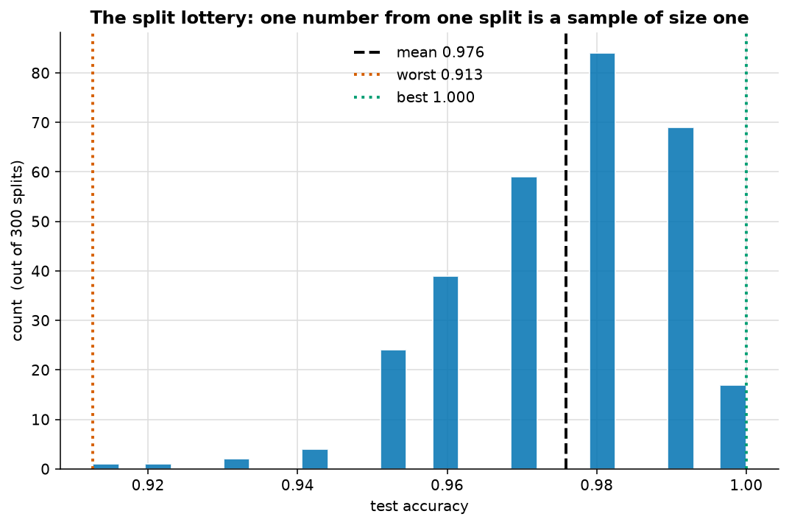
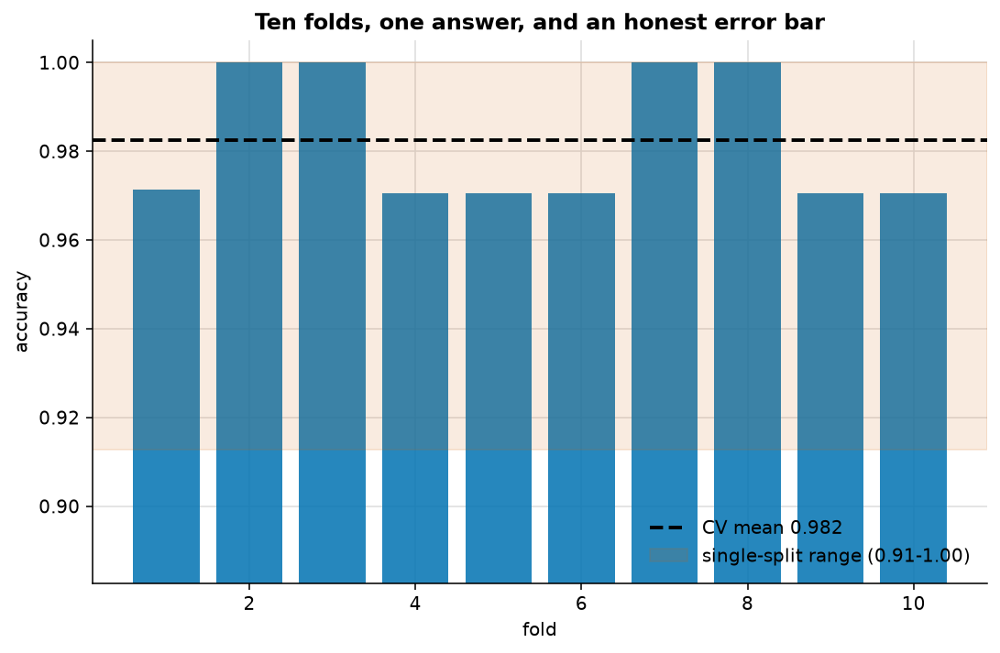
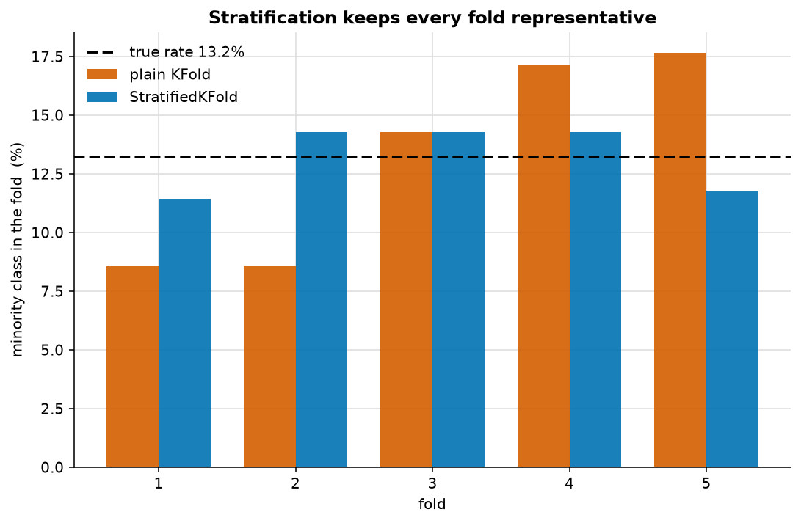
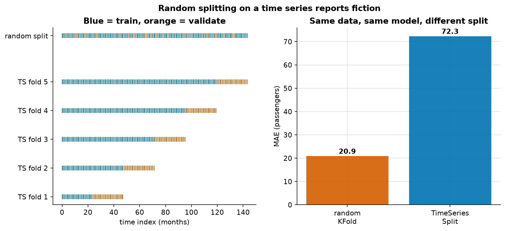

# Splitting data: train, validation, test and cross-validation

> **Concept reference:** Foundations volume, Part A.4
> **Datasets:** Penguins (342 rows, 3 species) and Flights (144 months)
> **Runtime:** ~33 s on a laptop CPU

```bash
python 01_foundations/01_train_test_split_and_cv/splitting.py
```

---

## The idea

| Split | Purpose | How often you touch it |
|---|---|---|
| **Training** | Fit the parameters | Constantly |
| **Validation** | Choose hyperparameters, architecture, threshold | Many times |
| **Test** | Estimate true generalisation | **Exactly once, at the end** |

Three, not two, because every time you look at validation performance and change something, you
leak a little information about that set into your choices. After fifty experiments the validation
score is optimistically biased — you have fitted your *decisions* to it. The test set exists to
give one honest number, and only works if you have not used it to decide anything.

---

## 1. The split lottery



The same model on the same data, with 300 different random 70/30 splits:

```
  worst split   0.913
  best  split   1.000
  spread        0.087   <- pure luck of the draw
  mean +/- sd   0.976 +/- 0.015
```

**An 8.7-point swing, with nothing changing but the random seed.** A single train/test split gives
you one draw from this distribution. Reporting it as "the" accuracy is reporting a sample of size
one — and if you tried a few seeds and kept the good one, you have reported the maximum of that
distribution, which is worse than useless.

## 2. Cross-validation instead



```
  10-fold CV per-fold accuracy: [0.971 1. 1. 0.971 0.971 0.971 1. 1. 0.971 0.971]
  mean          0.982
  std dev       0.014   spread BETWEEN folds
  std error     0.005   uncertainty in the MEAN
```

Two different numbers doing two different jobs. The **standard deviation** says how much folds
differ from one another — how sensitive the model is to which rows it sees. The **standard error**
(`sd / √k`) says how precisely you know the mean, and is the right band when comparing two models.

Report the mean *and* the spread. The spread is the honesty.

## 3. Why stratify



On an imbalanced subset (13.2% minority):

| Splitter | Minority % per fold | Spread |
|---|---|---|
| Plain `KFold` | 8.6, 8.6, 14.3, 17.1, 17.6 | **9.1 points** |
| `StratifiedKFold` | 11.4, 14.3, 14.3, 14.3, 11.8 | **2.9 points** |

Plain k-fold let one fold contain barely half the minority rate of another. Each fold is then
measuring a slightly different problem, which adds noise to your estimate for no reason.
Stratification costs nothing. **Use it for every classification problem.**

## 4. Time series must not be shuffled



```
  Random KFold    MAE  20.90 passengers   <- FICTION
  TimeSeriesSplit MAE  72.33 passengers   <- honest
```

**Random splitting looks 3.5× better than reality.** The left panel shows why: with a random split,
almost every validation point sits *between* two training points. The model is interpolating
between months it has already seen, which is not the task. Forecasting means extrapolating past the
end of what you know, and `TimeSeriesSplit` is the only shape that measures it — each fold trains
on a prefix and validates on what comes next.

If you take one thing from this folder: **a random split on temporal data is leakage**, and it
reports a number your production system will never reproduce.

---

## What to look for in the output

- The split-lottery **spread**, not its mean. The mean is fine; the spread is the lesson.
- The gap between **std dev** and **std error** in the CV output — they answer different questions
  and get confused constantly.
- The stratification spread shrinking from 9.1 points to 2.9.
- The **3.5× optimism** from shuffling a time series.

---

## The exam angle

- **Random split on time-series data is leakage.** In BigQuery ML that means
  `DATA_SPLIT_METHOD = 'SEQ'` with a `DATA_SPLIT_COL`, not the `AUTO_SPLIT` default. In AutoML it
  means choosing the **chronological** split option rather than accepting random.
- **Stratify for classification.** Especially when imbalanced or small.
- **Group splitting** when rows repeat an entity — several rows per customer split randomly puts
  the same customer in train and test and inflates the score.
- **The test set is touched once.** If you tuned against it, it is a validation set and you no
  longer have an unbiased estimate.

---

## Things to try

1. Reduce the penguin sample to 100 rows and re-run. The split lottery gets dramatically wider —
   small data means split luck dominates.
2. Change `n_splits` from 10 to 3 and then 20. Watch the standard error move.
3. Remove `shuffle=True` from `StratifiedKFold`. On sorted data this quietly breaks things.
4. In the time-series demo, add lag features (`y[t-1]`, `y[t-12]`) and re-run. The honest error
   falls a long way; the fictional one barely moves, because it was never measuring forecasting.
