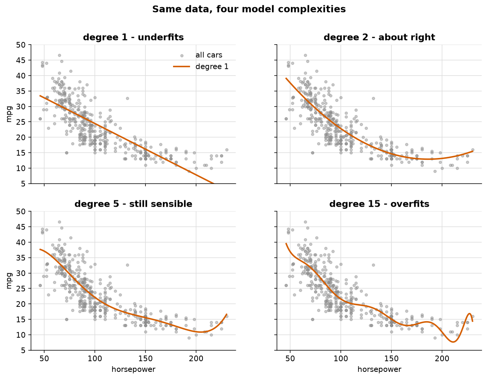
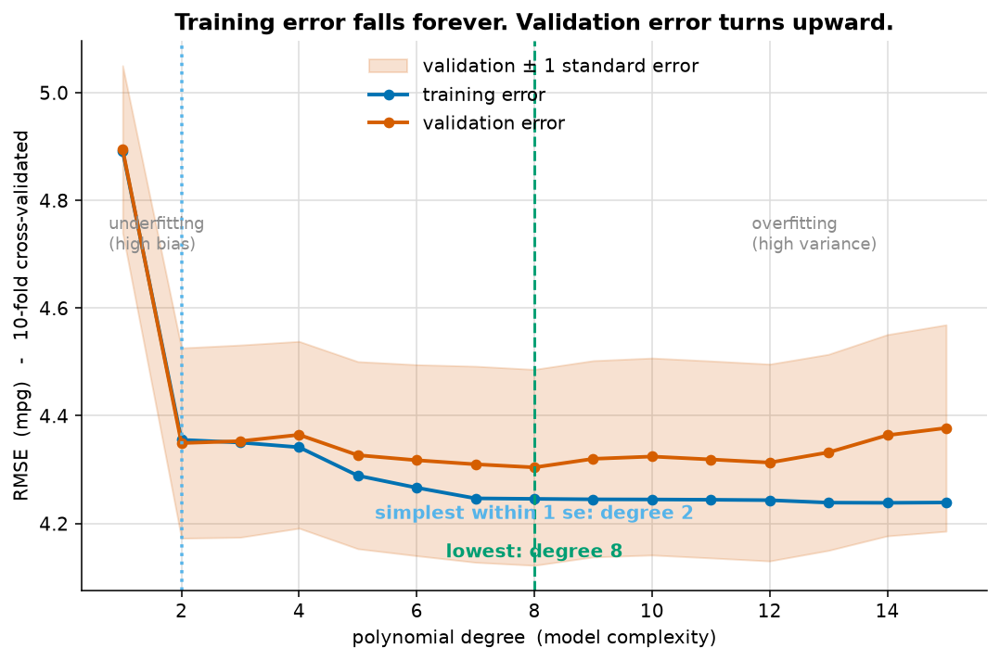
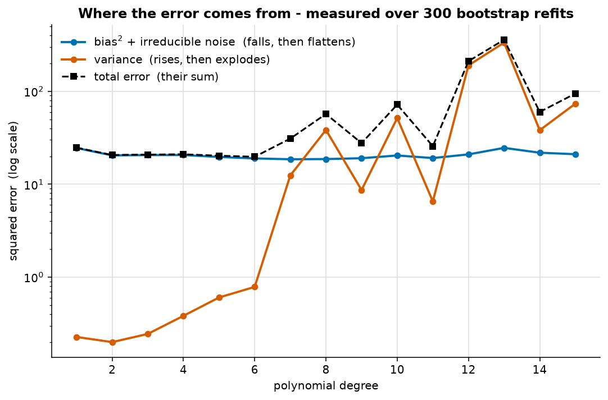
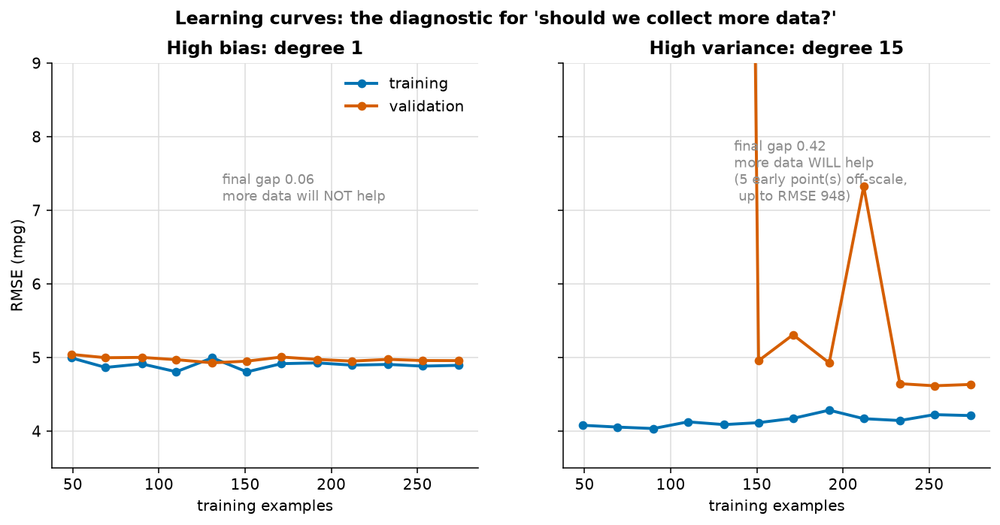

# The bias–variance trade-off

> **Concept reference:** Foundations volume, Part A.5
> **Dataset:** Auto MPG — 398 cars, predicting `mpg` from `horsepower`
> **Runtime:** ~25 s on a laptop CPU

```bash
python 01_foundations/02_bias_variance_tradeoff/bias_variance.py
```

---

## The idea

Every prediction error decomposes into exactly three parts:

```
  Total error  =  Bias²  +  Variance  +  Irreducible noise
                    │          │             │
                    │          │             └─ noise in the world.
                    │          │                No model removes it.
                    │          └─ how much the model CHANGES if you
                    │             retrain it on a different sample
                    └─ how far the model's average prediction sits
                       from the truth — error from being too simple
```

**Bias** is error from wrong assumptions: a straight line through a curved relationship.
**Variance** is instability: retrain on a slightly different sample, get a very different model.

Adding complexity trades one for the other. Polynomial degree makes that trade a single dial you
can turn and watch.

---

## 1. What under- and over-fitting look like



Degree 1 is a straight line through a curve — wrong in the same direction across whole regions of
the data. That is **bias**. Degree 15 chases individual points and produces implausible wiggles
where data is sparse. That is **variance**.

## 2. The U-curve



Validation error against complexity, using **10-fold cross-validation** rather than a single split.
That choice matters: on 392 rows a single 70/30 split is noisy enough that the curve comes out lumpy
and the "best" degree moves when you change the seed.

**Training error falls monotonically and forever.** On its own it is evidence of nothing — a model
can always fit data it has already seen better by adding parameters. Validation error is the one
that turns upward.

## 3. The decomposition, measured rather than asserted



The script refits on **300 bootstrap resamples** and measures, at each validation point, how far the
*average* prediction sits from the truth (bias) and how much predictions *spread* across resamples
(variance).

| degree | bias² + noise | variance | total |
|---|---|---|---|
| 1 | 24.6 | 0.2 | 24.8 |
| 6 | 19.0 | 0.8 | 19.8 |
| 13 | 24.6 | 335.2 | 359.9 |

Bias falls quickly then flattens. It **cannot reach zero** — a car's fuel efficiency is not a
deterministic function of its horsepower. Variance starts negligible and ends three orders of
magnitude larger.

> **An honest caveat, and a teaching point.** With a single observed `y` at each `x`, bias and
> irreducible noise **cannot be separated**. The blue line is therefore bias² *plus* noise, and
> `total = (bias² + noise) + variance` holds by construction rather than as a verification.
> Separating them would need repeated observations at identical horsepower.

## 4. Would more data help?



| Model | Final gap | Verdict |
|---|---|---|
| Degree 1 | 0.06 | **More data will NOT help.** Curves already converged, high and flat |
| Degree 15 | 0.42 | **More data WILL help.** Curves are still separating |

This is the practical payoff. *"Should we collect more data?"* becomes a diagnosis rather than an
opinion: **more data reduces variance, not bias.** If training error is already high, another
million rows will not help — the model cannot fit what it already has.

---

## What to look for in the output

**The one-standard-error rule.** The script finds degree 8 as the lowest validation error, then
declines to use it:

```
  Lowest validation error : degree 8  (4.304)
  Within one standard error: degree 2 and above (threshold 4.486)
  -> Prefer degree 2. The gap between it and degree 8 is 0.045 RMSE,
     against a standard error of 0.182. That is not a real difference.
```

Degrees 2 through 15 all sit within one standard error of the best — every degree from 2 up. Announcing "degree 8 is best"
would be **fitting the validation set** — reading noise as signal. The one-standard-error rule takes
the *simplest* model statistically indistinguishable from the best: degree 2.

And degree 2 is exactly what the first figure labels "about right" by eye. The visual intuition and
the statistical rule agree.

**Variance is erratic, not merely large.** It spikes — 335 at degree 13, then 38 at degree 14. One
unlucky bootstrap resample throws a wild curve and dominates the average. That instability *is* the
phenomenon, not noise in the measurement.

**Five learning-curve points run off the chart**, up to RMSE **948 mpg**. A 15th-degree polynomial
on ~40 points is near-singular. They are left off-scale deliberately; putting them on the axis would
flatten everything else to a line at zero.

---

## The exam angle

- **More data reduces variance, not bias.** High training *and* validation error means more
  capacity or better features — not more rows.
- **Training error alone means nothing.** The train–validation *gap* is the overfitting signal.
- **Regularisation is the dial.** L1/L2, dropout and early stopping all buy variance reduction at
  the cost of a little bias. That is why they are grouped together.
- **Don't read noise as signal.** A 0.01 improvement against a 0.18 standard error is not an
  improvement.

---

## Things to try

1. Change `SEED` and re-run. The U-curve stays put (cross-validation working); the bootstrap
   variance spikes move (variance being erratic).
2. Swap `horsepower` for `weight` in `load()` — a more linear relationship. Watch the optimal
   degree drop.
3. Use all numeric features instead of one. Bias falls; the sample size needed to control variance
   rises.
4. Replace `LinearRegression` with `Ridge(alpha=...)` and sweep alpha instead of degree. The same
   trade-off through a different dial.
