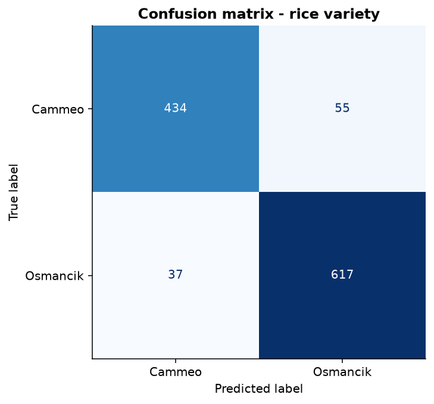
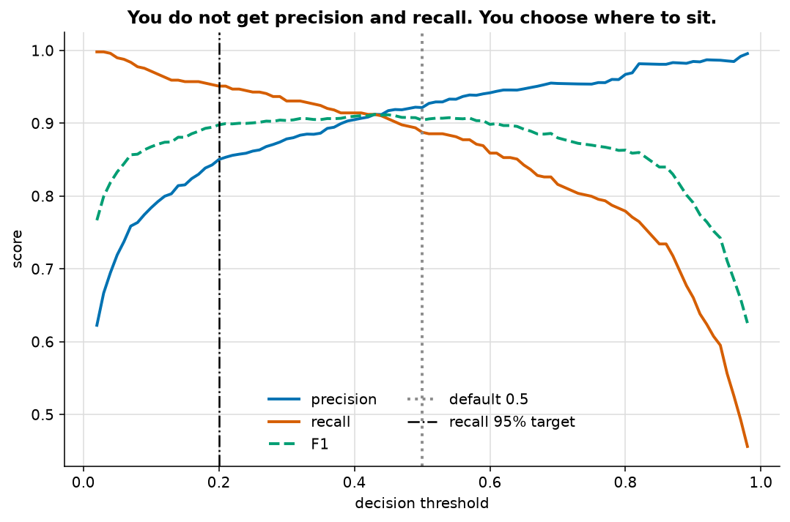
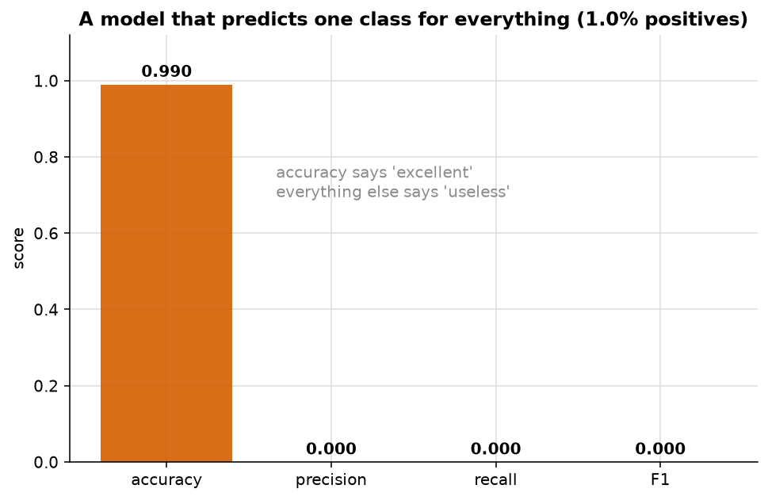
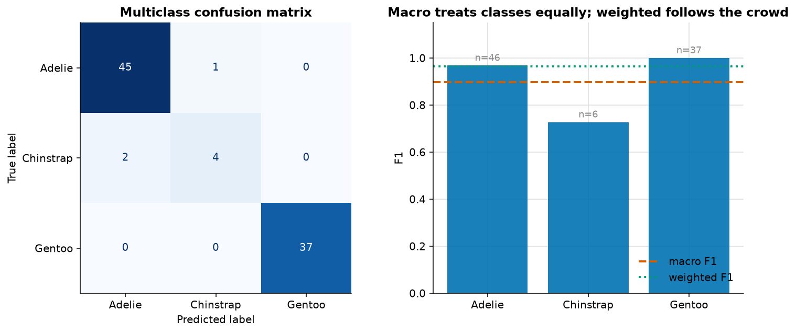

# The confusion matrix, and everything derived from it

> **Concept reference:** Foundations volume, Part A.6
> **Datasets:** Rice — 3,810 grains, 7 shape measurements, two varieties; Penguins for multiclass
> **Runtime:** ~8 s on a laptop CPU

```bash
python 01_foundations/03_confusion_matrix_and_metrics/metrics.py
```

---

## The idea

Four counts generate every classification metric you will ever report.

```
                          PREDICTED
                    Positive     Negative
                 ┌────────────┬────────────┐
        Positive │     TP     │     FN     │
 ACTUAL          │ True Pos.  │ False Neg. │
                 ├────────────┼────────────┤
        Negative │     FP     │     TN     │
                 │ False Pos. │ True Neg.  │
                 └────────────┴────────────┘
```

Learn the four; derive the rest.

---

## 1. The four counts, and the metrics they generate



The script computes every metric **by hand from the four counts**, then checks it against
scikit-learn:

```
  metric         by hand   sklearn   formula
  accuracy        0.9195    0.9195  [ok] (TP+TN)/all
  precision       0.9214    0.9214  [ok] TP/(TP+FP)       of what I flagged, how much was real
  recall          0.8875    0.8875  [ok] TP/(TP+FN)       of what was real, how much did I catch
  specificity     0.9434    0.9434  [ok] TN/(TN+FP)
  f1              0.9042    0.9042  [ok] 2TP/(2TP+FP+FN)
```

They agree to machine precision. The point is not the agreement — it is that after seeing it once,
`precision_score` stops being a black box.

## 2. You do not get precision and recall — you choose where to sit



| threshold | precision | recall | F1 |
|---|---|---|---|
| 0.10 | 0.784 | **0.971** | 0.868 |
| 0.30 | 0.878 | 0.930 | 0.904 |
| 0.50 | 0.921 | 0.888 | 0.904 |
| 0.70 | 0.955 | 0.816 | 0.880 |
| 0.90 | **0.985** | 0.661 | 0.791 |

**Same model, same data, same training run.** Only the threshold moved. Precision goes from 0.78 to
0.99 and recall falls from 0.97 to 0.66 in exchange.

This is why the threshold is a **business decision, not a modelling one**. The script shows both a
statistical choice (best F1, at 0.43) and a requirement-driven one ("catch 95% of Cammeo", at 0.20,
which costs 6 points of precision). **0.5 is a default, not an answer.**

## 3. The accuracy trap



Thin the positive class to 1%, then build a model that predicts the majority class for everything —
no features, no learning:

```
    accuracy   0.9900   <- looks superb
    precision  0.0000
    recall     0.0000   <- it caught NOTHING
    F1         0.0000
```

**99% accurate and completely worthless.** Whenever someone reports a high accuracy, the next
question is always *what is the base rate?*

## 4. Multiclass: macro and weighted disagree, on purpose



Test-set composition: Adelie 46, **Chinstrap 6**, Gentoo 37.

| averaging | precision | recall | F1 | what it does |
|---|---|---|---|---|
| **macro** | 0.919 | 0.882 | **0.898** | unweighted mean — every class counts equally |
| **weighted** | 0.965 | 0.966 | **0.965** | weighted by support — big classes dominate |
| micro | 0.966 | 0.966 | 0.966 | pool all counts — equals accuracy here |

Per-class F1: **Adelie 0.968, Chinstrap 0.727, Gentoo 1.000.**

The model is materially worse at the rare class. **Macro exposes that; weighted hides it** behind
the two classes with plenty of examples. A 6.7-point difference between two averages of the same
predictions, and only one of them tells you there is a problem.

That is why macro is the fairness-flavoured choice: when a scenario says the model must work
acceptably for *every* segment including the small ones, macro is the metric.

---

## The exam angle

- **False positive expensive → precision.** False negative expensive → **recall**. The scenario
  tells you which by describing what goes wrong, not by describing the model.
- **Accuracy on imbalanced data is a trap** and appears constantly.
- **Multi-label is not multiclass.** Several labels true at once means sigmoid on every output and
  binary cross-entropy — not softmax, which forces the outputs to sum to 1.
- **Macro averaging** for "must work for every category, including rare ones".
- **Moving the threshold** is how you buy recall without retraining. If a scenario says "the
  business needs 95% recall", that is a threshold change, not a new model.

---

## Things to try

1. Set `POSITIVE = "Osmancik"` (the majority class) and re-run. Every metric changes, because
   precision and recall are defined relative to *a* positive class.
2. Change the 1% in `figure_accuracy_trap` to 0.1%. Accuracy climbs toward 99.9% and the model is
   even more useless.
3. Swap `LogisticRegression` for `RandomForestClassifier`. The threshold curve changes shape —
   tree ensembles produce less smoothly calibrated probabilities.
4. In the multiclass demo, change the Chinstrap keep-rate from `0.25` to `0.05`. Watch macro and
   weighted diverge further.
