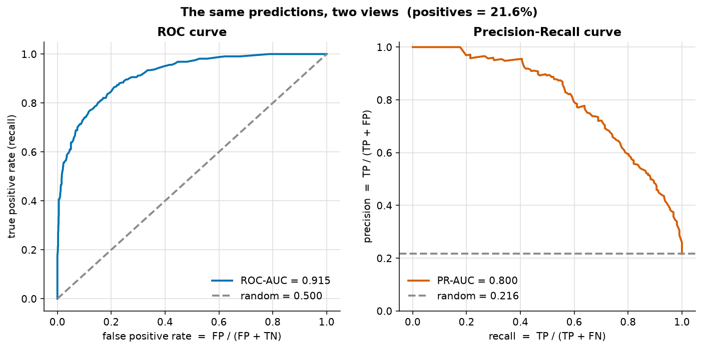
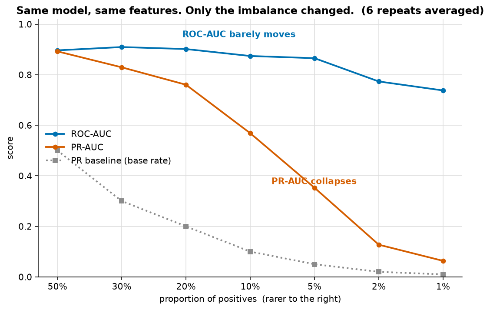
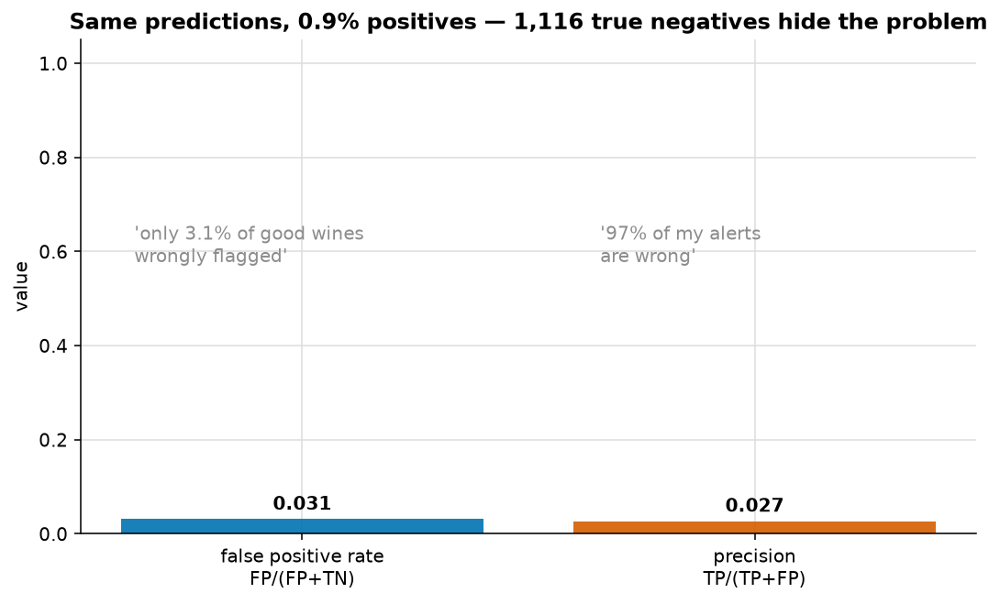
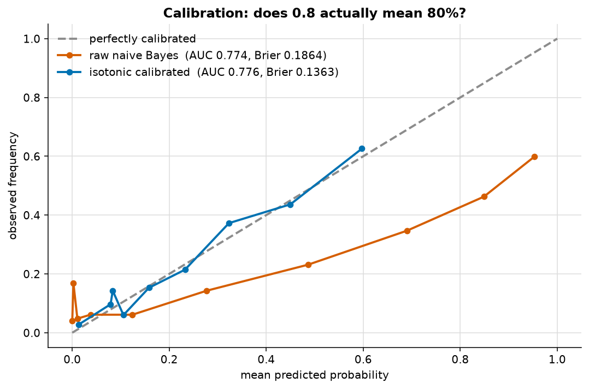

# ROC or precision–recall?

> **Concept reference:** Foundations volume, Part A.7
> **Dataset:** Wine Quality (white) — 4,898 wines, 11 features, `quality >= 7` is **21.6%**
> **Runtime:** ~32 s on a laptop CPU

```bash
python 01_foundations/04_roc_vs_pr_curves/roc_vs_pr.py
```

---

## The idea

A classifier does not output a class. It outputs a **score**, and sweeping the threshold across all
its values traces a curve. There are two such curves and they answer different questions.

| | ROC curve | Precision–Recall curve |
|---|---|---|
| Plots | TPR against **FPR** | Precision against **Recall** |
| Random baseline | **always 0.5** — the diagonal | **the base rate** — moves with the problem |
| Contains true negatives? | **Yes**, in `FP/(FP+TN)` | **No** |
| Right when | Classes roughly balanced, both errors matter | **Positives are rare** |

That third row is the whole story.

---

## 1. Both curves at the natural imbalance



```
  ROC-AUC              0.915
  PR-AUC (avg prec.)   0.800
  Random-guess ROC-AUC 0.500      (the diagonal)
  Random-guess PR-AUC  0.216      (the base rate)
```

Note the two baselines. A *random* ROC curve is the diagonal whatever the imbalance. A *random* PR
curve sits at the positive rate — so **PR-AUC is scored against a bar that moves with the problem**.
An ROC-AUC of 0.7 means the same thing everywhere; a PR-AUC of 0.7 means something very different at
50% prevalence than at 1%.

## 2. The prevalence sweep — the headline experiment



Hold the model, the features and the training procedure fixed. Vary **only** how rare the positive
class is, by subsampling. Six repeats averaged at each level.

| positives | ROC-AUC | PR-AUC | PR baseline |
|---|---|---|---|
| 50% | 0.896 | 0.892 | 0.500 |
| 30% | 0.909 | 0.829 | 0.300 |
| 20% | 0.901 | 0.760 | 0.200 |
| 10% | 0.874 | 0.568 | 0.100 |
| 5% | 0.865 | 0.353 | 0.050 |
| 2% | 0.773 | 0.127 | 0.020 |
| **1%** | **0.738** | **0.063** | 0.010 |

**ROC-AUC fell 0.159. PR-AUC fell 0.829 — five times further.**

At 1% positives, ROC-AUC still reads **0.74**: the kind of number that goes on a slide and gets a
model approved. PR-AUC reads **0.06**, which is the honest description of a model whose alerts are
almost all wrong.

Nothing about the model got worse. The *problem* got harder, and only one metric noticed.

## 3. Why ROC flatters — the arithmetic



A test set at 0.9% positives, flagging the top 3% of scores:

```
    TP     1    FP    36
    FN    10    TN  1116

    false positive rate  = FP/(FP+TN) = 36/1152 = 0.0312   <- looks excellent
    precision            = TP/(TP+FP) = 1/37    = 0.0270   <- the truth
    recall               = 0.0909

  ROC-AUC 0.741 vs PR-AUC 0.040 on the same predictions.
```

Both describe the same 36 false positives. The first says *"only 3.1% of the good wines were wrongly
flagged"*. The second says *"97% of my alerts are wrong"* — 37 alerts, one correct, and it caught
just 1 of the 11 good wines in the test set.

**The 1,116 true negatives sit in the false-positive rate's denominator and swamp it.** Precision
has no true negatives in it at all, so nothing can flatter it. The same gap shows in the areas:
ROC-AUC **0.741**, PR-AUC **0.040** against a random baseline of 0.009.

## 4. Calibration is a separate property



```
  raw naive Bayes        ROC-AUC 0.774   Brier 0.1864
  isotonic calibrated    ROC-AUC 0.776   Brier 0.1363
```

Calibration does not reorder anything, so **ROC-AUC is essentially unchanged** — but the Brier score
improves by 27% and the raw curve visibly sags away from the diagonal. Naive Bayes says 0.9 for
cases that occur far less than 90% of the time. (Naive Bayes is used deliberately here: its
independence assumption is wrong on correlated features, which makes it badly calibrated while still
ranking respectably. A random forest is already well calibrated on this data and makes a poor
demonstration.)

**Ranking is enough for "show me the top 100". Calibration is required when the probability feeds
arithmetic** — expected value, pricing, expected loss.

---

## The exam angle

- **Use PR-AUC when the positive class is rare.** This is the single most reliably tested classical
  fact on the exam. Fraud, defect, disease, churn at low base rate, "0.5% of transactions" — all
  precision–recall problems.
- **ROC-AUC is still correct** when classes are roughly balanced and both error types matter. It is
  not a bad metric; it is a metric with a precondition.
- **Downsampling distorts calibration.** The model learns the resampled base rate, not the real one.
  Fine if you only rank; recalibrate if you use the number.
- **AutoML's optimisation objective** is a real choice — `AUC PR` for a rare positive class, not the
  default.

---

## Things to try

1. Change the positive definition to `quality >= 6` (~66% positives). Watch PR-AUC become the
   *easier*-looking metric and ROC-AUC the more conservative one — the relationship inverts.
2. Set `n_repeats = 1` in the sweep. The curve wobbles badly at 1–2% because only ~11 positives land
   in the test split. That wobble is itself a lesson about small-sample metrics.
3. Replace the random forest with `LogisticRegression`. The gap between the two AUCs persists —
   it is a property of the *metrics*, not the model.
4. At 1% prevalence, print the confusion matrix at threshold 0.5. Most rows land on the negative
   side and recall collapses — which is why threshold moving matters most exactly here.
