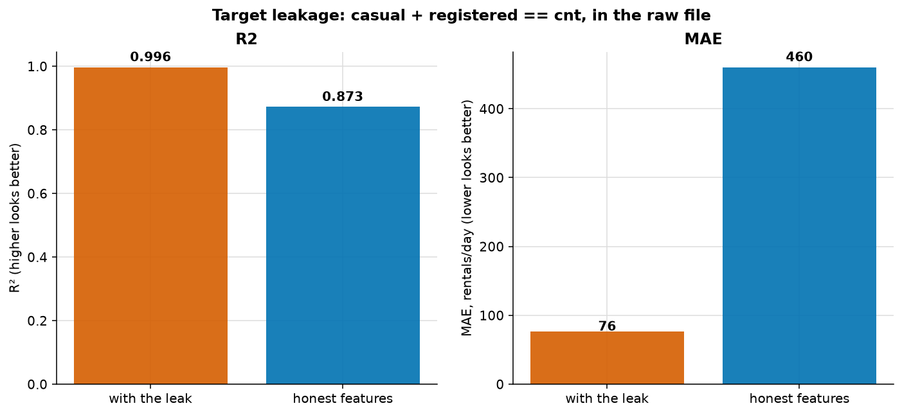
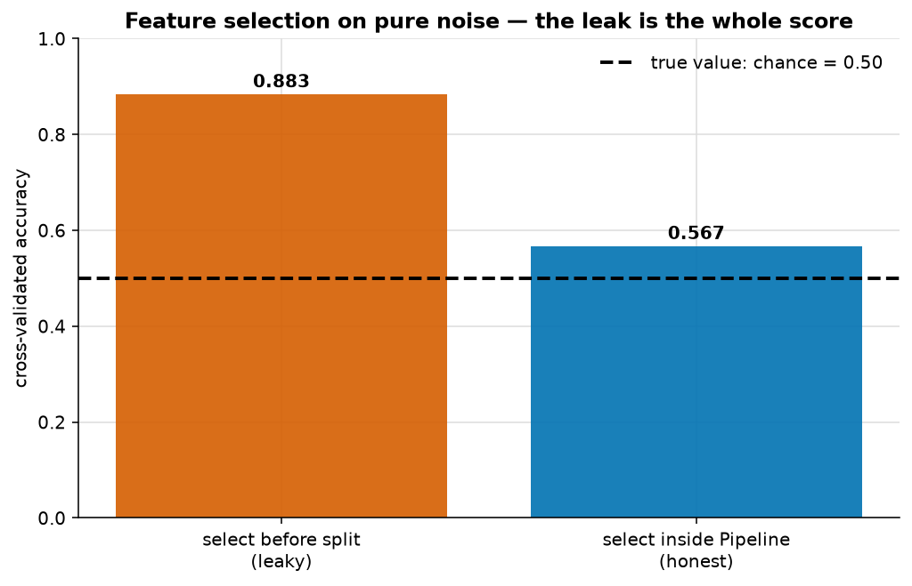
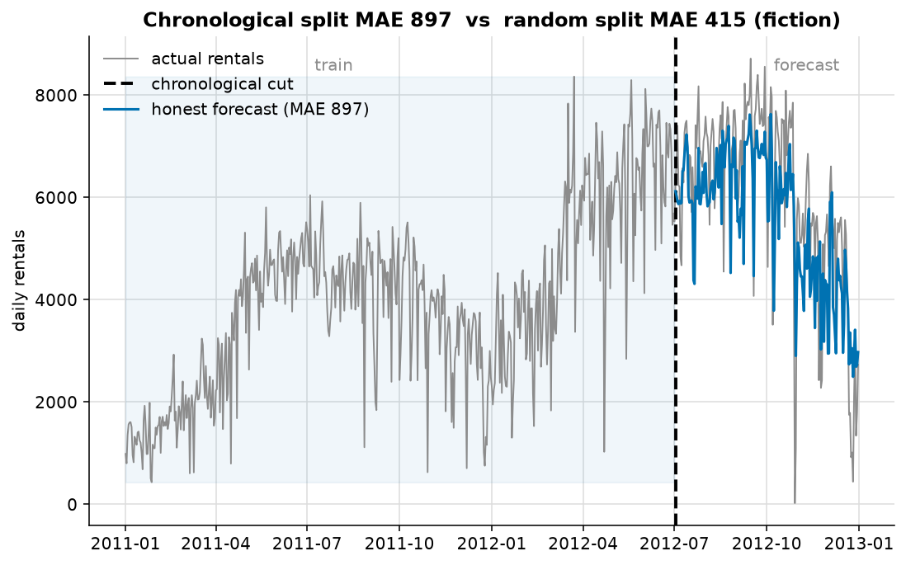

# Data leakage

> **Concept reference:** Foundations volume, Part A.11
> **Datasets:** Bike Sharing (731 days) and synthetic pure noise
> **Runtime:** ~11 s on a laptop CPU

```bash
python 01_foundations/05_data_leakage/leakage.py
```

---

## The idea

**Leakage is information reaching the model that would not be available at prediction time.** It
produces spectacular validation scores and total production failure, and it is the
highest-severity bug in applied machine learning — because nothing about it looks like a bug. The
code runs, the metrics improve, the review passes.

**The test, for every feature:** *would I actually know this value at the moment I need the
prediction?* If not — or only after the outcome — it leaks.

---

## 1. Target leakage — a feature that *is* the answer



This one is not invented. The Bike Sharing file ships with it:

```
  max |casual + registered - cnt|  =  0
```

`cnt` is exactly `casual + registered`. The target is the sum of two columns sitting beside it in
the same CSV.

| Feature set | R² | MAE (rentals/day) |
|---|---|---|
| **With the leak** | **0.996** | **76** |
| Honest features only | 0.873 | 460 |

The leak makes the error **6× smaller**. None of it is real: forecasting tomorrow's demand, you do
not know tomorrow's casual and registered counts — *they are the answer, split in two*.

This is what target leakage looks like in the wild. Not a contrived example, just two innocuous
columns in a public dataset that happen to sum to the label.

## 2. Preprocessing leakage — fitting before splitting



The cleanest possible demonstration: **120 rows, 6,000 pure-noise features, random labels.** There
is no signal. Any honest procedure must score about 0.50.

```
  Select features on ALL data, then CV   0.883   <- leakage
  Select inside the Pipeline (per fold)  0.567   <- honest
```

**The leaky version invented 38 points of accuracy from data containing none.** Choosing the "best"
20 of 6,000 noise columns using all the labels guarantees you pick the ones that happen to correlate
with the labels you are about to be tested on. The cross-validation that follows is then measuring
a choice that already saw the answers.

(The honest 0.567 is not exactly 0.50 because 120 rows gives a standard error around 0.045 — it sits
about 1.5 standard errors above chance, which is ordinary noise, not residual leakage.)

The same applies to **any fitted object**: scalers, imputers, encoders, feature selectors, PCA. All
must be fitted inside the loop. `Pipeline` does this automatically and is the reason `Pipeline`
exists.

## 3. Temporal leakage



```
  Random split      MAE  414.9 rentals/day   <- FICTION
  Chronological     MAE  897.4 rentals/day   <- honest
```

**Random splitting looks 2.2× better.** The dataset spans two years with strong growth. A random
split lets the model learn "year 2 is busier" from year-2 rows and then apply that to *other* year-2
rows. A real forecaster standing at the cut has never seen year 2 at all.

Note also that the honest number is the useful one: 897 MAE against a mean around 4,500 tells you
something true about how hard next-year forecasting is. The 415 tells you nothing.

---

## The five kinds, and how to catch them

| Kind | What happens | The fix |
|---|---|---|
| **Target** | A feature is a consequence of the label | Ask what is knowable at prediction time |
| **Preprocessing** | Scaler/imputer/selector fitted before the split | `Pipeline`, always |
| **Temporal** | Training on data from after the prediction point | Chronological split |
| **Group** | The same entity in train and test | `GroupKFold` on the entity id |
| **Duplicate** | Near-identical rows straddle the split | Deduplicate before splitting |

---

## The exam angle

- **"0.99 AUC offline, failed in production" is leakage**, not overfitting and not drift. This
  phrasing appears repeatedly.
- **Point-in-time correctness.** The production form of target leakage is joining a feature table
  at *today's* values onto *historical* labels. That is exactly what Feature Store point-in-time
  retrieval prevents.
- **`Pipeline` is the answer** to any question about preprocessing and cross-validation together.
- **Temporal data needs a chronological split** — `DATA_SPLIT_METHOD = 'SEQ'` in BigQuery ML, the
  chronological option in AutoML.

---

## Things to try

1. Drop only `registered` and keep `casual`. R² lands between the two — leakage is a spectrum, not
   a binary.
2. In the noise demo, raise `n_features` from 6,000 to 20,000. The leaked score climbs toward 1.0.
   More columns to fish in means a better-looking lie.
3. Change `k=20` to `k=2`. The leak shrinks — fewer chances to find a spurious correlation.
4. Add `cnt` from the previous day as a feature (`df["cnt"].shift(1)`). That is *legitimate* — you
   do know yesterday's count tomorrow — and it improves the honest forecast substantially. Useful
   contrast with the two columns that are not legitimate.
