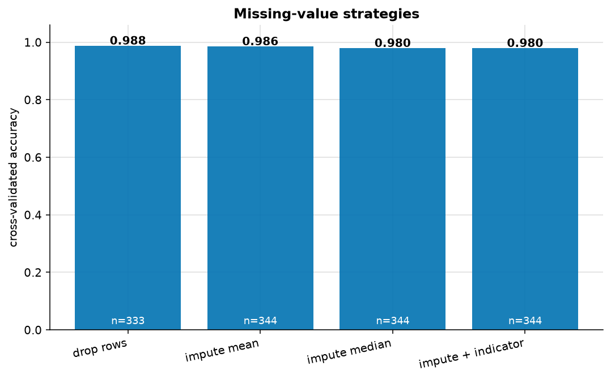
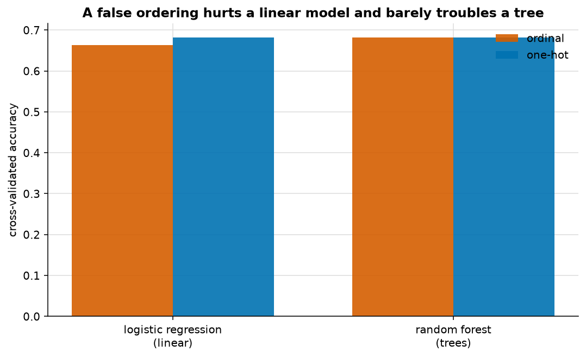
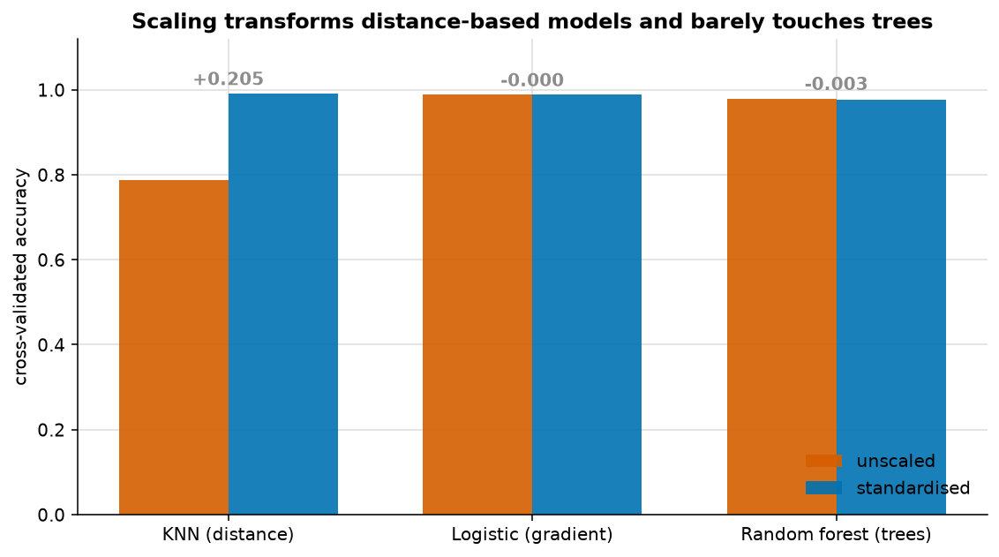
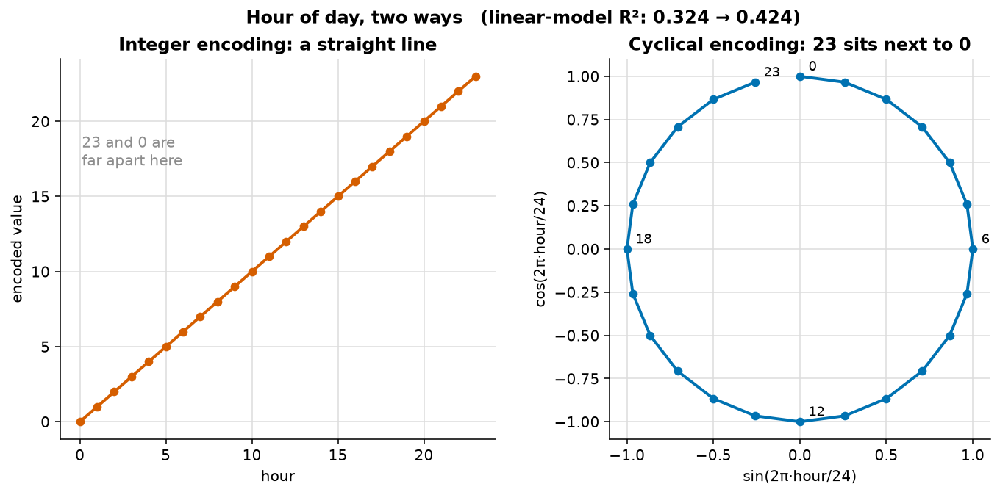

# Feature engineering

> **Concept reference:** Foundations volume, Part A.10
> **Datasets:** Penguins (344 rows, real missing values) and Bike Sharing hourly
> **Runtime:** ~13 s on a laptop CPU

```bash
python 01_foundations/06_feature_engineering/feature_engineering.py
```

---

## The idea

Feature engineering is usually a larger lever than the choice of algorithm. The same rows, encoded
differently, can move a model more than swapping logistic regression for a random forest — and it
is the part of the work most often skipped in favour of hyperparameter tuning.

---

## 1. Missing values



Penguins has genuine missing values — not injected for the demo:

```
    bill_length_mm         2  (0.6%)
    bill_depth_mm          2  (0.6%)
    flipper_length_mm      2  (0.6%)
    body_mass_g            2  (0.6%)
    sex                   11  (3.2%)
```

| Strategy | Accuracy | Rows used |
|---|---|---|
| Drop rows | 0.9880 | **333** |
| Impute mean | 0.9855 | 344 |
| Impute median | 0.9797 | 344 |
| Impute + indicator | 0.9797 | 344 |

Here dropping wins narrowly — with only 0.6% missing and no pattern to it, that is the honest
outcome and the script reports it rather than manufacturing a preferred answer.

**But dropping is not free**, and the reason matters more than this result. It costs rows, and it
assumes the missingness is *random*. If a value is missing **because** of something — a sensor
fails under load, a customer declines to answer — then dropping introduces bias, and the
`add_indicator` column is the feature you actually wanted. It is cheap; add it when you cannot rule
that out.

## 2. Categorical encoding



Encoding `island` and `sex`, using only those two columns so the encoding effect is isolated:

| Encoding | Logistic regression | Random forest |
|---|---|---|
| Ordinal (0, 1, 2) | 0.6639 | 0.6818 |
| One-hot | **0.6818** | 0.6818 |

Ordinal encoding turns Biscoe/Dream/Torgersen into 0/1/2, which tells a linear model that Dream sits
exactly halfway between the other two and Torgersen is "twice" Dream. None of that is true — the
ordering is alphabetical.

**The tree does not care.** It can split the same ordinal column repeatedly and carve out any
grouping it likes, so a false ordering costs it almost nothing. The linear model has no such escape.

The gap is modest here because there are only three categories; with a 50-level column it becomes
large. **Ordinal is correct when the order is real** — S < M < L, low/medium/high.

## 3. Scaling: who actually needs it



The features span very different ranges — `body_mass_g` runs 2700–6300, `bill_depth_mm` runs 13–21.

| Model | Unscaled | Scaled | Change |
|---|---|---|---|
| **KNN (distance)** | 0.7865 | **0.9913** | **+0.2048** |
| Logistic (gradient) | 0.9884 | 0.9883 | −0.0000 |
| Random forest (trees) | 0.9795 | 0.9766 | −0.0029 |

**KNN gains 20 accuracy points.** It measures Euclidean distance, so body mass (range ~3600)
completely drowns bill depth (range ~8) until both are standardised.

**Trees do not move.** A split is a threshold, and rescaling does not change the *order* of values,
so exactly the same splits remain available.

The logistic regression is the interesting case: the score barely changes, but **4 of 5 unscaled
folds hit the iteration limit without converging.** scikit-learn's own warning text suggests scaling
the data. It reached a good answer anyway here, but it had to be dragged there — on a harder problem
it would not.

## 4. Cyclical features



Predicting hourly bike rentals with a linear model:

```
    hour as an integer 0-23     R2 = 0.3243
    hour as sin/cos pair        R2 = 0.4236
    improvement                 +0.0993
```

As an integer, **hour 23 and hour 0 are 23 apart** — the model is told midnight is maximally distant
from 11pm. The sin/cos pair places them adjacent on a circle, which is what a clock actually is.
Ten points of R² for two lines of code.

The same applies to day-of-week, month, and compass bearing.

## 5. Assembling it without leaking

```python
pre = ColumnTransformer([
    ("numeric", Pipeline([
        ("impute", SimpleImputer(strategy="median", add_indicator=True)),
        ("scale",  StandardScaler()),
    ]), NUM),
    ("categorical", Pipeline([
        ("impute", SimpleImputer(strategy="most_frequent")),
        ("encode", OneHotEncoder(handle_unknown="ignore")),
    ]), CAT),
])
pipe = Pipeline([("prep", pre), ("model", LogisticRegression(max_iter=2000))])
```

Cross-validated accuracy **0.9855 on all 344 rows** — nothing dropped.

Every fitted quantity — the median, the mean and variance, the category vocabulary — is refitted on
each training fold and applied to the held-out fold. That is the **only** leak-free way to do this
(see `05_data_leakage`), and it is a single object you can save and deploy, so training and serving
cannot drift apart.

`handle_unknown="ignore"` matters in production: a category unseen during training would otherwise
raise at serving time.

---

## The exam angle

- **Trees do not need scaling.** An option insisting on standardisation before XGBoost is noise.
  Distance-based (KNN, k-means, SVM) and gradient-based models do need it.
- **High-cardinality categoricals get embeddings or hashing**, not one-hot. One-hot encoding a
  500,000-value product ID is wrong.
- **Missingness can be signal.** Impute *and* flag.
- **Cyclical features as sin/cos.**
- **Fit preprocessing inside the pipeline**, so the constants come from training data only. This is
  the same principle as BigQuery ML's `TRANSFORM` clause, Keras preprocessing layers and
  `tf.Transform`: the serving path must apply the exact constants computed at training time.

---

## Things to try

1. Inject 20% missingness into `body_mass_g` and re-run section 1. The strategies separate sharply
   once there is real missingness to handle.
2. Add `island`/`sex` to the scaling demo through the ColumnTransformer. KNN improves again —
   distance over one-hot columns needs the numerics on the same footing.
3. In section 4, add `sin/cos` for day-of-week as well. R² moves by only +0.0004 (0.4236 →
   0.4240): `workingday` is already in the model and carries most of the weekly pattern. Cyclical
   encoding fixes a *representation* problem; it cannot add signal the model already has.
4. Replace `StandardScaler` with `RobustScaler` and add a few extreme outliers. Robust scaling
   holds up; standardisation is dragged by the outliers.
