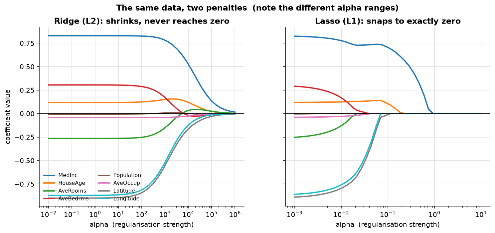
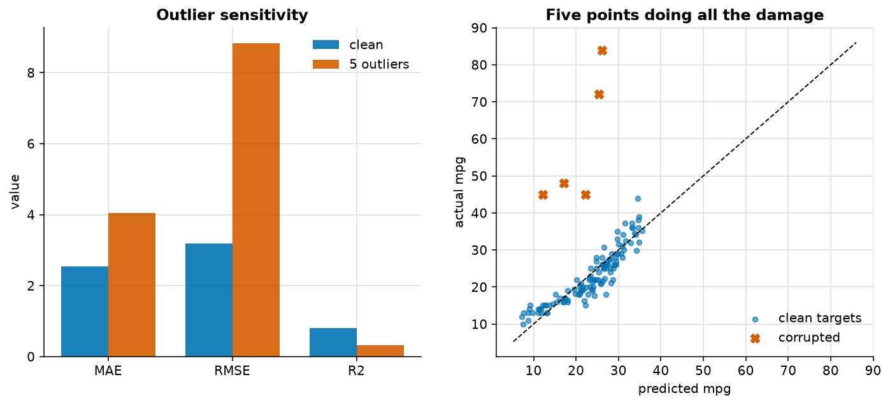
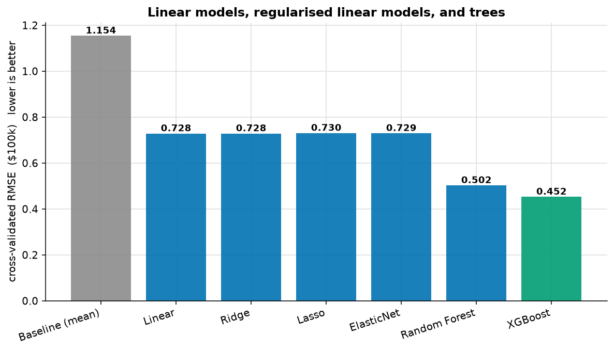
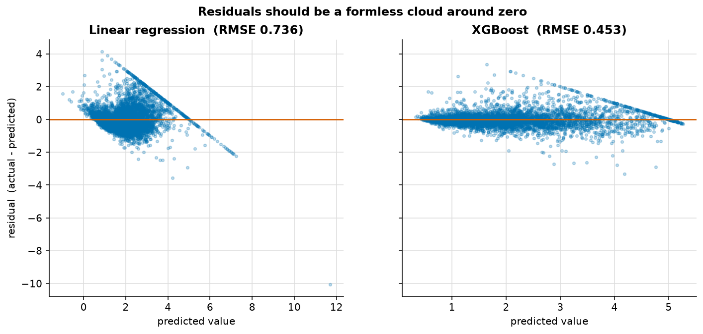

# Regression

> **Concept reference:** Foundations volume, Parts A.8 (metrics), A.10 (features), A.14 (algorithms)
> **Datasets:** California Housing (20,640 × 8) and Auto MPG (398 × 9)
> **Runtime:** ~55 s on a laptop CPU

```bash
python 02_traditional_ml/01_regression/regression.py
```

---

## 1. Always beat a baseline

```
  Predict the mean for everything   RMSE 1.1539   <- the baseline
  Linear regression                 RMSE 0.7283
  The model beats the baseline by 36.9%.
```

R² is *literally defined* against "predict the mean", so an R² near zero means your model is worth
nothing at all. Computing this takes one line and stops a surprising number of doomed projects.

## 2. L1 vs L2 — the fact worth seeing rather than memorising



| | Ridge (L2) | Lasso (L1) |
|---|---|---|
| Coefficients reaching exactly zero | **0 of 8**, at any alpha | **8 of 8** |
| Behaviour | Smooth asymptotic decay | Sharp kinks, then snap to zero |
| Gives you | Shrinkage and stability | **Feature selection** |

Ridge shrank total coefficient mass by 99.1% while zeroing **none** of them. Lasso zeroed all eight.
That is the entire distinction, and the shapes in the figure are hard to misremember afterwards.

> **Note the two alpha ranges differ** (Ridge 10⁻²–10⁶, Lasso 10⁻³–10¹). The penalties are
> parameterised differently: Ridge's is negligible against 20,640 samples until alpha is very large,
> while Lasso has zeroed everything by alpha = 1. A shared range makes the Ridge panel look
> deceptively flat — which is exactly the bug in the first version of this figure.

**ElasticNet** mixes both, which is what you want when features are correlated: pure Lasso picks one
of a correlated group arbitrarily and discards the rest.

## 3. Metric choice, and outliers



118 test cars, then 5 of them (4%) get a corrupted target:

| metric | clean | with 5 outliers | change |
|---|---|---|---|
| MAE | 2.540 | 4.037 | **+59%** |
| RMSE | 3.190 | 8.830 | **+177%** |
| R² | 0.808 | 0.315 | −61% |

**MAE is linear in the error**, so one huge miss counts once. **RMSE squares first**, so a single
outlier can dominate the score. Five corrupted points out of 118 tripled RMSE.

They will rank models differently. Choose MAE when a few extreme values should not set your
direction; choose RMSE when large errors genuinely are disproportionately costly.

## 4. Linear models vs trees



| Model | RMSE | MAE | R² |
|---|---|---|---|
| Baseline (mean) | 1.1539 | 0.9118 | −0.000 |
| Linear | 0.7283 | 0.5317 | 0.601 |
| Ridge | 0.7282 | 0.5317 | 0.601 |
| Lasso | 0.7302 | 0.5354 | 0.599 |
| ElasticNet | 0.7293 | 0.5335 | 0.600 |
| Random Forest | 0.5023 | 0.3270 | 0.810 |
| **XGBoost** | **0.4524** | **0.2947** | **0.846** |

**XGBoost is 38% better than linear regression.** Gradient-boosted trees capture interactions and
non-linearity without you specifying any, need no scaling, and handle mixed types. This is why
BigQuery ML's `BOOSTED_TREE_*` is the tabular workhorse, and why offering a deep neural network for
a mid-sized tabular problem should make you suspicious.

Note also that **the regularised linear models barely differ from plain linear.** Eight features and
20,000 rows is not a regime where overfitting bites — regularisation earns its keep when features
are many relative to rows.

## 5. Residual diagnostics



Look at the left panel. The residuals form a hard **diagonal edge** and fan out.

That edge is the target being **capped at 5.0** ($500k) in this dataset. A capped district's actual
value is pinned at 5.0, so its residual is `5.0 − prediction`: a straight line of slope −1.

```
    capped districts in test        238
    their mean residual             +1.14
    positive (model predicted < 5)  82%
    predicted above the cap         42
```

Most of the edge sits **above** zero. The linear model *under*-predicts the most expensive districts,
whose true value is unknown beyond the cap; only the 42 it predicts above 5.0 turn negative.

No metric would have told you that. Residuals should be a formless cloud around zero; any structure
— a diagonal, a curve, a widening fan — is the model telling you something the number cannot.

---

## The exam angle

- **L1 for sparsity and feature selection; L2 for smooth shrinkage.** Expect this as a one-line
  question.
- **Gradient-boosted trees usually win on tabular data.**
- **MAE vs RMSE is an outlier question.** "A few very large orders should not dominate" → MAE.
- **Trees need no scaling.** An option insisting on it before XGBoost is noise.
- **`ARIMA_PLUS` for univariate seasonal forecasting** — not covered here, see `06_time_series`.

---

## Things to try

1. Reduce California Housing to 500 rows and re-run section 4. Now the regularised models separate
   from plain linear — the regime finally favours them.
2. Set `l1_ratio=0.9` on ElasticNet. It starts behaving like Lasso; at `0.1`, like Ridge.
3. Log-transform the target (`np.log1p(y)`) and re-run. The residual fan flattens, because the
   errors were proportional rather than absolute.
4. Drop the capped rows (`y < 5.0`) and compare the residual plot. The diagonal edge disappears.
