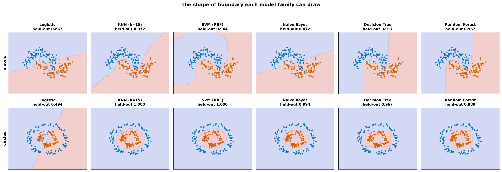
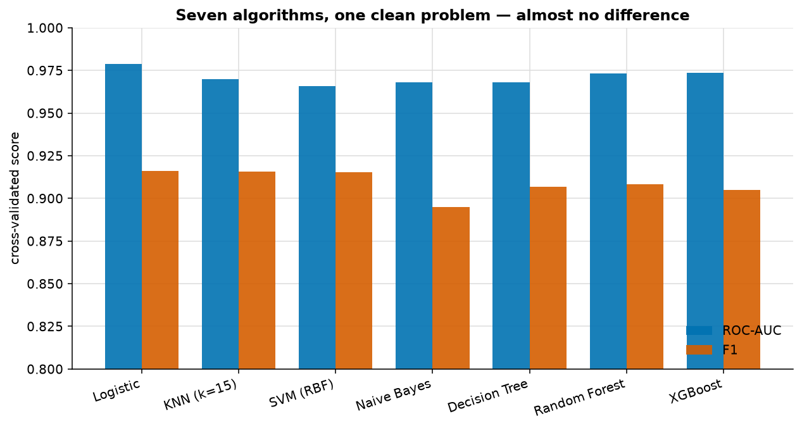
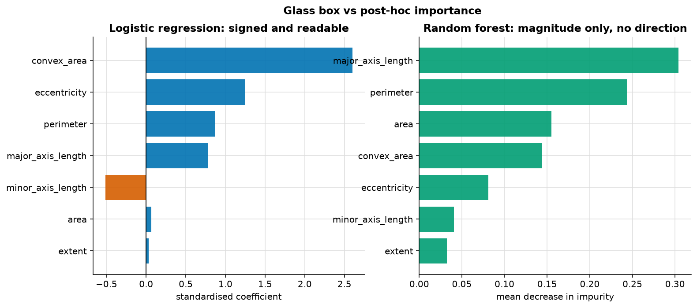
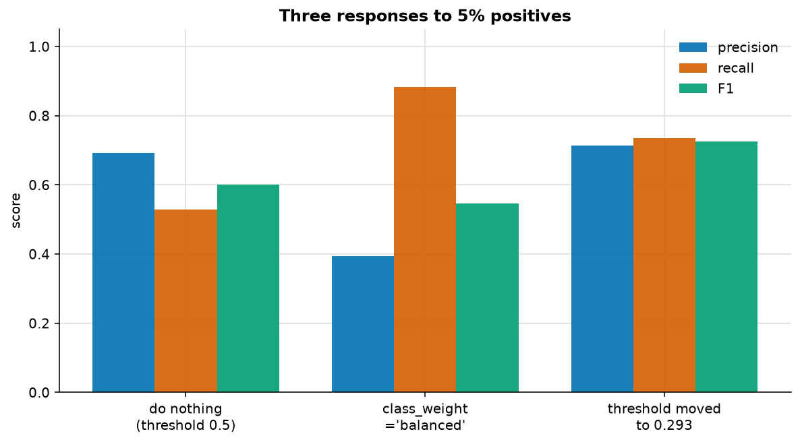

# Classification

> **Concept reference:** Foundations volume, Parts A.9 (confusion matrix), A.11 (ROC vs PR), A.14 (algorithms)
> **Dataset:** Rice — Cammeo vs Osmancik (3,810 grains × 7 shape features, 42.8% positive), plus two synthetic shapes
> **Runtime:** ~15 s on a laptop CPU

```bash
python 02_traditional_ml/02_classification/classification.py
```

---

## 1. Every model family can only draw one *shape* of boundary



Six classifiers, two synthetic problems, **held-out** accuracy in every title. This is the single
most useful picture in traditional ML, because it explains model behaviour structurally rather than
as a leaderboard.

| Model | moons | circles | The boundary it is capable of |
|---|---|---|---|
| Logistic | 0.867 | **0.494** | One straight line. That is all. |
| KNN (k=15) | **0.972** | **1.000** | Anything — it hugs the data |
| SVM (RBF) | 0.944 | **1.000** | Any smooth curve |
| Naive Bayes | 0.872 | 0.994 | A **quadratic** surface |
| Decision Tree | 0.917 | 0.967 | Axis-parallel rectangles |
| Random Forest | 0.967 | 0.989 | Hundreds of rectangles, averaged |

**Logistic regression scores 0.494 on circles — worse than a coin flip.** No straight line separates
a ring from its centre, so the model is not slightly wrong, it is structurally incapable. That is
*bias*, and here you can see it rather than infer it from a number.

**Naive Bayes is the one worth pausing on.** It scores 0.994 on circles but only 0.872 on moons —
and moons is the problem that *looks* easier. Gaussian Naive Bayes fits one Gaussian per class, so
its boundary is **quadratic, not linear**: it wraps a ring almost perfectly. Two crescents are not
Gaussian blobs, so it barely beats logistic there (+0.006).

> A model's limitation is **the shape of its assumptions**, not a position on a
> "simple → powerful" ranking you can memorise. Naive Bayes outranks a decision tree on one problem
> and loses to it on the other.

Look also at **KNN and SVM on circles: both score exactly 1.000, but their boundaries look nothing
alike.** SVM's is a clean ellipse; KNN's is visibly lumpy. Same score today, very different
stability on new data — that lumpiness *is* variance.

## 2. On real data, the algorithm barely matters



Same seven classifiers, 5-fold cross-validated on all 7 Rice features:

| Model | accuracy | F1 | ROC-AUC | PR-AUC | fit s |
|---|---|---|---|---|---|
| **Logistic** | 0.9283 | 0.9161 | **0.9789** | **0.9738** | 0.005 |
| KNN (k=15) | 0.9281 | 0.9156 | 0.9700 | 0.9536 | 0.004 |
| SVM (RBF) | 0.9281 | 0.9152 | 0.9658 | 0.9540 | 0.232 |
| Naive Bayes | 0.9108 | 0.8951 | 0.9679 | 0.9620 | 0.002 |
| Decision Tree | 0.9207 | 0.9069 | 0.9682 | 0.9500 | 0.007 |
| Random Forest | 0.9218 | 0.9082 | 0.9731 | 0.9644 | 0.284 |
| XGBoost | 0.9192 | 0.9049 | 0.9734 | 0.9656 | 0.257 |

**Total ROC-AUC spread across all seven: 0.0131.**

And the winner is **plain logistic regression** — the same model that scored worse than chance one
section ago. Rice is close to linearly separable, so the cheapest, most interpretable, fastest-to-
train model is also the most accurate. XGBoost took 50× longer to fit and finished fifth.

> This is the section to remember when you are tempted to spend a week on algorithm selection.
> On a clean, well-separated problem, everything reasonable lands in the same place. **Features,
> framing and the choice of metric move the needle; algorithm shopping does not.**

## 3. Glass box vs post-hoc explanation



**Logistic regression is a glass box** — exponentiate a coefficient and you get an odds ratio:

| feature | coef | odds ratio | reading |
|---|---|---|---|
| convex_area | 2.602 | **13.49** | +1 sd increases the odds ×13.5 |
| eccentricity | 1.245 | 3.47 | +1 sd increases the odds ×3.5 |
| perimeter | 0.870 | 2.39 | |
| major_axis_length | 0.785 | 2.19 | |
| minor_axis_length | −0.515 | 0.60 | +1 sd **decreases** the odds ×1.7 |

**A 5-leaf decision tree is also a glass box** — the whole model, printed (accuracy 0.930):

```
|--- major_axis_length <= 191.08
|   |--- major_axis_length <= 181.24   -> [1578, 15]   Osmancik
|   |--- major_axis_length >  181.24   -> [ 451, 106]  Osmancik
|--- major_axis_length >  191.08
|   |--- perimeter <= 467.82
|   |   |--- major_axis_length <= 192.97 -> [ 51,  46]  Osmancik (a coin flip)
|   |   |--- major_axis_length >  192.97 -> [ 53, 138]  Cammeo
|   |--- perimeter >  467.82           -> [  47, 1325] Cammeo
```

Two details worth noticing. It used **2 of 7 features** — a tree does its own feature selection, and
unused columns simply never appear. And the leaf counts show where the model is confident
(`[47, 1325]`) versus where it is guessing (`[51, 46]`), which a single accuracy number hides
completely.

**Random Forest importances are post-hoc** — an approximation of a model you cannot read directly.
Note the asymmetry:

| | Magnitude | Direction |
|---|---|---|
| Logistic coefficient | ✅ | ✅ (sign) |
| Tree/RF importance | ✅ | ❌ **none** |

Importance tells you `convex_area` matters. It cannot tell you whether *more* of it means Cammeo.

> **Exam-relevant distinction:** glass box (the model *is* the explanation) is not the same as
> post-hoc explanation (SHAP, feature importance, Integrated Gradients). If a regulation demands
> explainable decision logic, a post-hoc approximation of a black box **does not satisfy it.**

## 4. Class imbalance — the result that contradicts the usual advice



Rice resampled to 5.0% positives, then three standard remedies:

| approach | precision | recall | F1 | PR-AUC |
|---|---|---|---|---|
| do nothing (threshold 0.5) | 0.692 | 0.529 | 0.600 | 0.754 |
| `class_weight='balanced'` | 0.395 | **0.882** | 0.545 | 0.748 |
| **threshold moved to 0.293** | 0.714 | 0.735 | **0.725** | 0.754 |

**Read the PR-AUC column first. All three are within 0.006 of each other.**

PR-AUC measures *ranking* quality across every threshold, and none of these techniques improved the
ranking. "Do nothing" and "threshold moved" are literally the same fitted model, so an identical
score is expected — the surprise is that `class_weight` barely changed it either.

What *did* change is where you sit on the precision/recall trade:

- `class_weight='balanced'` → recall 0.529 → 0.882, but precision 0.692 → **0.395**
- threshold moved → recall 0.529 → 0.735, precision 0.692 → 0.714

**By F1, `class_weight` is the worst of the three** (0.545 vs 0.725). It over-corrects, buying recall
far too expensively. That contradicts the common advice to reach for `class_weight` first, and it is
what the data actually shows here.

> **The real lesson:** imbalance techniques mostly **relocate you on a curve you already had.**
> If you need a *better curve*, you need better features or a better model — not reweighting. If you
> only need a different operating point, **threshold moving is free, and you choose the point;**
> `class_weight` moves you somewhere you did not pick.

---

## The exam angle

- **Imbalanced data → PR-AUC, not ROC-AUC, and not accuracy.** See `01_foundations/04_roc_vs_pr_curves`.
- **"Explain the decision to a regulator"** → glass box (logistic, shallow tree), not SHAP over a
  black box.
- **Feature importance has no direction.** An option claiming it shows which way a feature pushes is
  wrong.
- **Threshold tuning is a deployment decision, not a training one.** You can change it without
  retraining, which is why it is the cheapest lever in production.
- **Trees do implicit feature selection** and need no scaling; KNN and SVM **require** scaling —
  both are pipelined here for that reason.
- On Vertex AI, this whole section is `AutoML Tabular` territory; the reason to hand-build is
  interpretability and cost, not accuracy.

---

## Things to try

1. Set `factor=0.8` in `make_circles` so the rings nearly touch. Naive Bayes collapses while
   KNN and SVM hold up — the quadratic assumption stops being enough.
2. Drop KNN's `k` from 15 to 1 and re-run section 1. The boundary becomes islands of single points:
   maximum variance, drawn to scale.
3. Re-run section 2 with only `major_axis_length`. Nearly all the performance survives, which is
   why the 5-leaf tree could ignore five features.
4. Push the imbalance to 1% and re-run section 4. The gap between ROC-AUC and PR-AUC widens
   sharply, and `class_weight` over-corrects even harder.
5. Swap `LogisticRegression` for `LogisticRegression(C=np.inf)` (no penalty; the `penalty`
   argument, `penalty=None` included, is deprecated as of scikit-learn 1.8) and compare
   coefficients. The
   odds ratios inflate — regularisation was quietly keeping them honest.
