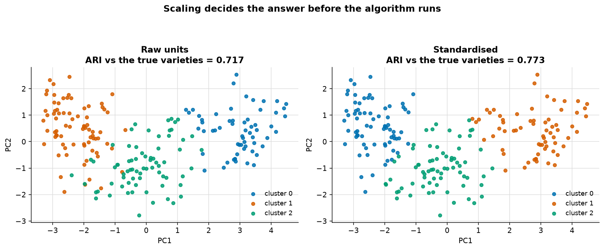
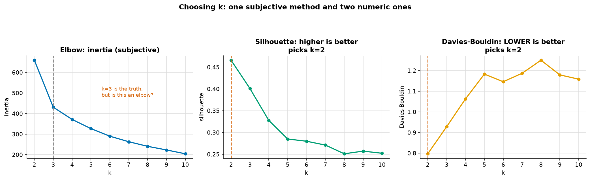
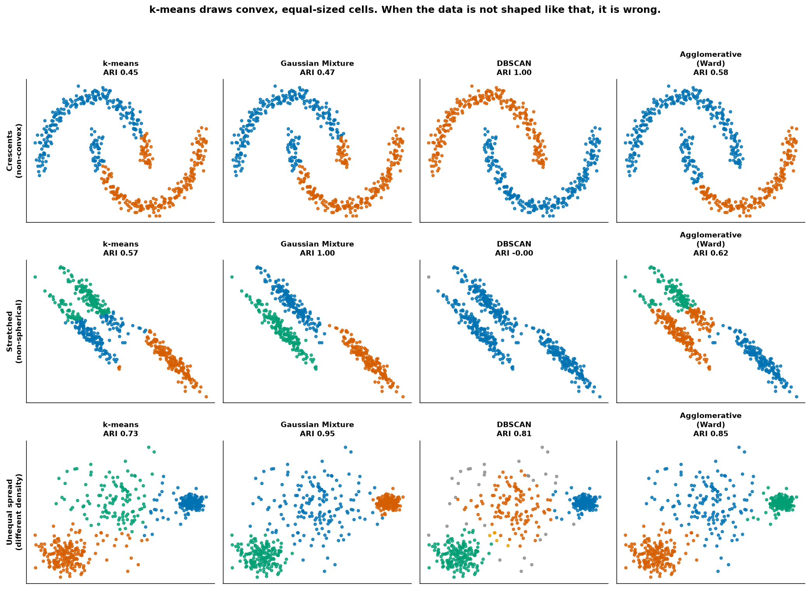
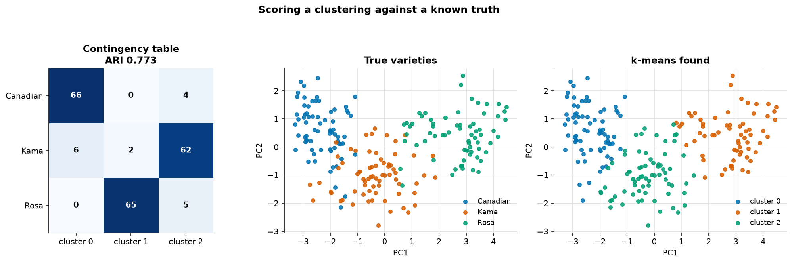
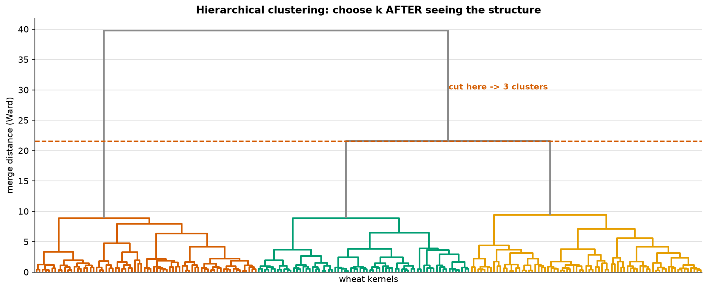

# Clustering

> **Concept reference:** Foundations volume, Part A.16 (unsupervised learning)
> **Dataset:** Wheat Seeds (210 kernels × 7 measurements, 3 varieties), plus three synthetic shapes
> **Runtime:** ~11 s on a laptop CPU

```bash
python 02_traditional_ml/03_clustering/clustering.py
```

The variety label is **held back from every algorithm** and used only to score the result
afterwards — which is exactly how you validate a clustering when you happen to have a ground truth.

---

## 1. Scaling is not optional



k-means minimises squared distance. Nothing in it knows that `area` and `compactness` are different
kinds of quantity — it only sees numbers, and the column with the biggest numbers wins.

| feature | std dev (raw units) |
|---|---|
| area | 2.903 |
| asymmetry | 1.500 |
| perimeter | 1.303 |
| … | … |
| compactness | **0.024** |

`area` varies **123× more** than `compactness`, so unscaled k-means is effectively clustering on
that one column.

| | ARI vs the true varieties |
|---|---|
| Raw units | 0.717 |
| **Standardised** | **0.773** |

A free improvement from one line of code, and on datasets with a genuinely extreme unit mismatch
(currency next to a ratio, say) the gap is far wider than this.

## 2. Choosing k — and why all three methods pick the "wrong" answer



| k | inertia | drop | silhouette | Davies-Bouldin |
|---|---|---|---|---|
| **2** | 659.2 | | **0.466** | **0.797** |
| 3 | 430.7 | 34.7% | 0.401 | 0.928 |
| 4 | 371.3 | 13.8% | 0.328 | 1.063 |
| 5 | 326.5 | 12.1% | 0.285 | 1.182 |

**Inertia falls monotonically by construction** — more centroids can only reduce within-cluster
distance — so there is no minimum to find and no "best" value. You are eyeballing a change in
slope, which is why two people reading the same elbow plot routinely disagree.

Silhouette and Davies-Bouldin at least return a number. **Both pick k=2, against three real
varieties.** That looks like a failure. It is not.

| true variety pair | centroid distance |
|---|---|
| Canadian vs Kama | **2.56** |
| Kama vs Rosa | 3.37 |
| Canadian vs Rosa | **5.00** |

Canadian and Kama sit half as far apart as Canadian and Rosa. **Geometrically there really are two
groups; biologically there are three.** Silhouette measures separation, and it reported separation
correctly.

> **The lesson that transfers:** an internal metric answers *"how many well-separated blobs are in
> this space"*, never *"how many categories exist in the world"*. When those answers differ, the
> metric is not wrong — **your features do not resolve the distinction you care about**, and the fix
> is better features, not a different k.

## 3. Where k-means breaks



ARI against the generating labels (1.00 = perfect recovery):

| problem | k-means | Gaussian Mixture | DBSCAN | Agglomerative (Ward) |
|---|---|---|---|---|
| Crescents (non-convex) | 0.45 | 0.47 | **1.00** | 0.58 |
| Stretched (non-spherical) | 0.57 | **1.00** | **−0.00** | 0.62 |
| Unequal spread (density) | 0.73 | **0.95** | 0.81 | 0.85 |

**k-means never gets above 0.73.** It is the only algorithm that is mediocre on all three, while
every other method is excellent on at least one. Each failure has a different cause:

- **Crescents** — a Voronoi cell is *convex*, so no value of k can produce a crescent. k-means
  slices both moons across the middle. GMM fails identically: a Gaussian is convex too.
- **Stretched** — the bands are long and thin, so a point at the end of one band is closer to a
  neighbouring centroid than to its own. GMM fits a **full covariance** per component, so it can
  tilt and stretch to match, and scores a perfect 1.00.
- **Unequal spread** — equal-size cells minimise inertia, so k-means eats into the wide cluster to
  pad out the narrow ones.

**DBSCAN is both the best and the worst cell in this table.** It scores a perfect 1.00 on the
crescents, because it grows clusters by *density* rather than distance-to-a-centre, so shape is
irrelevant to it. It is also the only algorithm here that can refuse to classify a point at all —
the grey noise label.

But on the stretched bands it scores **−0.00**. The bands nearly touch, so at `eps=0.35` a chain of
neighbours bridges straight from one into the next and DBSCAN merges them all.
**Density-connectivity is transitive:** two points in different clusters get joined if *any* path of
close points links them. That is the price of not assuming a shape.

> Note also that `eps` had to be hand-set per dataset. k-means asks you for **k**, a quantity you
> can reason about; DBSCAN asks you for a **distance**, which depends on scaling, dimensionality and
> density at once. *"No need to specify k"* is not the free lunch it is usually sold as.

## 4. Never score a clustering with accuracy



| metric | value |
|---|---|
| Naive accuracy (`label == label`) | 0.348 ← **meaningless** |
| Adjusted Rand Index (ARI) | 0.773 |
| Normalised Mutual Information | 0.728 |

That accuracy is not a poor score, it is a **nonsense** score. k-means never saw the variety names
and had no way to map its cluster 0 onto Kama.

Renumber the *same* clusters 0→2, 1→0, 2→1 — an identical partition:

| | before | after |
|---|---|---|
| accuracy | 0.348 | **0.295** |
| ARI | 0.773 | **0.773** |

ARI and NMI compare **partitions** — which points share a group — so they are invariant to
relabelling. ARI is also **adjusted for chance**: across 200 random 3-way clusterings the mean ARI
was **+0.0004**, where an unadjusted Rand Index would have sat near 0.3.

## 5. Hierarchical clustering: choose k *after* seeing the structure



The dendrogram inverts the workflow. Build the full merge tree once, then cut it wherever you like —
every k is available from one fit, and the branch heights show what you lose at each cut.

The cost is **O(n²) memory**, so it does not scale to millions of rows. That is exactly when you
fall back to k-means or `MiniBatchKMeans`.

---

## The exam angle

- **"Customer segmentation, no labels"** → k-means is the default answer; BigQuery ML has
  `MODEL_TYPE='KMEANS'` and it does the scaling for you.
- **"Arbitrary shapes" or "must identify outliers"** → DBSCAN. It is the only common algorithm that
  outputs *no cluster* for a point.
- **"Overlapping groups" or "soft/probabilistic assignment"** → Gaussian Mixture.
- **Evaluate without labels** → silhouette, Davies-Bouldin, Calinski-Harabasz.
  **Evaluate with labels** → ARI, NMI, V-measure. Never accuracy.
- **Always scale before any distance-based method** — k-means, KNN, DBSCAN, SVM.
- Inertia/elbow has **no optimum** by construction. An option presenting it as an objective
  criterion is wrong.

---

## Things to try

1. Re-run section 2 on only `area` and `groove_length`. Silhouette's preference for k=2 gets
   stronger — fewer features, less separation between Canadian and Kama.
2. Set DBSCAN's `eps=0.20` on the stretched bands. It stops merging them and the ARI jumps, which
   shows how sharp that knob is.
3. Change `linkage` from `ward` to `single` in the dendrogram. Single linkage chains, and the tree
   degenerates into one long spine — the classic failure mode.
4. Cluster the Seeds data with `GaussianMixture(3)` and compare ARI to k-means' 0.773. The
   varieties look roughly elliptical, so you might expect it to edge ahead. It does not: ARI
   **0.723** (with `n_init=10` too). A full covariance per component is 3 × 28 extra parameters on
   210 points, and the extra flexibility fits noise rather than the varieties.
5. Run k-means with `n_init=1` and several different `random_state` values. The ARI moves, because
   k-means only finds a *local* optimum — which is what `n_init=10` is quietly protecting you from.
