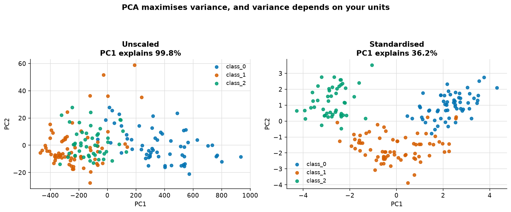
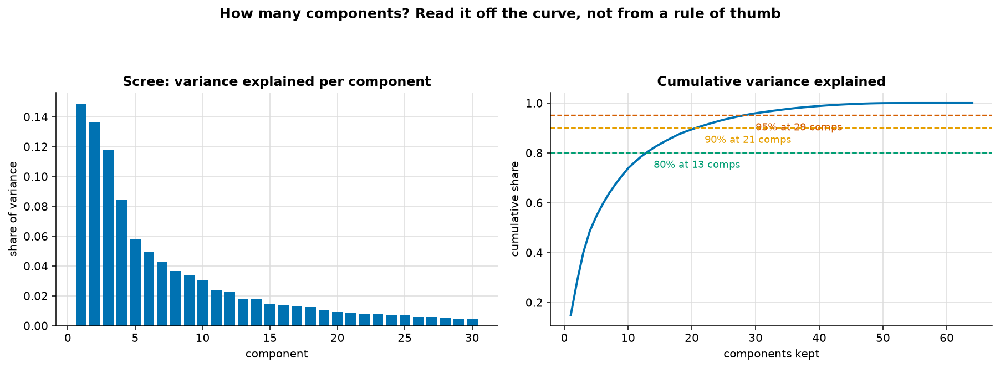
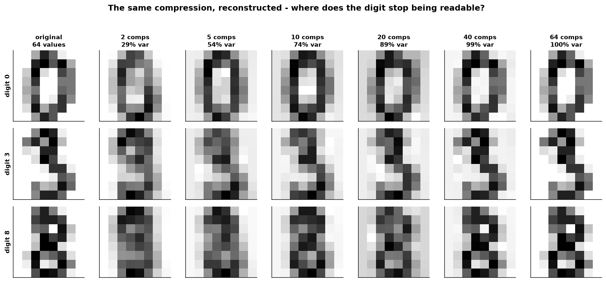
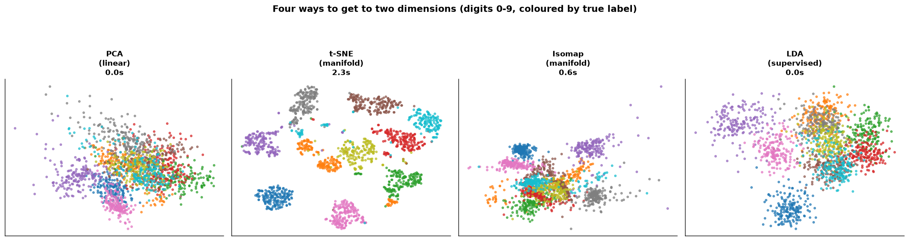
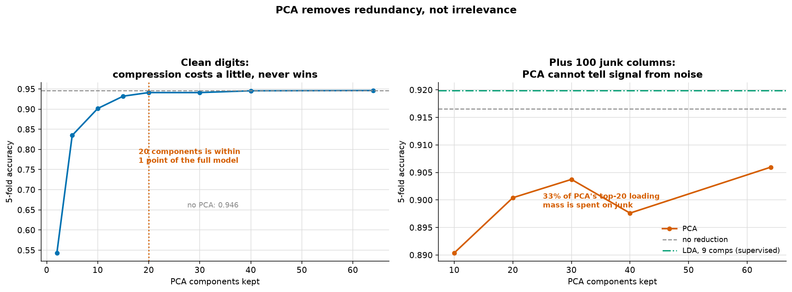

# Dimensionality Reduction

> **Concept reference:** Foundations volume, Parts A.10 (features), A.16 (unsupervised learning)
> **Datasets:** Digits (1,797 × 64) and Wine (178 × 13), both scikit-learn built-ins
> **Runtime:** ~22 s on a laptop CPU

```bash
python 02_traditional_ml/04_dimensionality_reduction/dimensionality_reduction.py
```

---

## 1. PCA is scale-dependent, and it is not subtle



PCA finds the directions of greatest **variance**, and variance is measured in the squared units of
each feature. Wine makes the consequence impossible to miss — `proline` has a standard deviation of
**314**, `nonflavanoid_phenols` has **0.124**.

| | PC1 explains | PC1 is made of |
|---|---|---|
| **Unscaled** | **99.8%** | loading **1.000** on `proline` — and nothing else |
| **Standardised** | 36.2% | `flavanoids` 0.423, `total_phenols` 0.395, `od280/od315` 0.376 |

Unscaled, **PC1 is the proline column with a new name**, and the three grape varieties barely
separate. Standardised, they fall into three clear groups. Same data, same algorithm, opposite
result.

> Always `StandardScaler` before PCA — unless every feature is already in the same unit, as with
> image pixels.

## 2. How many components?



| retain | components needed | share of original width |
|---|---|---|
| 80% | 13 | 20% |
| **90%** | **21** | **33%** |
| 95% | 29 | 45% |
| 99% | 41 | 64% |

Read it off the cumulative curve rather than applying a rule of thumb. And then look at the same
question with your eyes:



Each row is one digit, reconstructed with `inverse_transform` after keeping k components. The 0
survives 5 components; the **3** becomes readable around **10**; the **8** needs about **20** —
which is roughly the 90% mark. Beyond that, nothing visibly improves.

PCA is **lossy but reversible-ish**: `inverse_transform` returns 64 pixels, just not the same ones
you started with.

## 3. Linear projection vs manifold learning



| method | supervised? | fit time | `transform()` for new rows? |
|---|---|---|---|
| PCA | no | 0.0 s | **yes** |
| t-SNE | no | 2.6 s | **no** |
| Isomap | no | 0.7 s | yes (approximate) |
| LDA | **yes** | 0.1 s | **yes** |

**t-SNE pulls the ten digits into ten clean islands. PCA produces one smeared cloud**, because it
can only rotate and project — it is a linear map, and the digit classes are not linearly arranged.
Isomap lands in between. LDA separates well, but note it is the only method here that was *shown
the labels*.

### The restriction people routinely ignore

- **Distances between t-SNE clusters are not meaningful.** Two blobs drawn far apart are not more
  different than two drawn close together.
- **Cluster sizes are not meaningful either** — t-SNE equalises density.
- **There is no `transform()` for new data.** Every run refits from scratch, and a different seed or
  perplexity gives a different picture.

> So **t-SNE and UMAP are for looking at data, not for generating features.** PCA and LDA are the
> ones you can put in a pipeline and apply to test rows.

## 4. PCA removes redundancy, not irrelevance



First, the honest result on clean digits:

| components | accuracy | vs all 64 |
|---|---|---|
| 2 | 0.5431 | −0.4029 |
| 10 | 0.9015 | −0.0445 |
| **20** | **0.9410** | **−0.0050** |
| 40 | 0.9455 | −0.0006 |
| 64 / no PCA | 0.9460 | — |

**Compression never wins.** What it does is stay within one point all the way down to 20 components
— 31% of the original width — for a model that is much narrower to store, serve and keep clean.
The timings barely move either: at 64 features an SVC is already fast and PCA itself costs
something, so the speed argument only starts paying at far higher dimensionality.

### Testing the claim that PCA "removes noise and improves accuracy"

Add **100 columns of pure Gaussian junk** to the 64 real pixels and see whether PCA finds its way
back:

| approach | accuracy |
|---|---|
| no reduction (164 columns) | 0.9165 |
| PCA, 20 components | 0.9004 |
| PCA, 64 components | 0.9059 |
| **LDA, 9 components (supervised)** | **0.9199** |

**PCA never beats doing nothing.** Supervised LDA, with just 9 components, beats every PCA setting
*and* beats no reduction at all.

Here is the mechanism: of the squared loading mass in PCA's top 20 components, **33% sits on the
junk columns.** PCA is unsupervised — it maximises *variance*, and it has no idea which variance is
useful. After standardising, a pure-noise column has variance 1, exactly like a real pixel, so PCA
cheerfully spends components describing it.

> **PCA removes redundancy (correlated columns), not irrelevance.** If your problem is irrelevant
> features, you need something that looks at `y` — LDA, or an explicit feature-selection step.
> No amount of variance-maximising will find the signal.

## 5. PCA leaks if you fit it before the split

| | test accuracy |
|---|---|
| PCA fitted on train + test (**wrong**) | 0.9481 |
| PCA fitted inside a `Pipeline` (**right**) | 0.9463 |
| difference | **+0.0019** |

The gap is small, and that is exactly what makes it dangerous. Digits is large, clean and balanced,
so the components barely move when the test rows are added. On a small or high-dimensional dataset
the same mistake is worth several points — and **it always flatters you**, so nothing looks wrong
until production.

> The rule is mechanical: **any step that learns from data** — scaler, PCA, imputer, target
> encoder, feature selector — **goes inside the `Pipeline`**, so `cross_val_score` refits it on
> every training fold. See `01_foundations/05_data_leakage`.

---

## The exam angle

- **Scale before PCA.** An option that runs PCA on raw mixed-unit features is wrong.
- **PCA is unsupervised; LDA is supervised** and caps at `n_classes − 1` components.
- **t-SNE/UMAP for visualisation only** — no `transform()`, no meaningful inter-cluster distance.
  An option feeding t-SNE output into a production model is wrong.
- **PCA inside the Pipeline**, never fitted on the full dataset first.
- "**Too many features, model is slow / overfitting**" → PCA, feature selection, or regularisation.
  Know that PCA addresses *redundancy* while L1 and selection address *irrelevance*.
- On Vertex AI, this is mostly a feature-engineering concern; BigQuery ML exposes
  `MODEL_TYPE='PCA'` and `ML.PRINCIPAL_COMPONENTS`.

---

## Things to try

1. Re-run section 1 with `PCA(2)` on raw Wine but colour by `proline` decile instead of variety.
   The unscaled projection is a near-perfect proline gradient — that is all it encoded.
2. Change the junk columns in section 4 from `normal(0, 5)` to `normal(0, 0.1)`. Now PCA *can*
   ignore them, because before standardising they have almost no variance — which shows the
   effect is entirely about relative variance, not about "noise".
3. Replace `StandardScaler` with nothing in the junk experiment. PCA suddenly performs better,
   for the bad reason that unscaled junk has low variance.
4. Set t-SNE's `perplexity` to 5 and then 50. The picture changes substantially, which is the
   clearest argument against reading anything quantitative off it.
5. Swap `SVC` for `KNeighborsClassifier` in section 4. KNN suffers far more from the junk columns,
   because distance in 164 dimensions is mostly noise — the curse of dimensionality, measured.
