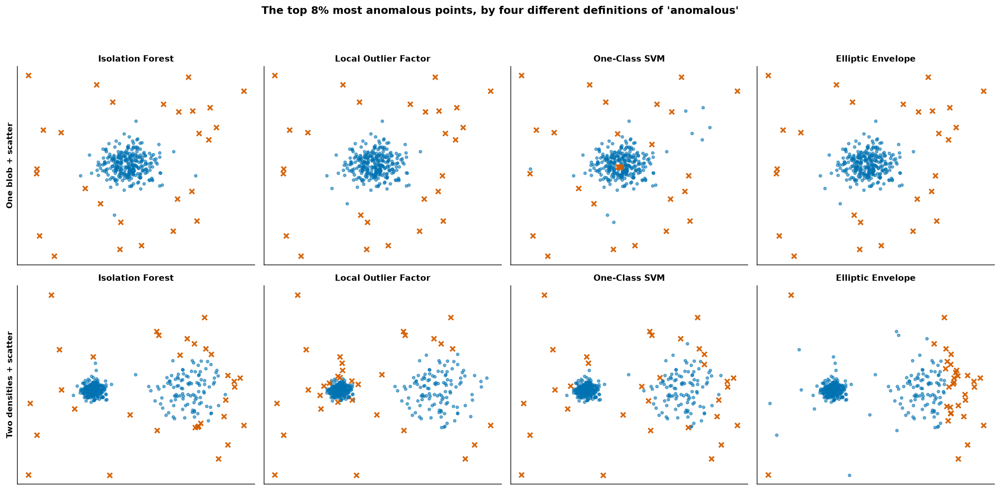
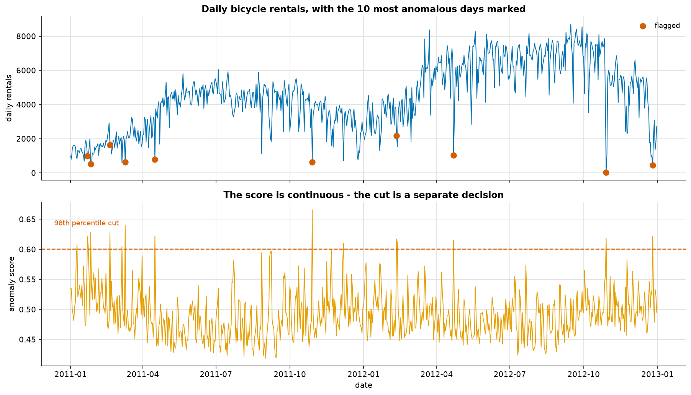
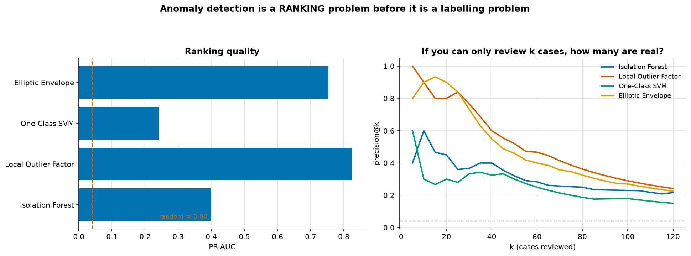
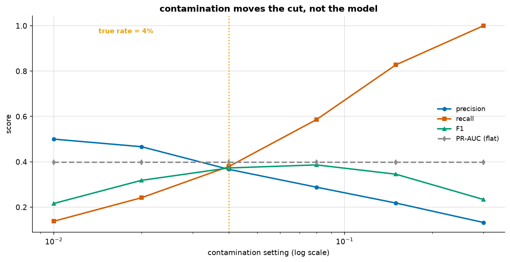

# Anomaly Detection

> **Concept reference:** Foundations volume, Parts A.11 (ROC vs PR), A.16 (unsupervised learning)
> **Dataset:** Bike Sharing daily (731 days × 16), plus two synthetic shapes
> **Runtime:** ~9 s on a laptop CPU

```bash
python 02_traditional_ml/05_anomaly_detection/anomaly_detection.py
```

The defining difficulty of this topic is that **you usually have no labels**, so you cannot tune,
cannot validate, and cannot know your error rate. Everything below is shaped by that.

---

## 1. Four algorithms, four different definitions of "unusual"



The top row is the textbook picture — one blob, some scatter — and all four agree, which is exactly
why they look interchangeable. They are not.

The bottom row has a **dense cluster, a sparse cluster, and 20 genuinely stray points**. Only the 20
are real anomalies; the sparse cluster is ordinary data that happens to be spread out. Here is
where each detector's 31 flags actually landed:

| detector | stray points found | wasted on sparse cluster | on dense cluster |
|---|---|---|---|
| Isolation Forest | 15 / 20 | 17 | 0 |
| **Local Outlier Factor** | **16 / 20** | **6** | 10 |
| One-Class SVM | 16 / 20 | 15 | 1 |
| Elliptic Envelope | **4 / 20** | **28** | 0 |

**Elliptic Envelope found 4 of 20 and threw 28 flags at perfectly normal points.** It fits *one*
Gaussian to everything, so with two clusters present it simply flags whatever sits furthest from
the joint mean.

**Isolation Forest and One-Class SVM are global** — a point in a genuinely sparse region is easy to
isolate, so it looks unusual even when it is an ordinary member of a spread-out group.

**LOF compares each point's density only to its own neighbours'**, so a uniformly sparse cluster
costs it 6 flags against 15–28 for the others. That is the entire reason LOF exists.

> LOF's flags land on the **dense cluster's rim** instead: in a tight group, being slightly further
> out than your neighbours is a large *relative* difference. Local sensitivity is a trade, not a
> free win.

## 2. A real series, with nothing to check against



Isolation Forest on two years of daily rentals, 8 features, no labels. The most extreme day is
**2012-10-29 — 22 rentals against a median of 4,548**, 207× below it. A severe storm closed the
city, and the model found it knowing nothing about weather events.

**But it ranks 8th, not 1st**, and that is the more useful fact. The model scores all 8 features
jointly, so being the most extreme in *one* column does not automatically win.

Now the sobering part: **only 1 of the top 10 has an ordinary rental count**, and 8 are rain or snow
days. The model has largely rediscovered *"bad weather means few rentals"*.

> That is a **sanity check, not a discovery**, and it is worth saying so rather than dressing it up.
> An unsupervised detector agreeing with the obvious explanation is evidence that it works — not
> evidence that it beats a simple rule.

## 3. Scoring it properly



29 anomalies injected into 731 rows (4%). Half are extreme in one column; half are ordinary values
in an impossible *combination*.

| detector | PR-AUC | ROC-AUC | P@30 | P@60 |
|---|---|---|---|---|
| **Local Outlier Factor** | **0.824** | 0.990 | **0.77** | **0.47** |
| Elliptic Envelope | 0.753 | 0.974 | 0.73 | 0.40 |
| *(rule: \|z\| on rentals)* | *0.458* | | | |
| Isolation Forest | 0.398 | 0.937 | 0.37 | 0.28 |
| One-Class SVM | 0.242 | 0.846 | 0.33 | 0.25 |

**The one-column z-score rule beats two of the four real detectors.** It finds only the half of the
anomalies that are extreme in rentals and is structurally blind to the impossible combinations —
and that is still enough to embarrass Isolation Forest and One-Class SVM.

So *"reach for a multivariate detector"* is not automatically right. What **is** true is that the
best one scores 0.824, about **1.8× the rule**, because it can see both kinds of anomaly at once.

> **Always measure against the dumb baseline before concluding the model is needed.**

Two metric notes. **ROC-AUC flatters everything here** (0.846–0.990) because at a 4% base rate
there are so many easy negatives — quote PR-AUC. And **precision@k is usually the number that
matters in practice**: if an analyst can review 30 cases a day, *"how many of my top 30 are real"*
is the question, and answering it requires no threshold at all.

## 4. `contamination` moves the cut, not the model



| contamination | flagged | precision | recall | F1 | PR-AUC |
|---|---|---|---|---|---|
| 0.01 | 8 | 0.500 | 0.138 | 0.216 | **0.398** |
| 0.04 | 30 | 0.367 | 0.379 | 0.373 | **0.398** |
| 0.08 | 59 | 0.288 | 0.586 | **0.386** | **0.398** |
| 0.30 | 219 | 0.132 | 1.000 | 0.234 | **0.398** |

**PR-AUC is identical to four decimal places across a 30× range.** Not merely stable — the same
number. `contamination` never touches the trees; it only sets `offset_`, the value a score is
compared against inside `predict()`. The ranking was fixed the moment the forest was built.

What it does control is the precision/recall trade — exactly like moving a classification
threshold ([02_classification](../02_classification/), section 4).

> **The trap:** `contamination` is a **prior you are asserting** — *"I believe x% of my data is
> anomalous."* In unsupervised work you usually have no way to check it. Prefer to rank by score
> and cut at whatever volume you can actually investigate.

## 5. Outlier detection vs novelty detection

- **Outlier detection** — fit on dirty data, find the bad rows inside it.
- **Novelty detection** — fit on data believed clean, then score new rows as they arrive. This is
  the production shape.

```python
LocalOutlierFactor(n_neighbors=20).predict   # AttributeError - does not exist
```

By default **LOF is transductive**: it scores the rows it was fitted on and nothing else, so there
is no model to deploy. `novelty=True` must be set at *construction* time.

| detector | fit on clean half | fit on everything (§3) |
|---|---|---|
| Local Outlier Factor | 0.683 | 0.824 |
| Isolation Forest | 0.200 | 0.398 |

**Both detectors scored lower under the clean-fit setup** — on this data, novelty framing did not
help. The columns are not strictly comparable (the left scores half the rows), so read the shape,
not the gap. Halving the training data cost more than the cleaner reference bought.

> Use a known-good period when you have one, **but measure it rather than assuming.**

---

## The exam angle

- **"Find unusual transactions / readings, no labels"** → Isolation Forest is the standard default
  on tabular data: no distance metric to tune, near-linear in *n*.
- **"Clusters of differing density"** → LOF. **"One elliptical population"** → Elliptic Envelope.
  **"Must handle arbitrary shapes and flag outliers"** → DBSCAN (see [clustering](../03_clustering/)).
- **Never evaluate with accuracy.** At a 4% base rate, flagging nothing scores 96%. Use PR-AUC or
  precision@k.
- **`contamination` is a threshold, not a learned parameter.**
- On Google Cloud: BigQuery ML has `MODEL_TYPE='AUTOENCODER'` and `KMEANS`-based anomaly detection
  via `ML.DETECT_ANOMALIES`; Vertex AI has no dedicated anomaly service, so this is custom-training
  or BQML territory.
- **Timeseries anomaly** is a different problem — see [06_time_series](../06_time_series/).

---

## Things to try

1. Change `cluster_std` of the sparse cluster in section 1 from 1.10 to 0.35, matching the dense
   one. Every detector's sparse-cluster waste collapses — the difficulty was never the algorithm,
   it was the density mismatch.
2. Raise LOF's `n_neighbors` from 20 to 60. Its flags shift off the dense rim, because a larger
   neighbourhood is a less local comparison. At `n_neighbors=n` it stops being local at all.
3. Drop `cnt` from the section-2 feature list. The flagged days change completely — they become
   odd *weather* days rather than odd *volume* days. The features define the question.
4. Inject only combination-anomalies in section 3 (delete the first half). The z-score rule
   collapses to near the 0.04 base rate while LOF holds up, which isolates exactly what a
   multivariate method buys.
5. Swap `StandardScaler` for `RobustScaler`. Anomalies inflate the mean and standard deviation that
   `StandardScaler` computes, so the scaler is partly defined by the very points you are hunting.
