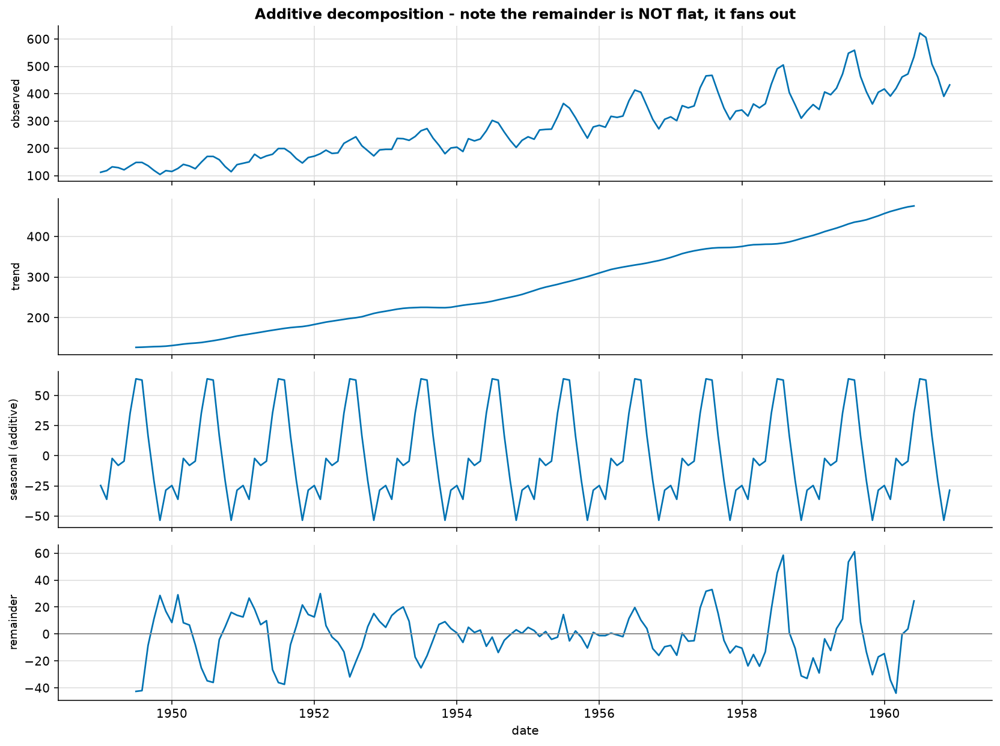
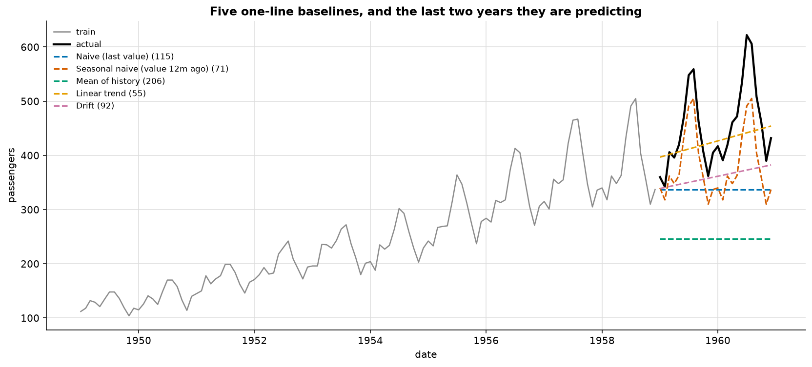
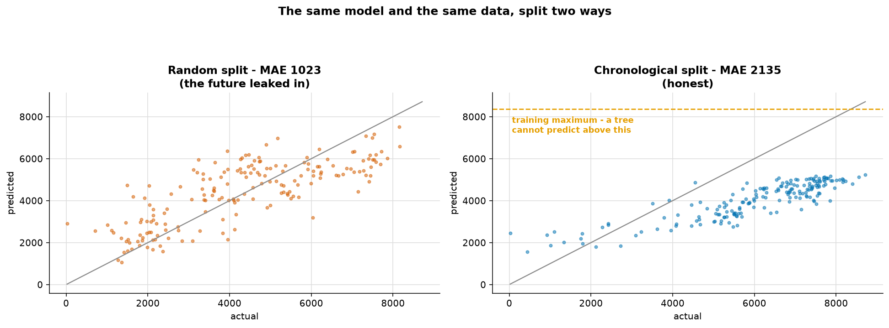
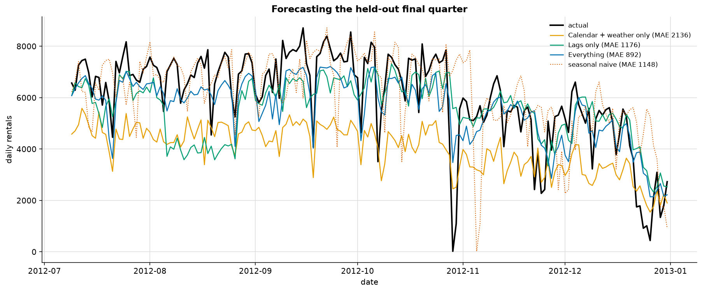
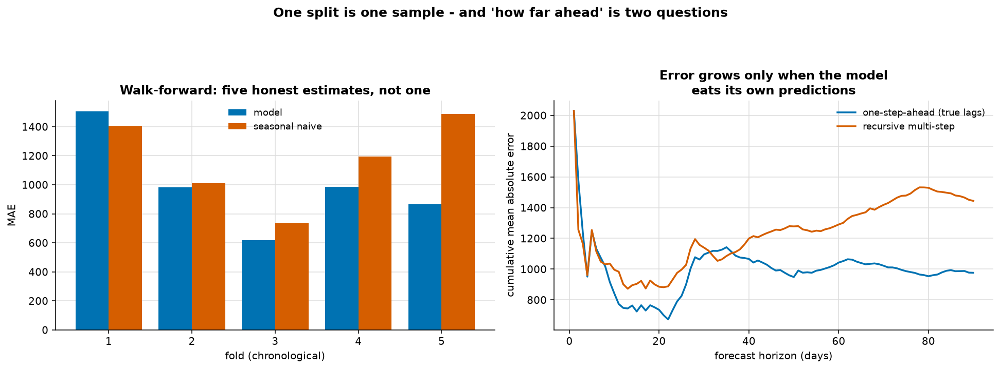

# Time Series

> **Concept reference:** Foundations volume, Parts A.7 (validation), A.10 (features)
> **Datasets:** Airline passengers (144 months) and Bike Sharing daily (731 days)
> **Runtime:** ~14 s on a laptop CPU

```bash
python 02_traditional_ml/06_time_series/time_series.py
```

This is the one topic where the *validation setup* matters more than the model. Almost every
mistake here inflates your score, which is why they survive so long.

---

## 1. Decomposition: what is this series made of?



| | value |
|---|---|
| Std dev of the first 24 months | 17.6 |
| Std dev of the last 24 months | **76.3** (4.3× larger) |
| Residual spread, additive model | 19.3 |
| Residual spread, **multiplicative** model | **9.3** |

**The seasonal swings grow with the level** — the peaks get taller as the airline gets bigger. That
makes the seasonality **multiplicative**, and it is the single most important thing to notice
before modelling this series.

Look at the remainder panel: it is **U-shaped** instead of level. Mean |remainder| by year runs
25 in 1949, down to 4 in 1954, and back up to 20–24 by 1958–60. The additive model fits *one*
seasonal amplitude — an average — which is too big for the small early years and too small for the
large late ones, so the remainder is largest at both ends and smallest where the level is closest
to average. That is the additive model failing to absorb growing swings, visible as a shape before
any number tells you.

> The standard fix is to model `log(y)`. A multiplicative series becomes additive on the log scale,
> which is why so many forecasting recipes open with a log transform.

## 2. The baselines you have to beat



Holding out the last 24 months:

| baseline | MAE | MAPE |
|---|---|---|
| **Linear trend** | **54.9** | **11.2%** |
| Seasonal naive (value 12m ago) | 71.2 | 15.5% |
| Drift | 91.6 | 18.4% |
| Naive (last value) | 115.2 | 23.6% |
| Mean of history | 206.3 | 44.2% |

Note **which one won**. Seasonal naive is the baseline everyone quotes, but here a straight line
through ten years of growth beat it — this series is dominated by its *trend*. On a flat, strongly
seasonal series the ranking reverses.

> **Which baseline wins tells you what your series is made of.** Run several and let the winner
> point at the structure — here trend first, seasonality second, exactly what section 1 showed.

"Mean of history" is hopeless at 206.3. It is the baseline from
[01_regression](../01_regression/), and it does **not** transfer to a trending series.

And whichever wins: **report it next to your model.** A forecasting result quoted without a
baseline cannot be evaluated by anyone.

## 3. The split that invents performance



Same model, same data, same features — only the split changes:

| split | MAE |
|---|---|
| Random 75/25 | **1023.5** ← fiction |
| Chronological 75/25 | **2134.8** ← honest |

**The random split looks 2.1× better.** Nothing is wrong with the model: a random split puts
2012-06-14 in training and 2012-06-15 in test, and consecutive days are nearly identical. The model
is *interpolating between known points*, not forecasting. At deployment there is no "tomorrow" in
your training set.

### The second effect: trees cannot extrapolate

This series trends upward, so a chronological split also asks the model to predict *above any level
it has seen*:

| | rentals |
|---|---|
| highest value in training | 8,362 |
| highest value in test | 8,714 |
| **highest value predicted** | **5,245** |

A tree's prediction is an **average of training values**, so it is structurally capped at the
training maximum — that third number can never exceed the first. Linear models and explicit trend
terms extrapolate; trees do not.

> This is the most common way a gradient-boosted forecast quietly under-predicts a growing series.
> Detrend first, or use a model with a trend term.

## 4. Lag features: forecasting as supervised regression



| features | n | MAE |
|---|---|---|
| Calendar + weather only | 10 | 2136.4 |
| Lags only | 9 | 1176.0 |
| **Everything** | 19 | **891.8** |
| *seasonal naive (t−7)* | — | *1147.9* ← **the bar** |

Lags alone (1176) nearly match everything the weather and calendar columns provide together
(2136 → 1176 is a 45% cut). **Yesterday's demand is the single most informative column you have** in
almost any demand-forecasting problem, and it is free.

The full model beats the seasonal-naive bar by **22%**. *That* is the number to report — the raw
MAE means nothing on its own.

### The leak to avoid

```python
out[f"roll_mean_{w}"] = out[target].shift(1).rolling(w).mean()
#                                    ^^^^^^^^ without this, today's value is inside the feature
```

A rolling mean computed **without shifting first** includes today's target, so the model is handed
a blurred copy of the answer.

> It is the most flattering bug in time series, and **it survives cross-validation** — the leak is
> inside the feature, not the split, so no amount of correct splitting will catch it.

## 5. Walk-forward validation, and two different "horizons"



`TimeSeriesSplit`, five folds of 60 days, training window always preceding the test window:

| fold | test window | model MAE | seasonal naive |
|---|---|---|---|
| 1 | Mar–May 2012 | 1505.7 | 1404.2 ← **loses** |
| 2 | May–Jul 2012 | 982.2 | 1011.9 |
| 3 | Jul–Sep 2012 | **616.8** | 734.1 |
| 4 | Sep–Nov 2012 | 984.3 | 1195.9 |
| 5 | Nov–Dec 2012 | 864.2 | 1488.6 |

**Mean 990.6 ± 290.2, against naive 1166.9.** The fold-to-fold spread is 889 MAE — a single split
would have handed you any one of these numbers with no idea of the range. The model also *loses to
naive in fold 1*, which a single lucky split would have hidden entirely.

### One-step-ahead vs recursive multi-step

These are constantly conflated, and only one of them compounds:

| horizon | one-step-ahead | recursive multi-step | ratio |
|---|---|---|---|
| 7 d | 1073 | 1048 | 0.98× |
| 30 d | 1096 | 1140 | 1.04× |
| 60 d | — | — | 1.24× |
| 90 d | **976** | **1444** | **1.48×** |

**One-step-ahead error does not grow** — it is flat or falling, because every day the model is
handed yesterday's *true* value before predicting today. That is a legitimate setup (it is what a
daily-refreshed forecast does) but it is **not a 90-day forecast**.

**Recursive multi-step** builds tomorrow's lags out of today's *prediction*, so errors compound.
Same model, same data, same days — the only difference is whether the model was refed the truth
each morning, and by 90 days that is worth 1.5× the error.

> **Always quote the horizon *and* the regime.** "MAE 900" is not a claim on its own.

---

## The exam angle

- **Never `KFold` a time series.** `TimeSeriesSplit`, or a manual chronological cut. An option
  offering random shuffling on temporal data is always wrong.
- **Seasonal naive is the baseline to report.** Expect a question where the "best" model fails to
  beat it.
- **Trees cannot extrapolate.** For a trending series: detrend, difference, or use a model with an
  explicit trend component.
- **Multiplicative seasonality → log transform.**
- **Lag/rolling features must be shifted.** This is the time-series form of data leakage; see
  `01_foundations/05_data_leakage`.
- On Google Cloud: **BigQuery ML `ARIMA_PLUS`** is the managed answer for univariate seasonal
  forecasting (it handles holidays, multiple seasonalities and anomalies automatically), and
  `ARIMA_PLUS_XREG` when you have external regressors. Vertex AI Forecasting covers the AutoML
  route. Know that the fiscal/holiday calendar is a first-class input, not an afterthought.

---

## Things to try

1. Re-run section 1 on `np.log(passengers)`. Multiplicative becomes additive, and the remainder
   no longer has the clean U that tracks distance from the average level (by-year mean |remainder|
   on the log scale ranges 0.009–0.040, with no ends-high, middle-low pattern).
2. Add a `Seasonal naive + drift` baseline to section 2 (last year's value plus the average annual
   increase). It should beat both of its parents, because the series has trend *and* season.
3. Delete the `.shift(1)` from the rolling features in `make_lags` and re-run section 4. MAE for
   "Everything" improves from 891.8 to 734.7, about 18% better — and that is what makes this leak
   dangerous. It does not collapse to something implausible that would give itself away; it hands
   you a plausible, better-looking number.
4. In section 5, change `TimeSeriesSplit(n_splits=5)` to `max_train_size=180` for a sliding rather
   than expanding window. Useful when old data is actively misleading.
5. Fit a `Ridge` instead of a `RandomForest` in section 3 and look at the maximum prediction again.
   It rises from 5,245 to 7,039 and MAE improves (2,134.8 → 1,935.0), but it is still below the
   training maximum of 8,362. A linear model *can* extrapolate — nothing caps it — but it only does
   so if a feature pushes it there, and weather and calendar features have no trend in them. To
   follow growth you need a trend term (a time index or lagged demand).
