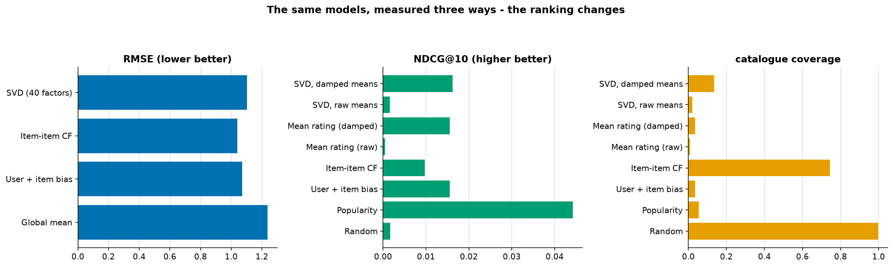
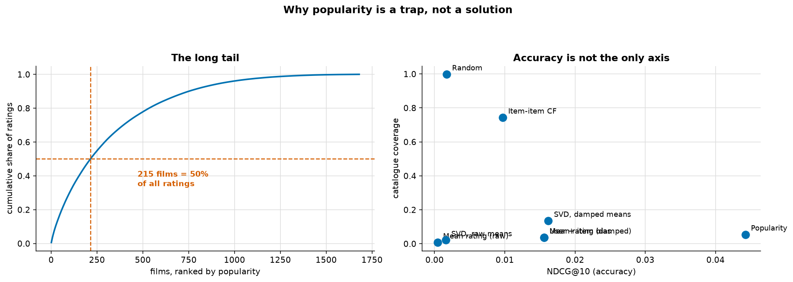

# Recommender Systems

> **Concept reference:** Foundations volume, Parts A.11 (metrics), A.16 (unsupervised learning)
> **Dataset:** MovieLens 100K — 100,000 ratings, 943 users, 1,682 films
> **Runtime:** ~7 s on a laptop CPU

```bash
python 02_traditional_ml/07_recommenders/recommenders.py
```

This is the topic where **the obvious metric measures the wrong thing**, and the whole example is
built around showing that concretely.

---

## 1. Sparsity is the problem

| | |
|---|---|
| ratings | 100,000 |
| full user × item grid | 1,586,126 cells |
| **density** | **6.30%** — 93.7% of it is empty |
| ratings per user | median 65 (min 20, max 737) |
| ratings per film | median 27 (min **1**, max 583) |

The most-rated **10% of films carry 43% of all ratings**. Every method below is a different answer
to *"how do I fill in a matrix that is 94% holes"*, and that is why ordinary supervised regression
on a user × item table is not the tool.

### The split

Each user's **most recent** rating is held out — not a random one. A random split would put a
user's later ratings in training and earlier ones in test, which is the leak from
[06_time_series](../06_time_series/) wearing a different hat.

## 2. Predicting the rating (the Netflix Prize formulation)

| model | RMSE | MAE |
|---|---|---|
| Global mean | 1.2374 | 1.0413 |
| User + item bias | 1.0716 | 0.8427 |
| **Item-item CF** | **1.0395** | **0.8067** |
| SVD (40 factors) | 1.1023 | 0.8711 |

The best model is **16% better than predicting the global mean** for everything.

Look at how much comes from **biases alone** — just *"this user is generous"* plus *"this film is
good"*, with no interaction modelling at all, reaches 1.0716. Bias terms were the single largest
component of most Netflix Prize solutions, and they are about ten lines of pandas.

Note also how **small the whole spread is**. That is the first hint that RMSE may not be the thing
worth optimising.

## 3. The same models, scored as a ranking problem



Nobody is ever shown a predicted star rating. They are shown a **list**. So score the list:

| model | HitRate@10 | NDCG@10 | coverage |
|---|---|---|---|
| Random | 0.0042 | 0.0017 | 99.8% |
| **Popularity** | **0.0901** | **0.0442** | 5.4% |
| User + item bias | 0.0361 | 0.0156 | 3.6% |
| Item-item CF | 0.0212 | 0.0097 | **74.3%** |
| Mean rating (raw) | 0.0011 | 0.0004 | 0.7% |
| Mean rating (damped) | 0.0361 | 0.0156 | 3.6% |
| SVD, raw means | 0.0021 | 0.0016 | 2.1% |
| SVD, damped means | 0.0297 | 0.0162 | 13.5% |

**Best by RMSE: Item-item CF. Best by ranking: Popularity.** They are not the same model, and
Item-item CF — the RMSE winner — ranks *below* the bias model.

### Two things this table exposes

**Shrinkage is not optional when you rank on an average.** `Mean rating (raw)` scores NDCG 0.0004;
damping the identical statistic towards the global mean lifts it to **0.0156 — 38× better**. The
reason is visible the moment you look at what a raw mean ranks highest:

```
mean 5.00 from   1 rating(s)   Marlene Dietrich: Shadow and Light (1996)
mean 5.00 from   1 rating(s)   Great Day in Harlem, A (1994)
mean 5.00 from   2 rating(s)   Prefontaine (1997)
mean 4.35 from 578 ratings     Star Wars (1977)   <- the actual favourite
```

A single 5.00 beats a 4.35 earned over hundreds of ratings. Damping weights each mean by the
evidence behind it — the same shrinkage idea as regularisation in
[01_regression](../01_regression/), applied to a statistic rather than a coefficient.

**An additive user term cannot personalise.** `Mean rating (damped)` and `User + item bias` score
*identically*, and that is not a coincidence:

```
mu + (sum - n*mu)/(n + k)  ==  (sum + k*mu)/(n + k)
```

The user term shifts every item by the same amount, so it cannot change an **ordering**. A
"personalised" model whose only user-specific component is additive is not personalised at all.

## 4. Popularity, the long tail, and coverage



**215 films out of 1,682 (12.8%) account for half of all ratings.**

| | NDCG@10 | coverage |
|---|---|---|
| Popularity | **0.0442** | 5.4% |
| SVD, damped means | 0.0162 | **13.5%** |
| Item-item CF | 0.0097 | **74.3%** |

**Popularity won the accuracy metric outright, by nearly 3×.** And it is close to worthless as a
product: it tells every user the same thing, surfaces nothing from the tail, and gives nobody a
reason to come back. Accuracy metrics cannot see any of that — which is why serious systems track
**coverage, diversity, novelty and serendipity** alongside them.

It is also **self-reinforcing**: recommending popular items generates more interactions with
popular items, which makes them more popular.

> **Be careful about the reverse conclusion too.** This is one small offline split with a single
> held-out film per user, and offline ranking metrics are notoriously weak predictors of online
> behaviour — the held-out film is "correct" only in the sense that the user happened to watch it,
> which popularity-driven interfaces helped cause. This evaluation cannot settle the question.
> **An A/B test can.**

## 5. Cold start

A new user arrives having rated nothing:

| model | what happens |
|---|---|
| Item-item CF | sums over an **empty** set → every score is 0, ranking arbitrary |
| SVD | no row in the factorisation → **no latent vector exists** |
| User + item bias | user term is 0 → they get the global list, i.e. popularity |
| **Popularity** | **works perfectly.** It never needed the user |

So the honest architecture for most products is a **cascade**, not a single model:

```
0 interactions      ->  popularity, or editorial picks
a few interactions  ->  content-based (genre, cast, text)
many interactions   ->  collaborative filtering / matrix factorisation / two-tower
```

The same problem applies to **new items**, and it is worse: a film nobody has rated can never be
recommended by a collaborative method, so it can never acquire ratings. Content features are the
only way out of that loop — and that is exactly why the production pattern is a **two-tower model**
(`03_neural_networks/09`), embedding users and items from *features* so both sides survive having
no history.

---

## The exam angle

- **Collaborative filtering** uses the interaction matrix; **content-based** uses item/user
  features. Cold start is the standard reason to reach for content-based or hybrid.
- **Matrix factorisation** (SVD / ALS / WALS) is the classic scalable answer.
  **BigQuery ML has `MODEL_TYPE='MATRIX_FACTORIZATION'`** — expect it as the managed option.
- **Two-tower retrieval** is the modern Vertex AI pattern: embed user and item separately, then
  approximate-nearest-neighbour lookup (Vector Search / Agent Retrieval) at serving time.
- **Evaluate ranking with HitRate@k, NDCG@k, MAP@k** — not RMSE, and never accuracy.
- **Hold out the most recent interaction**, not a random one.
- Watch for the popularity/feedback-loop distractor: "recommendations became less diverse over
  time" → popularity bias, fix with diversity/exploration terms.

---

## Things to try

1. Change `k` (the damping constant) from 10 to 1 and then 100 in section 2. At `k=1` the raw-mean
   pathology mostly returns (damped-mean NDCG 0.0156 → 0.0040). At `k=100` you might expect
   everything to collapse towards the global mean, but NDCG *rises* to 0.0254, because heavier
   damping pushes the ranking towards well-rated *popular* films, and popularity is what wins on
   this split. Meanwhile the bias model's RMSE gets worse (1.0716 → 1.1168). The best `k` for
   ranking and the best `k` for RMSE are not the same.
2. Increase `TruncatedSVD` components from 40 to 200. Both get **worse**: RMSE 1.1023 → 1.1196 and
   NDCG@10 (damped means) 0.0162 → 0.0132. The extra factors fit the zero-filled matrix more
   tightly, which means fitting the zeros, which helps neither rating prediction nor ranking.
3. Add a **user-user** CF variant alongside item-item. Item-item usually wins on this data because
   there are fewer films than users and item similarity is more stable.
4. Filter the catalogue to films with ≥ 20 ratings before ranking. Coverage drops but NDCG rises —
   quantifying exactly how much of the tail you are giving up for accuracy.
5. Score `MAP@10` as well as `NDCG@10`. With a single held-out item per user they rank models
   almost identically, which is itself worth seeing — the metric choice matters far less than the
   *rating-vs-ranking* choice.
