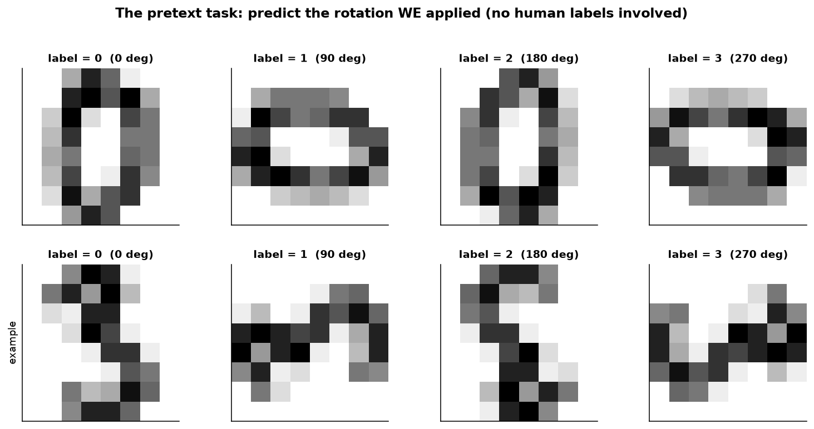
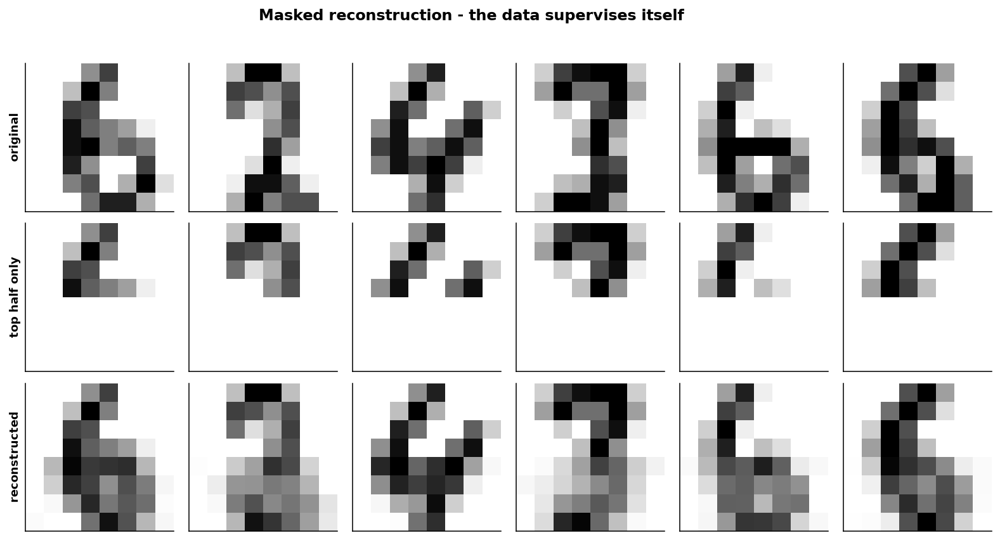
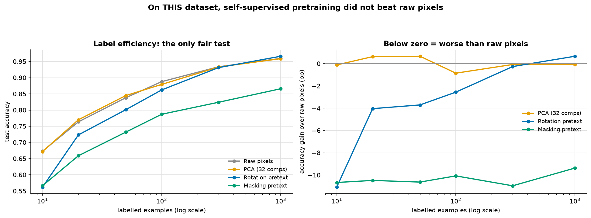

# Self-Supervised Learning

> **Concept reference:** Foundations volume, Parts A.16 (unsupervised), A.17 (transfer learning)
> **Dataset:** Digits (1,797 × 64), labels withheld from every encoder
> **Runtime:** ~13 s on a laptop CPU

```bash
python 02_traditional_ml/08_self_supervised/self_supervised.py
```

**The idea in one sentence:** hide part of the data, train a model to recover it, and keep the
*representation* rather than the prediction. The invented task (the **pretext task**) is throwaway;
what you want is what the model had to understand in order to solve it.

Everything here is scikit-learn only. The ideas are the ones behind BERT, SimCLR and MAE — the
encoders are just much smaller, and **that turns out to matter a great deal.**

---

## 1. Pretext task one: predict the rotation



Rotate each image by 0/90/180/270° and label it with the angle. **No human labels are involved** —
the label is an operation we applied, so it is free and always correct. 1,797 images become 7,188
training examples.

**Rotation-prediction accuracy: 0.952** (chance is 0.250).

The model has learned which way up a digit goes, which it could not do without encoding something
about strokes and their arrangement. The classifier is disposable; the hidden layer is what we keep.

> A caveat specific to digits: **0, 1 and 8 are nearly rotation-symmetric**, so the pretext task is
> genuinely ambiguous for them. A pretext task that is *impossible* on part of your data caps what
> the representation can learn there.

And resist stopping here. **A high pretext score is not evidence that the representation is
useful.** Section 3 measures that properly.

## 2. Pretext task two: masked reconstruction



Given the **top half** of an 8×8 digit, reconstruct the **bottom half**:

| | mean absolute pixel error |
|---|---|
| predict the average bottom half | 3.223 |
| **learned from the top half** | **2.259** (30% better) |

The top half genuinely constrains the bottom half — that is the structure the model is forced to
internalise. Same principle as BERT masking words or a masked autoencoder masking image patches.

## 3. Does it actually help? The label-efficiency curve



Train a simple logistic head on N labelled examples and vary N. The encoders saw **no labels** —
only rotations and masked pixels.

| labels | Raw pixels | PCA (32) | Rotation pretext | Masking pretext |
|---|---|---|---|---|
| 10 | **0.673** | 0.672 | 0.562 | 0.566 |
| 20 | 0.764 | **0.770** | 0.723 | 0.659 |
| 50 | 0.838 | **0.845** | 0.801 | 0.732 |
| 100 | **0.888** | 0.879 | 0.862 | 0.787 |
| 300 | **0.934** | 0.933 | 0.931 | 0.824 |
| 1000 | 0.960 | 0.959 | **0.966** | 0.866 |

### The honest result: the pretext tasks lost where it matters

This is a **negative result and it is left in**, because it is far more instructive than a tuned
demonstration would be. At 10 labels the best pretext representation is **10.7 points worse** than
doing nothing at all, and both pretext tasks trail raw pixels at every budget up to 300. The one
exception is rotation at **1,000 labels (0.966 vs 0.960; +0.007 unrounded)** — the plentiful-label end,
where pretraining should matter *least*. Where labels are scarce, which is the whole point of
self-supervision, both lost.

**Why it failed here, concretely:**

1. **The input is already a good representation.** Plain logistic regression on the 64 raw pixels
   reaches ~0.96. There is very little structure left for an encoder to discover.
2. **There is no unlabelled-data advantage.** Self-supervision wins when unlabelled examples vastly
   outnumber labelled ones. Here there are 1,797 images total — *the same pile, relabelled*. SimCLR
   used 1.3M images; BERT used billions of tokens.
3. **The encoder is tiny.** One hidden layer of 128 units cannot build a richer representation than
   the pixels it is handed.
4. **The masking encoder sees half the image.** It is built from the top 32 pixels only, so it has
   discarded half the evidence before the classifier ever sees it — which is why it is worst.

PCA matches raw pixels almost exactly, which is the same message from another direction: on 8×8
digits, a linear decomposition captures essentially everything there is.

> **What to take from this:** the *method* — the label-efficiency curve — is the right way to
> evaluate any pretext task, and it is the part that transfers. Had we quoted only the 0.95
> rotation accuracy from section 1, we would have concluded the pretraining worked. It did not.
> **Self-supervision is a scale phenomenon.**

## 4. A pretext task that learns nothing

A deliberately bad pretext task: **predict the total ink in the image.**

| | |
|---|---|
| pretext R² | **0.982** — solved almost perfectly |
| digit accuracy from 50 labels, raw pixels | 0.843 |
| digit accuracy from 50 labels, "total ink" representation | **0.774** |

Summing pixel values requires no understanding of shape at all, so there is nothing to transfer.
The task is solved perfectly *and* the representation is worse than useless.

A pretext task is only useful if solving it **requires the structure you care about**. This is the
**shortcut problem**, the central design difficulty in self-supervised learning:

- colourisation can be solved from texture statistics alone
- jigsaw puzzles can be solved by matching edge pixels
- contrastive learning collapses if the augmentations are too weak

> **A high pretext score is not evidence of a good representation. Only the downstream
> label-efficiency curve is.**

### A debugging note worth keeping

The first version of section 4 reported **R² = −2.876** — worse than predicting the mean — for a
target that is a *linear function of the inputs* and that ordinary least squares fits with R² = 1.0.
The cause was the target scaling: dividing total ink by its maximum puts it in a narrow band around
0.75 (mean 313, sd 34), and Adam fits a near-constant target far from zero badly. **Standardising
the target fixed it instantly.** When a model fails at something trivially linear, suspect
conditioning before architecture.

---

## The exam angle

- **Self-supervised = labels derived from the data itself.** Distinguish from *unsupervised* (no
  labels at all, e.g. clustering) and *semi-supervised* (a few real labels plus unlabelled data).
- **Pretrain → fine-tune** is the foundation-model recipe, and the entire rationale for
  **Model Garden** on Vertex AI: someone else paid for the pretraining.
- **The pretext model is discarded; the encoder is kept.** Expect a question about freezing the
  encoder and training a new head.
- **Evaluate on the downstream task with few labels**, never on pretext accuracy.
- Typical vision pretext tasks: rotation, jigsaw, colourisation, masked patches (MAE), contrastive
  (SimCLR/MoCo). Typical NLP: masked language modelling (BERT), next-token prediction (GPT).
- **It needs scale.** If a question describes a small clean tabular dataset, self-supervision is not
  the answer — this folder is the evidence.

---

## Things to try

1. Cut the labelled digits to 200 images but keep all 1,797 for pretraining. That is the regime
   self-supervision is designed for, and the gap narrows — though on this data it still does not
   reverse.
2. Widen the rotation encoder from 128 to 512 units. A little better, and nowhere near enough —
   which localises the problem in the *data*, not the architecture.
3. Mask random pixels instead of the bottom half, and give the encoder all 64 inputs. This is much
   closer to a real masked autoencoder and removes the "sees half the image" handicap.
4. Replace the digits with something where raw features are genuinely poor — raw audio, or an
   unstandardised mixed-unit table. The advantage should appear.
5. Build a contrastive pretext task: two augmented views of the same digit should embed closer than
   views of different digits. That is SimCLR in miniature, and augmentation strength is the knob
   that decides whether it learns anything.
