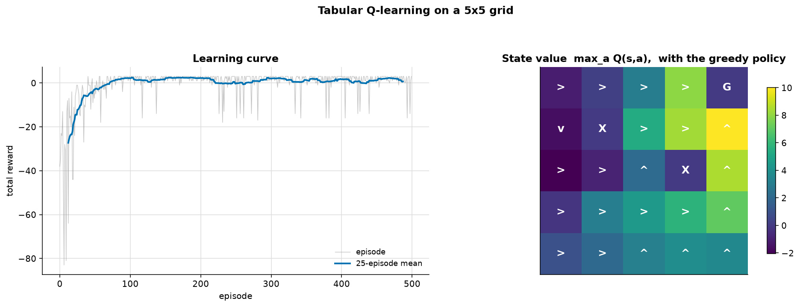
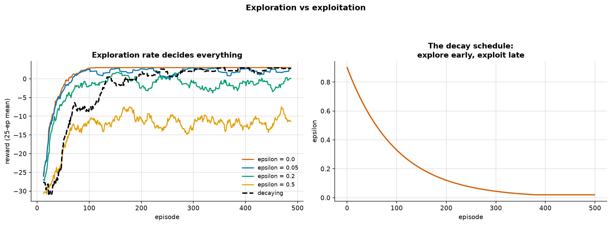
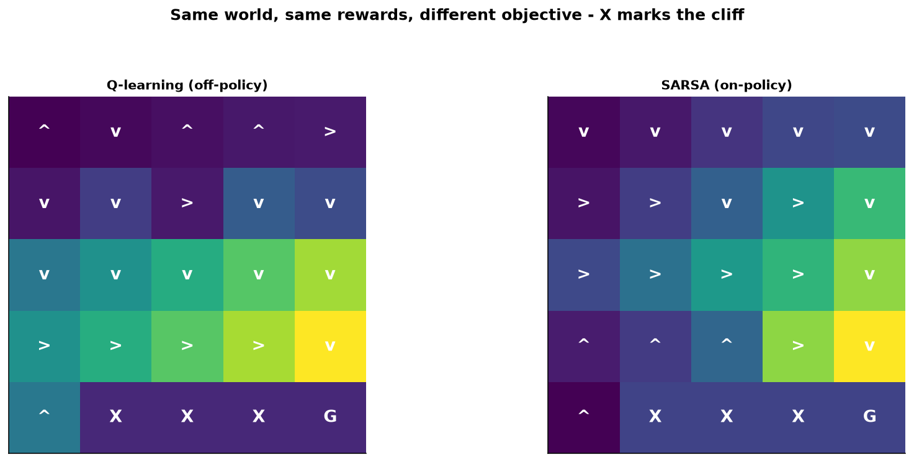

# Reinforcement Learning

> **Concept reference:** Foundations volume, Part A.18 (reinforcement learning)
> **Environment:** a 5×5 grid world, hand-written — no gym, no dependency
> **Runtime:** ~5 s on a laptop CPU

```bash
python 02_traditional_ml/09_reinforcement_learning/reinforcement_learning.py
```

Supervised learning is handed the right answer for every example. RL gets only a **reward**,
usually long after the action that earned it, and has to work out which decisions deserve the
credit. That **credit-assignment problem** is the whole subject.

The environment is written out in ~40 lines rather than imported. An RL example where the world is
a black box teaches you nothing about what the agent is actually solving.

---

## 1–2. Q-learning on a grid world



A 5×5 grid: start bottom-left, goal top-right, two penalty squares. **+10** goal, **−10** penalty,
**−1** every step. The Q-table is 25 states × 4 actions = **100 numbers, all starting at zero**. The
agent is told nothing — not the layout, not where the goal is, not that walls exist.

| | mean reward |
|---|---|
| first 50 episodes | **−16.62** |
| last 50 episodes | **+1.36** |

The learned policy:

```
 >  >  >  >  G
 v  X  >  >  ^
 >  >  ^  X  ^
 >  >  >  >  ^
 >  >  ^  ^  ^
```

The arrows steer **around** the penalty squares — learned only by stepping on them and being
punished. There was no rule saying "X is bad".

### The update rule is the whole algorithm

```
Q[s,a]  <-  Q[s,a] + alpha * ( r + gamma * max Q[s',:] - Q[s,a] )
                              └────────── TD error ──────────┘
```

The bracket is the **temporal-difference error**: the gap between what we thought this
state–action was worth and what it looks like now that we have seen the reward and the next state.
Value propagates **backwards from the goal, one square per visit** — which is why early episodes
look random and progress arrives suddenly rather than smoothly.

## 3. Exploration vs exploitation — and a result that contradicts the textbook



| epsilon | final-50 reward | states visited | reached goal |
|---|---|---|---|
| **0.00** | **3.00** | 22/25 | 5/5 |
| 0.05 | 2.01 | 22/25 | 5/5 |
| 0.20 | −1.79 | 22/25 | 0/5 |
| 0.50 | −9.09 | 22/25 | 0/5 |

**ε = 0 — pure exploitation, never a random action — gets the best reward.** So why does anyone
bother with exploration?

Because **this environment explores for free.** Q starts at zero and every step earns −1, so any
action already tried has a *negative* value while every untried action still sits at 0. `argmax`
therefore prefers the untried one. **Zero initialisation plus negative rewards is optimistic
initialisation** — a systematic, non-random exploration strategy hiding in the reward design.

### Testing that claim

Remove the −1 step cost so an untried action is no longer more attractive, and rerun the same agent:

| epsilon | reward | states visited |
|---|---|---|
| **0.00** | **0.00** | **0.0 / 25** |
| 0.05 | 9.20 | 14.2 / 25 |
| 0.20 | 7.52 | 17.0 / 25 |

**ε = 0 collapses completely: zero reward, zero states ever updated.** With no step cost and no
randomness the agent walks into the same wall forever. A tiny ε = 0.05 rescues it entirely.

> **The real lesson**, better than "always explore": exploration has to come from *somewhere*, but
> ε-greedy randomness is only one source. Optimistic initialisation, count-based bonuses and
> entropy regularisation are others — and a reward structure can supply it by accident.

On the original grid, high ε hurts for a different reason: a random step can land on a penalty and
end the episode at −10. Note that **all four settings visited 22 of 25 states** — exploration
damaged the reward *collected* while learning without damaging what was *learned*. Do not conflate
the two.

## 4. The discount factor

| gamma | final-50 reward | effective horizon |
|---|---|---|
| 0.00 | **−70.52** | 1 step |
| 0.50 | 1.28 | ~2 steps |
| **0.90** | **1.46** | ~10 steps |
| 0.99 | 1.40 | ~100 steps |

**γ = 0 makes the agent completely myopic** — every step looks like −1 and there is no reason to
prefer any direction, so it cannot solve a problem whose payoff is several steps away. As γ rises
the agent sees further; `1/(1−γ)` is the rough effective horizon.

> **γ is part of the problem definition, not a hyperparameter to tune for score.** Choosing it is
> choosing how much you care about the future — a recommender optimising at γ = 0 maximises the
> next click and burns long-term engagement.

## 5. Q-learning vs SARSA: off-policy and on-policy



Cliff walking, the Sutton & Barto setup — cliff reward **−100**, exploration **ε = 0.25**:

```
 .  .  .  .  .
 .  .  .  .  .
 .  .  .  .  .
 .  .  .  .  .    <- the risky route, one slip from the cliff
 S  X  X  X  G
```

| | mean reward, last 100 episodes |
|---|---|
| Q-learning (off-policy) | **−27.04** |
| **SARSA (on-policy)** | **−11.22** |

```
Q-learning                      SARSA
 ^  v  ^  ^  >                   v  v  v  v  v
 v  v  >  v  v                   >  >  v  >  v
 v  v  v  v  v                   >  >  >  >  v     <- crosses on row 2
 >  >  >  >  v    <- row 3       ^  ^  ^  >  v
 ^  X  X  X  G                   ^  X  X  X  G
```

**Q-learning routes along row 3, directly above the cliff — the shortest path. SARSA climbs to row
2 and crosses one square further from the edge.** Q-learning found the better *path* and collected
less than half the reward, because while it is still exploring it keeps falling off.

### The single line of difference

```python
if sarsa:
    target = r + gamma * Q[s2, a2]    # the action actually taken next
else:
    target = r + gamma * Q[s2].max()  # the BEST next action, taken or not
```

**Q-learning learns the value of the optimal policy while behaving exploratorily** — that is what
*off-policy* means. **SARSA learns the value of the policy it is actually following**, exploration
included, so a route that is only safe if you never slip gets marked down.

> Which you want depends on **whether exploration is free**. In a simulator, take Q-learning and
> the optimal path. On real hardware or a live system where a random action has a real cost,
> SARSA's caution is the correct objective, not a limitation.

---

## The exam angle

- **RL vocabulary:** agent, environment, state, action, reward, policy (π), value function (V),
  action-value function (Q), episode, trajectory.
- **Off-policy (Q-learning, DQN)** vs **on-policy (SARSA, PPO, A3C)** — expect this distinction
  directly. Off-policy can learn from a replay buffer or logged data; on-policy cannot.
- **Exploration/exploitation** is the classic RL question. ε-greedy, decaying ε, softmax/Boltzmann,
  UCB, optimistic initialisation.
- **γ is the discount factor**, `1/(1−γ)` is roughly the horizon.
- **A Q-table only works for small discrete state spaces.** Continuous or huge state spaces need
  function approximation → **Deep Q-Networks**, which is the same update with a neural network in
  place of the table.
- On Google Cloud: RL is niche. **Vertex AI has no managed RL service** — it is custom training.
  Where RL shows up in practice is **RLHF** for tuning language models, and contextual bandits for
  recommendations/ads.
- **Contextual bandits** are the one-step special case (no state transitions) and are far more
  common in industry than full RL.

---

## Things to try

1. Change `alpha` from 0.1 to 0.9. Learning is faster and much noisier — the agent overwrites its
   estimate on every sample instead of averaging.
2. Move the goal to the centre of the grid and rerun. Value now radiates outward from the middle,
   and you can watch it in the state-value heatmap.
3. Make the environment stochastic: with probability 0.2, move in a random direction instead of the
   chosen one. You might expect SARSA's advantage to grow. It **disappears** (+15.8 → −1.3): once
   slips are part of the *environment*, Q-learning's value estimates include them too, so it also
   learns to detour away from the cliff. SARSA's edge came from pricing in its own exploration,
   and environment noise prices that in for both.
4. Set the cliff penalty back to −10 and rerun section 5. Q-learning hugs the cliff; SARSA still
   takes a (shorter) detour, one row up for most of the way. The rewards nearly converge (−1.50 vs
   −1.91), so the cheap penalty makes caution cost slightly more than it saves. The magnitude of
   the penalty decides whether caution *pays*, even though SARSA still chooses it.
5. Initialise `Q = np.ones(...) * 20` (wildly optimistic) with ε = 0. The agent systematically
   sweeps every state before settling — optimistic initialisation in its explicit form.
