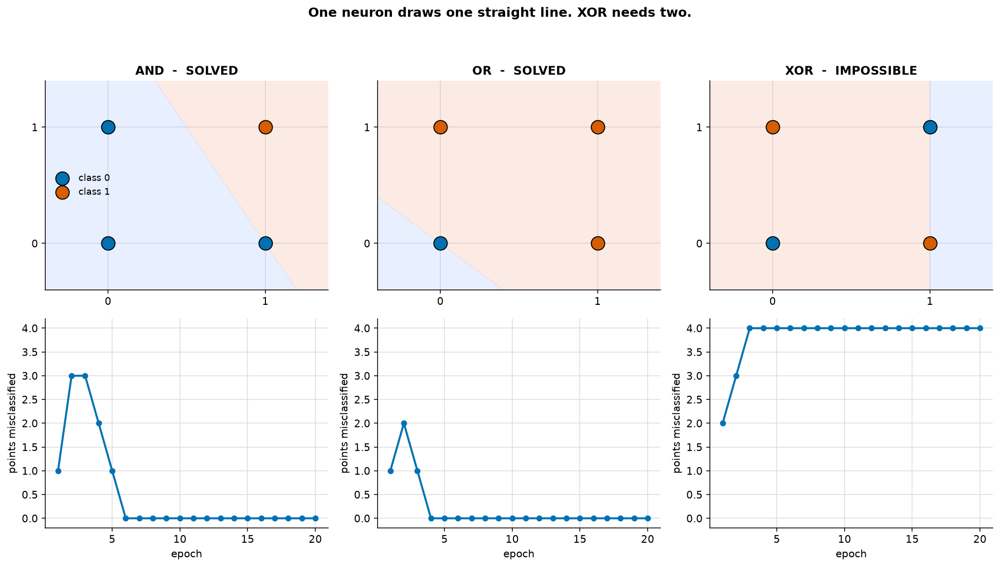
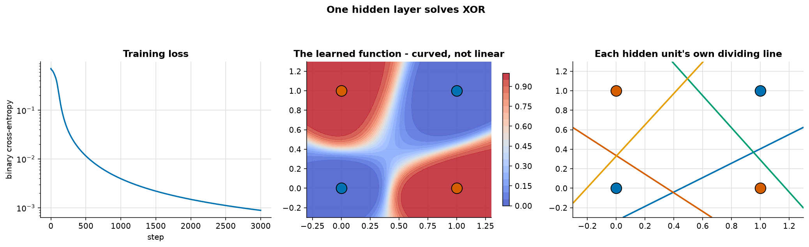
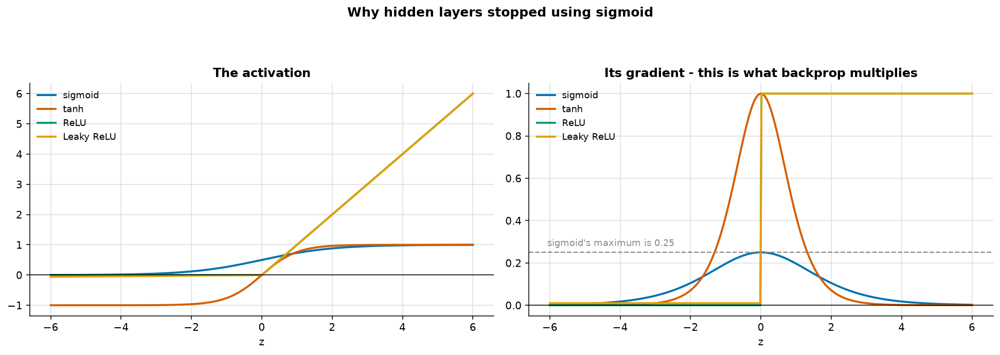

# The Perceptron, and Backpropagation by Hand

> **Concept reference:** Foundations volume, Parts B.1–B.5
> **Dependencies:** NumPy only — no TensorFlow, no PyTorch, no autograd
> **Runtime:** ~4 s on a laptop CPU

```bash
python 03_neural_networks/01_perceptron_from_scratch/perceptron.py
```

Every gradient here is derived on paper and typed in, then **verified numerically in section 4**.
The most useful thing you can do before picking up a framework is to have written the thing the
framework is doing for you.

---

## 1. One neuron draws one straight line



Rosenblatt's 1958 rule, unchanged — note there is no loss function and no gradient here, because it
predates both:

```python
prediction = step(w @ x + b)
# on a mistake:
w += lr * (target - prediction) * x
```

| problem | solved? | errors in final epoch |
|---|---|---|
| AND | ✅ | 0 |
| OR | ✅ | 0 |
| **XOR** | ❌ | **4** |

AND and OR are **linearly separable**, so the error count drops to zero and stays there. XOR is
not. Look at the bottom-right panel: the error count **never settles**. The rule keeps moving the
line forever, because no line exists.

> This is not slow convergence, it is **impossibility**. Minsky and Papert's 1969 proof of it
> stopped neural-network research for most of a decade.

## 2–3. One hidden layer, and backpropagation



Two inputs → 4 hidden units (tanh) → 1 output (sigmoid). **17 trainable parameters.**

| input | target | predicted |
|---|---|---|
| [0 0] | 0 | 0.0004 |
| [0 1] | 1 | 0.9988 |
| [1 0] | 1 | 0.9993 |
| [1 1] | 0 | 0.0013 |

Loss falls from 0.7094 to **0.000892** in 3,000 steps.

### The backward pass, in full

```python
n = len(y)
dz2 = (self.out.ravel() - y).reshape(-1, 1) / n   # sigmoid + BCE cancel exactly
dW2 = self.h.T @ dz2
db2 = dz2.sum(axis=0)
dh  = dz2 @ self.W2.T
dz1 = dh * (1 - self.h ** 2)                      # d/dx tanh = 1 - tanh²
dW1 = self.X.T @ dz1
db1 = dz1.sum(axis=0)
```

**The first line is the one worth memorising.** For a sigmoid output with binary cross-entropy
loss, `dL/dz2` is just `(prediction − target)` — the sigmoid derivative and the log in the loss
cancel exactly. That cancellation is *why* those two are always paired.

The right-hand panel of the figure shows each hidden unit's zero-crossing: its own personal
straight line. **The network's curved boundary is built entirely out of straight pieces.** That is
the whole idea of depth — compose simple functions into a complicated one.

## 4. Gradient checking

```
numerical = ( L(w + eps) − L(w − eps) ) / (2 * eps)
```

| parameter | max abs diff | relative error | verdict |
|---|---|---|---|
| W1 | 2.069e−11 | 4.138e−08 | **PASS** |
| b1 | 2.951e−11 | 5.034e−08 | **PASS** |
| W2 | 2.912e−11 | 3.239e−08 | **PASS** |
| b2 | 1.693e−11 | 2.121e−07 | **PASS** |

A relative error below ~1e−6 means the analytic and numerical gradients agree to the limits of
floating-point precision.

> If you ever write a backward pass by hand, **write this check first**. A transposed matrix or a
> dropped minus sign still trains, just badly, and you will blame the learning rate for a week.

And note the cost: **two full forward passes per parameter.** Fine for 17; impossible for 100
million. That is exactly why autograd exists — backprop gets every gradient in *one* backward pass.

## 5. Why hidden layers stopped using sigmoid



| activation | max gradient | gradient at z=4 | max⁠¹⁰ |
|---|---|---|---|
| sigmoid | **0.2500** | 0.017408 | **9.53e−07** |
| tanh | 0.9998 | 0.001301 | 9.98e−01 |
| ReLU | 1.0000 | 1.000000 | 1.00e+00 |
| Leaky ReLU | 1.0000 | 1.000000 | 1.00e+00 |

Backpropagation **multiplies** gradients layer by layer, so the *best* case for a 10-layer sigmoid
network is 0.25¹⁰ — about one part in a million.

> **Two honest caveats about that table.** It uses each activation's *maximum* gradient, attained
> only at exactly z=0, so real networks do considerably worse. And it makes tanh look as safe as
> ReLU, which it is not — tanh saturates at both ends just like sigmoid; it merely has slope 1 at
> the origin.

### So measure it instead

Gradient magnitude reaching each layer of a real 6-layer network:

| layer | sigmoid | ReLU | ReLU/sigmoid |
|---|---|---|---|
| **1** (input) | **1.394e−06** | 9.721e−04 | **697.5×** |
| 2 | 1.821e−05 | 1.041e−03 | 57.2× |
| 3 | 7.931e−05 | 1.073e−03 | 13.5× |
| 4 | 3.384e−04 | 9.138e−04 | 2.7× |
| 5 | 1.485e−03 | 5.982e−04 | 0.4× |
| **6** (next to loss) | **7.255e−03** | 5.339e−04 | 0.1× |

Read each column **top to bottom** — that is the gradient decaying as it propagates backwards:

- **sigmoid attenuates by 5,206×** from layer 6 to layer 1
- **ReLU attenuates by 0.5×** — essentially flat

The sigmoid network's input layer receives a gradient ~5,000× smaller than its output layer. It is,
for practical purposes, **not being trained at all.** ReLU's gradient is exactly 1 wherever the
unit is active, so it multiplies out to 1 no matter how deep the network — and that single property
is most of why deep learning started working in 2012.

ReLU's own failure mode is the **dead unit**: gradient is exactly 0 for negative inputs, so a unit
pushed firmly negative stops updating permanently. Leaky ReLU's 0.01 slope exists to prevent that.

---

## The exam angle

- **A single linear unit cannot solve a non-linearly-separable problem.** Adding a hidden layer is
  the fix, not more training or a bigger learning rate.
- **Vanishing gradients** → ReLU family, residual connections, batch/layer normalisation, careful
  initialisation. Expect sigmoid-in-hidden-layers as a wrong answer.
- **Sigmoid + binary cross-entropy** and **softmax + categorical cross-entropy** are the standard
  pairings, because the derivative simplifies to `(prediction − target)`.
- **Initialisation matters**: Xavier/Glorot for tanh/sigmoid, He for ReLU. All-zero weights make
  every unit identical and the network can never break symmetry.
- **Dead ReLU** → Leaky ReLU, ELU, or a lower learning rate.
- Universal approximation says one hidden layer *can* represent any continuous function — it says
  nothing about how wide it must be or whether you can train it. Depth is about efficiency.

---

## Things to try

1. Set `n_hidden=1` in `TinyNet` and retrain on XOR. It fails — one hidden unit is one line, so
   you are back to the perceptron. At 2 it works.
2. Initialise `W1` and `W2` to all zeros. Every hidden unit receives an identical gradient forever
   and the network never breaks symmetry. This is why initialisation is random.
3. Swap `tanh` for `sigmoid` in the hidden layer (and change `dz1` to `h * (1 - h)`). XOR still
   trains, but noticeably slower — tanh is zero-centred, sigmoid is not.
4. Break the gradient on purpose: change `dz1 = dh * (1 - self.h ** 2)` to `dh * self.h`. The
   gradient check fails immediately, and training still *partly* works — which is exactly the
   silent-failure scenario the check exists to catch.
5. Raise the learning rate. At 5.0 XOR still trains (a few early bumps, then a lower final loss
   than at 0.5). At 50 it fails, but not with a NaN: the loss bounces on every other step and
   settles at 10.36, with the network predicting 1 for all four inputs. The `np.clip` in `loss()`
   caps each log term at −log(1e-9) ≈ 20.7, so a saturated network shows a flat, large loss rather
   than an overflow. Deriving your own gradients does not save you from an unstable step size, and
   a guard in the loss can hide the blow-up you were expecting to see.
