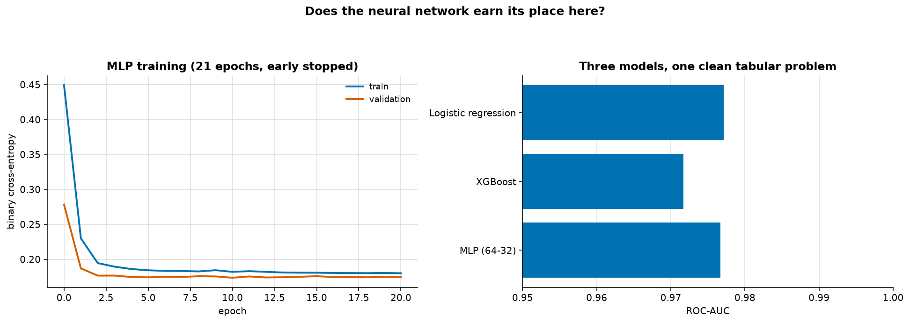
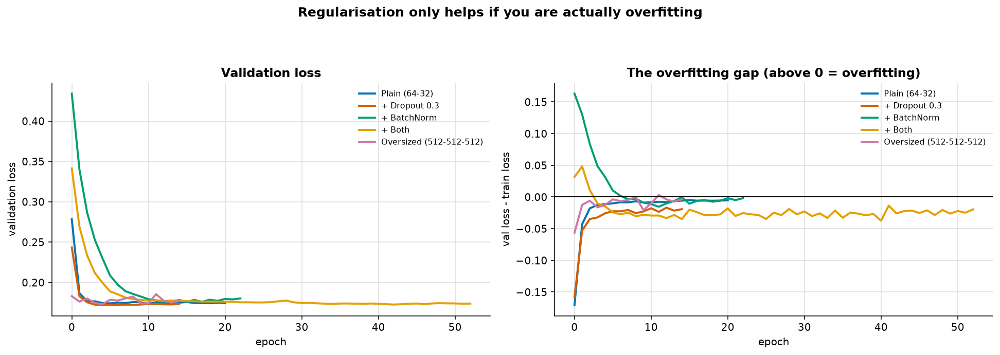
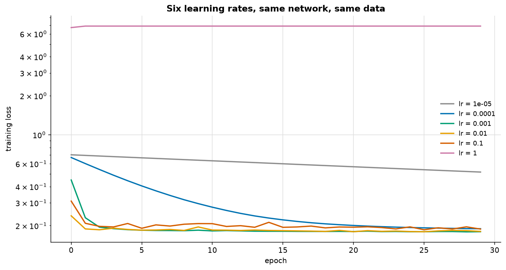

# A Multilayer Perceptron on Tabular Data

> **Concept reference:** Foundations volume, Parts B.6–B.9
> **Dataset:** Rice (3,810 × 7), split 2,438 train / 610 val / 762 test
> **Runtime:** ~2 min on a laptop CPU
> **Requires:** `pip install -r requirements-dl.txt` (Keras 3 + a backend)

```bash
python 03_neural_networks/02_mlp_tabular/mlp_tabular.py
```

This is the repository's first Keras model, and the most important question it answers is not
*"how do I build an MLP"* but ***"should I"***.

---

## 1–2. Does the network earn its place?



| model | accuracy | ROC-AUC | params | fit s | epochs |
|---|---|---|---|---|---|
| MLP (64-32) | 0.9160 | 0.9767 | 2,625 | 3.99 | 21 |
| XGBoost | 0.9147 | 0.9717 | 8,166 | 0.36 | 300 |
| **Logistic regression** | **0.9213** | **0.9771** | **8** | **0.01** | 1 |

**Logistic regression wins.** The MLP has 2,625 parameters, took **268× longer to fit**, and
delivered **−0.0004 ROC-AUC** for it. Total spread across all three: 0.0055.

> This is the honest state of neural networks on small tabular data: **competitive, not dominant**,
> and far more expensive in tuning, training time and operational complexity. Gradient-boosted
> trees remain the default because they need no scaling, no architecture choice and no
> learning-rate search.

Neural networks do earn their place on tabular data — when you have **high-cardinality
categoricals worth embedding** (see [06_embeddings](../06_embeddings/)), when you must **fuse
tabular data with text or images** in one model, or when the dataset is large enough that trees
stop scaling.

### What the framework is and isn't doing

Compared with the NumPy network in [01](../01_perceptron_from_scratch/), Keras derives the
gradients, runs Adam instead of plain SGD, batches the data, and handles the train/eval switch for
dropout and batch norm. It does **not** choose the architecture, the preprocessing, or the learning
rate — and those are what decide the outcome.

## 3. Regularisation, measured rather than assumed



| variant | val loss | test AUC | params | epochs | gap |
|---|---|---|---|---|---|
| Plain (64-32) | 0.1735 | 0.9767 | 2,625 | 21 | **−0.005** |
| + Dropout 0.3 | **0.1717** | 0.9764 | 2,625 | 15 | −0.019 |
| + BatchNorm | 0.1759 | 0.9757 | 3,009 | 23 | −0.002 |
| + Both | 0.1726 | 0.9768 | 3,009 | 53 | −0.020 |
| Oversized (512-512-512) | 0.1730 | 0.9768 | **529,921** | 15 | −0.004 |

**The `gap` column — validation loss minus training loss — is negative in every row.** Nothing here
is overfitting, so nothing here needs regularising, and none of the variants meaningfully helps.

Rice has 3,800 rows, 7 well-behaved features and two well-separated classes. There is very little
to overfit *to*. **Dropout and batch norm are answers to a problem this data does not have.**

The **oversized** row is the interesting one: 529,921 parameters against 2,438 training rows — over
200 parameters per example — and it still does not collapse, because early stopping catches it
first. **Capacity alone does not cause overfitting; capacity plus enough epochs does.**

| technique | what it actually does |
|---|---|
| **Dropout** | zeroes activations **during training only**, so no unit can rely on another. Off at predict time, activations rescaled — which is why train and test loss are not comparable while it is on. |
| **Batch norm** | standardises each layer's pre-activations using **batch** statistics, then learns a scale and shift. Mainly stabilises and accelerates training; the regularisation is a side effect of batch noise. |
| **Early stopping** | the cheapest regulariser there is. On in every run above — watch the epoch counts differ. |

## 4. The learning rate



30 epochs at each rate, no early stopping, so the curves are comparable. Chance-level loss is 0.693.

| learning rate | final train loss | best val loss | behaviour |
|---|---|---|---|
| 1e−05 | 0.5170 | 0.5179 | too slow — still descending |
| 1e−04 | 0.1891 | 0.1780 | healthy |
| **1e−03** | **0.1794** | **0.1735** | healthy *(Adam's default)* |
| 1e−02 | 0.1804 | 0.1742 | healthy |
| 1e−01 | 0.1879 | 0.1757 | healthy |
| **1e+00** | **6.8955** | 6.8964 | **BROKEN — worse than guessing** |

**The healthy band spans three orders of magnitude** (1e−4 to 1e−1) — wider than people expect, and
why Adam's 1e−3 default so often just works.

At **1e−5** the steps are too small to leave the starting region in 30 epochs. It looks like a bad
model and is not — it is an *under-trained* one.

At **1.0** the loss sits at 6.9, **ten times above chance**. Each step overshoots so badly that the
weights land somewhere worse than random initialisation, and Adam cannot recover.

> A loss that rises, plateaus high, or goes NaN is almost always **the learning rate** — not the
> architecture, not the data. Check it before changing anything else.

## 5. Preprocessing is not optional

Rice's features range from `extent` (~0.5) to `area` (~15,000):

| input | test ROC-AUC | epochs run |
|---|---|---|
| Standardised | **0.9767** | 21 |
| **Raw (unscaled)** | **0.5000** | 11 |

**0.5000 is exactly chance.** The network learned nothing at all.

The gradient with respect to a weight is proportional to its input, so `area` produces gradients
~30,000× larger than `extent`. One learning rate cannot serve both — it is either far too large for
one weight or far too small for the other.

> This is the **same lesson** as k-means in [02_traditional_ml/03](../../02_traditional_ml/03_clustering/)
> and PCA in [/04](../../02_traditional_ml/04_dimensionality_reduction/), arriving for a third time
> by a different route. Anything that combines features by **weighted sums or distances** needs
> them on comparable scales. Trees, which only ever compare a feature to a threshold, are the
> exception.

---

## The exam angle

- **Tabular data → try gradient-boosted trees first.** An option proposing a deep network for a
  small tabular problem is usually the distractor. On Vertex AI this is AutoML Tabular territory.
- **Always scale inputs for a neural network.** Never necessary for trees.
- **Dropout is inactive at inference.** Expect a question about train/serve differences.
- **Batch norm uses batch statistics in training and running averages at inference** — a classic
  source of train/serve skew with small batches.
- **Learning rate is the first hyperparameter to tune**; Vertex AI Vizier / Hypertune exists mostly
  for this.
- **Early stopping needs a validation set**, and `restore_best_weights=True` matters — without it
  you keep the *last* weights, not the best.

---

## Things to try

1. Remove `EarlyStopping` from the oversized network and train 300 epochs. Now it overfits properly
   and dropout finally earns its keep — the technique was never wrong, the situation was.
2. Swap Rice for Adult Income (`load_adult`), which has real categorical columns. The MLP's
   position improves once there is something to embed.
3. Set `batch_size=2048`. Batch norm degrades noticeably — fewer, larger batches mean less batch
   noise, and part of its regularising effect comes from that noise.
4. Replace `Adam` with plain `SGD(learning_rate=1e-3)`. The healthy band narrows sharply; Adam's
   per-parameter step sizes are doing more work than they get credit for.
5. Scale with `MinMaxScaler` instead of `StandardScaler`. Both work; the failure in section 5 is
   about *scale mismatch*, not about which scaler you pick.
