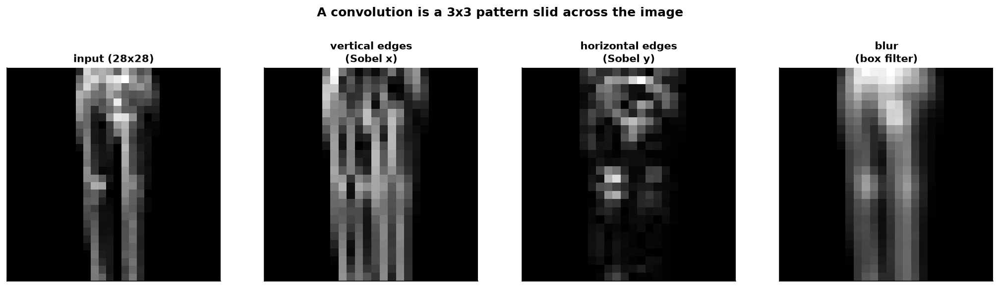
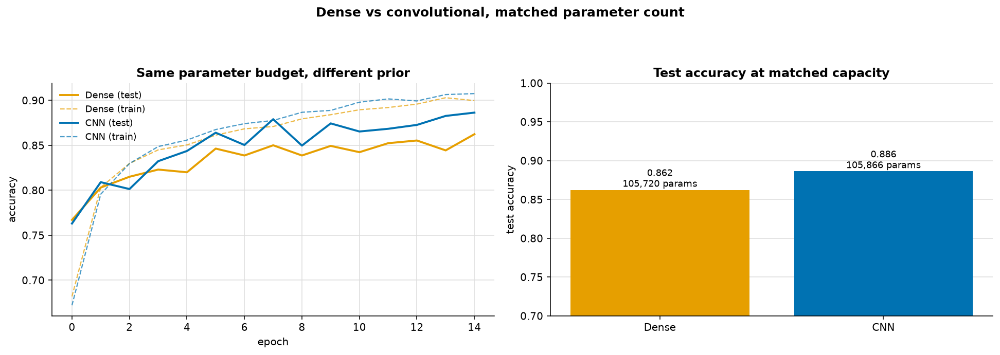
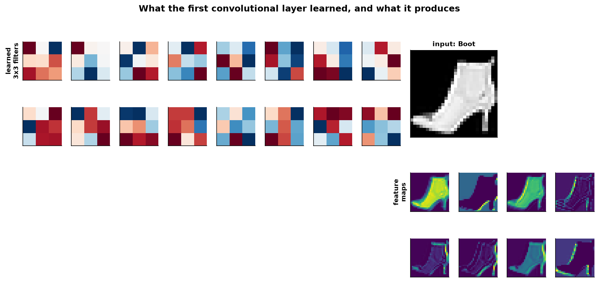
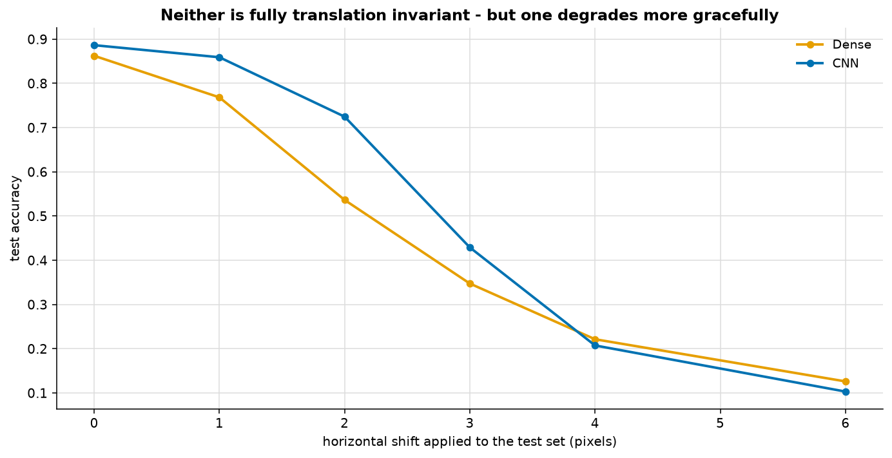
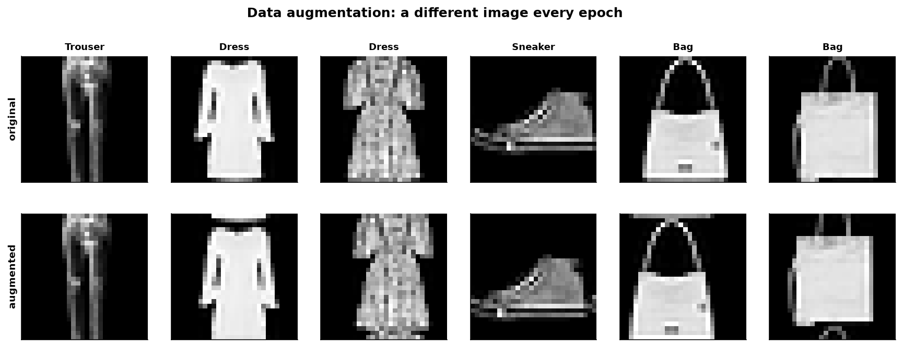

# Convolutional Neural Networks

> **Concept reference:** Foundations volume, Parts B.10–B.12
> **Dataset:** Fashion-MNIST, subsampled to 10,000 train / 3,000 test
> **Runtime:** ~1 min 50 s on a laptop CPU

```bash
python 03_neural_networks/03_cnn_images/cnn_images.py
```

Fashion-MNIST rather than plain MNIST on purpose: MNIST is so easy that a dense network reaches
98% and the comparison shows nothing.

---

## 1. What a convolution actually computes



A 3×3 filter has **9 weights**. It is slid across all 28×28 positions, taking a dot product at
each, and the output says **where** that pattern occurred. The three filters here are hand-built
Sobel edge detectors — not learned — so you can see that a filter is just a pattern matcher.

Two consequences, and they are the entire argument for CNNs:

| | |
|---|---|
| **Locality** | a pixel is compared only with its neighbours, because that is where the information in an image lives |
| **Weight sharing** | the *same* 9 weights are reused at every position, so a vertical edge is detected anywhere in the frame without being learned separately per location |

> A dense layer has **neither** property. You could shuffle all 784 pixel columns and it would
> train identically — which tells you exactly how much spatial information it discards.

## 2. Dense vs CNN at a matched parameter budget



A CNN beating a *tiny* dense network proves nothing, so the dense width is chosen automatically
(124) to match the CNN's parameter count:

| model | params | train acc | test acc | fit s |
|---|---|---|---|---|
| Dense | 105,720 | 0.8997 | 0.8623 | 9.0 |
| **CNN** | 105,866 | 0.9075 | **0.8863** | 29.2 |

**+0.0240 test accuracy at equal capacity — a 17% reduction in error rate** (0.138 → 0.114).

Both networks have the same capacity and saw the same data. The difference is entirely the
**architectural prior**: the CNN was told by construction that the input is a grid and that
patterns are worth reusing. The dense network had to discover that from 10,000 examples, and
largely did not.

Note the train/test gaps too — dense **+0.037**, CNN **+0.021**. Weight sharing is a regulariser:
far fewer independent weights means less to memorise.

> **An earlier version of this ran 6 epochs and found only +0.005.** The CNN was simply
> undertrained — it is still climbing at epoch 10 while the dense net has flattened. Stopping a
> comparison early does not make it fair, it makes it wrong.

## 3. What the first layer learned



16 filters of 3×3 = 9 weights each, 160 weights for the whole layer. Red and blue are positive and
negative weights. **Several filters show a clear light/dark split across the patch — those are edge
detectors, and the network invented them without being told edges matter.** The same thing the
hand-built Sobel filter was doing in section 1.

The feature maps on the right are one image seen through eight different filters; each highlights a
different structure. Depth works by stacking this — layer 2 combines edges into corners and
textures, layer 3 into object parts.

## 4. Translation invariance, tested



Shift every **test** image horizontally. Neither model saw a shifted image during training:

| shift (px) | Dense | CNN | gap |
|---|---|---|---|
| 0 | 0.8623 | 0.8863 | +0.024 |
| 1 | 0.7683 | 0.8590 | +0.091 |
| 2 | 0.5363 | 0.7247 | **+0.188** |
| 3 | 0.3473 | 0.4290 | +0.082 |
| 4 | 0.2213 | 0.2073 | −0.014 |
| 6 | 0.1260 | 0.1030 | −0.023 |

The CNN holds up far better over 1–3 pixels — its lead peaks at +0.19 at a 2-pixel shift — and by
4 pixels **both have collapsed** towards chance (0.10), the CNN marginally the worse. Both degrade, and it is worth being precise about **why the CNN is only partially invariant**:

- **Convolution is equivariant, not invariant.** Shift the input and the feature maps shift with
  it.
- **Max-pooling** then discards position *within* each 2×2 window, buying a little true invariance
  per pooling layer — about 4 pixels of slack with two pooling layers here.
- Beyond that the flattened features genuinely differ, and accuracy falls.

Full translation invariance comes from **global pooling**, or from augmentation.

## 5. Data augmentation — which did not work here



Same CNN, same 15 epochs, with a random ±3px shift and horizontal flip applied **per image, fresh
every batch**:

| | train acc | test acc | gap | fit s |
|---|---|---|---|---|
| CNN, plain | 0.9075 | **0.8863** | +0.0212 | 29.2 |
| CNN, augmented | 0.8307 | 0.8223 | **+0.0084** | 37.1 |

**Test accuracy −0.064.** Augmentation *hurt*, and that is reported rather than tuned away.

But look at the gap column before concluding it failed: **+0.021 → +0.008. Most of the
overfitting is gone.** The regularisation mechanism worked as advertised.

> **Part of what went wrong is the budget.** Augmentation makes the training task harder, so the
> model needs more epochs to reach the same fit, and at a fixed 15 both train and test accuracy
> are still climbing. **But budget is not the whole story.** Trained for 40 epochs, the augmented
> CNN reaches 0.8663 against the plain CNN's 0.8913. The gap narrows from −0.064 to −0.025 but
> never closes: the augmented model is behind at every one of the 40 epochs. Wrap-around shifts
> and flips make *training* images that the unshifted test set never contains, and on a model that
> was barely overfitting there is little for that extra variety to buy.

The second reason is that the plain CNN was only mildly overfitting to begin with — the same lesson
as regularisation in [02_mlp_tabular](../02_mlp_tabular/): **it only helps if you are actually
overfitting.**

### A performance note worth keeping

Keras' `RandomTranslation`/`RandomFlip`/`RandomZoom` layers cost **~38 s per epoch** on this CPU
against ~3 s for the model itself — they dominated the runtime twelve to one. The same transforms
written with `np.roll` and a slice run in a fraction of that, and are considerably clearer about
what augmentation actually is.

---

## The exam angle

- **Images → CNN, not a flattened dense network.** The prior is worth more than the parameters.
- **Convolution is equivariant; pooling adds invariance.** Expect this distinction.
- Know the shapes: `Conv2D(filters, kernel_size)` with `padding='same'` preserves H×W; each
  `MaxPooling2D(2)` halves it.
- **Augmentation choices must respect the domain** — horizontal flip is fine for clothing, wrong
  for digits and text.
- **Transfer learning** is the real-world answer for images: take a pretrained backbone, freeze it,
  retrain the head. On Vertex AI that is Model Garden; in Keras, `keras.applications`.
- Parameter count of a conv layer is `(kh × kw × in_channels + 1) × out_channels` — independent of
  image size, which is the whole point.

---

## Things to try

1. Train both models for 40 epochs instead of 15. The augmented CNN closes most of the gap
   (0.8223 → 0.8663) but does **not** overtake the plain one (0.8913), at any epoch. Try a smaller
   `max_shift`, or drop the flip, and see which part of the augmentation costs accuracy.
2. Replace `Flatten()` with `GlobalAveragePooling2D()`. Parameters drop sharply and the translation
   curve in section 4 flattens out, because position is discarded entirely.
3. Add a third Conv2D block. Accuracy improves a little; training time roughly doubles.
4. Set `padding='valid'` instead of `'same'`. Each conv shrinks the feature map, and you can watch
   the arithmetic in `model.summary()`.
5. Run it on plain MNIST by swapping the loader. The dense/CNN gap nearly vanishes — which is
   exactly why this example does not use MNIST.
