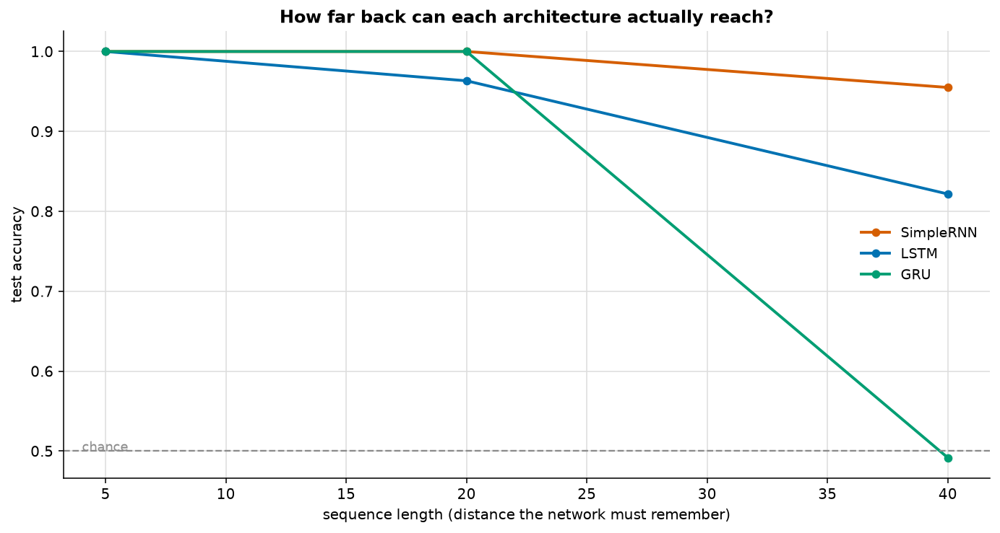
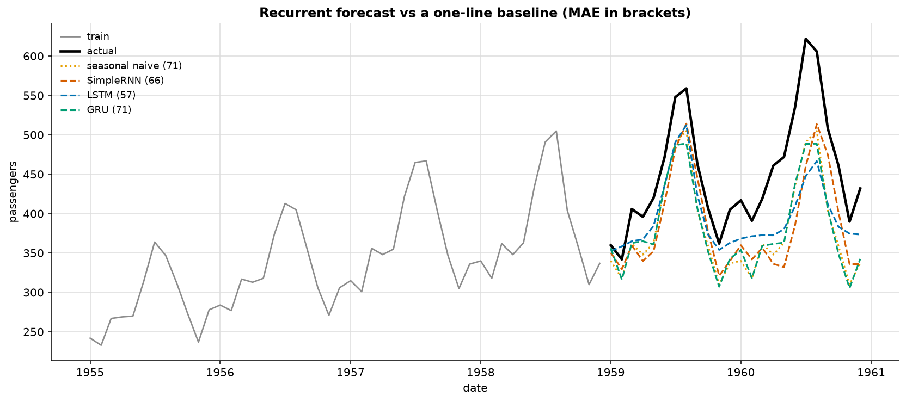

# Recurrent Networks: RNN, LSTM, GRU

> **Concept reference:** Foundations volume, Parts B.13–B.15
> **Data:** a synthetic copy task, plus the airline series from [02_traditional_ml/06](../../02_traditional_ml/06_time_series/)
> **Runtime:** ~3 min on a laptop CPU

```bash
python 03_neural_networks/04_rnn_lstm_gru/rnn_lstm_gru.py
```

---

## 1. Why a sequence is not a bag of features

A dense layer can tell `[1,3]` from `[3,1]` only because they land in different columns. What it
cannot do is generalise the rule to length 5, or 50, or a variable length — every length would need
its own model.

A recurrent layer applies the **same weights at every timestep** and carries a hidden state:

```
h_t = tanh(W_x · x_t  +  W_h · h_{t-1}  +  b)
```

That is the same weight-sharing idea as a CNN, applied **along time instead of space** — and the
parameter count does not grow with sequence length.

## 2. The memory horizon — where the textbook result did not reproduce



Copy task: the label is the sign of the **first** value; every later step is N(0,1) noise of the
same magnitude. 40 epochs each.

| sequence length | SimpleRNN | LSTM | GRU | params (LSTM) |
|---|---|---|---|---|
| 5 | 1.000 | 1.000 | 1.000 | 2,521 |
| 20 | **1.000** | 0.963 | **1.000** | 2,521 |
| 40 | **0.955** | 0.822 | 0.492 | 2,521 |

**The architectures designed to remember longer did worse than the one they replaced.** This is
left in rather than re-run until it agrees with the folklore.

### Why

- **This is the easiest kind of memory.** One value must be held and nothing ever needs forgetting.
  A SimpleRNN whose recurrent weight sits near 1 simply passes the state along — it does not need a
  gate for that, it needs only not to interfere.
- **The gates must be learned.** Keras already applies the standard fix — the forget-gate bias
  starts at 1 (`unit_forget_bias=True`, the default), so the gate opens at sigmoid(1) ≈ 0.73 rather
  than 0.5. That still leaks about a quarter of the cell state every step. Before it can remember
  anything the LSTM must learn to hold that gate fully open, and with 3–4× the parameters and a
  fixed budget it often does not get there.
- **The classic demonstrations use harder tasks.** The adding problem and sequential MNIST require
  *selective* memory: keep this, drop that. That is what gates are for, and this task never asks.

> **An architectural advantage is conditional on the task and the training budget**, not a property
> the architecture carries around with it. LSTM does not have "more memory" in the abstract — it
> has **selective** memory, which costs parameters and optimisation difficulty and only pays when
> the problem needs selectivity.

An earlier version of this table ran 12 epochs and scored the LSTM at 0.512 on length 40. With 40
epochs it reaches 0.822 at length 40 and 0.963 at length 20. **Undertraining one arm of a comparison is the
same mistake as the 6-epoch CNN** in [03](../03_cnn_images/).

## 3. What the gates actually do

A SimpleRNN overwrites its whole state each step and has no way to *decide* to keep something. An
LSTM adds a separate **cell state** with an almost-linear path through time, plus three gates:

| gate | controls |
|---|---|
| **forget** `f_t` | what to drop from `c_{t-1}` |
| **input** `i_t` | what to write from this step |
| **output** `o_t` | what to expose as `h_t` |

```
c_t = f_t * c_{t-1}  +  i_t * candidate_t
h_t = o_t * tanh(c_t)
```

**The important line is `c_t`.** When the forget gate is near 1 and the input gate near 0, `c_t` is
almost exactly `c_{t-1}` — copied forward with *no matrix multiply and no squashing*. The gradient
flows back along that path essentially undamped, which is precisely what the SimpleRNN lacks.

A **GRU** merges forget and input into one update gate and drops the separate cell state: ~25%
fewer parameters, usually equivalent accuracy. Try GRU first.

| | params (24 units) | vs SimpleRNN |
|---|---|---|
| SimpleRNN | 649 | 1.0× |
| GRU | 1,969 | ~3× |
| LSTM | 2,521 | ~4× |

## 4. A real forecast — where the ranking reverses



Airline passengers, 12-month input window, 24-month held-out horizon, **recursive** multi-step.
Modelled on `log(y)` because the seasonality is multiplicative.

| model | MAE | vs seasonal naive | params |
|---|---|---|---|
| seasonal naive | 71.2 | — | 0 |
| SimpleRNN | 66.4 | 0.93× | 649 |
| **LSTM** | **57.2** | **0.80×** | 2,521 |
| GRU | 70.7 | 0.99× | 1,969 |

**The LSTM is clearly best here — 20% better than the baseline** — having lost the toy task in
section 2. Same point from the other side: the gates pay for themselves when there is structure
worth selectively remembering, and cost you when there is not.

> **Two caveats that keep this honest.** 108 training windows is a very small dataset for thousands
> of parameters, so beating a zero-parameter rule is not a triumph. And a single 24-month split is
> *one sample*, not an estimate — walk-forward validation would be the honest way to claim a real
> improvement.

---

## The exam angle

- **Sequences → recurrent or attention-based models**, not a flattened dense layer.
- **LSTM/GRU exist to fix the vanishing gradient over time.** Know the cell state and the three
  gates; know that GRU has two gates and fewer parameters.
- **RNNs cannot be parallelised across time** — strictly left to right. That limitation is the
  entire motivation for the transformer ([05](../05_transformer_attention/)).
- **Bidirectional** layers see the whole sequence, so they are fine for classification and
  impossible for real-time forecasting.
- For time series on Google Cloud, **BigQuery ML `ARIMA_PLUS`** and Vertex AI Forecasting are the
  managed answers; a hand-built LSTM is rarely the recommended option.
- Always compare against the seasonal-naive baseline.

---

## Things to try

1. Build the LSTM with `unit_forget_bias=True` (Keras' default, bias 1) versus
   `unit_forget_bias=False` (bias 0). Measured: length 20 drops from 0.963 to 0.527, but length 40
   *rises* from 0.822 to 0.908. A change to one initial bias moves the result by up to 0.44 in
   either direction — the clearest evidence that section 2 is an *optimisation* result rather than
   a capacity one, and that a single run of it should not be over-read.
2. Switch the copy task to the **adding problem** — two marked positions whose values must be
   summed while everything else is ignored. That needs selective memory, and the gated models
   should finally pull ahead.
3. Lower the noise in `make_copy_task` from 1.0 to 0.2. The SimpleRNN then solves length 100
   perfectly — the task stops testing memory and starts testing signal detection.
4. Make the forecast layer `Bidirectional(LSTM(24))`. It will look better and is **cheating** for
   forecasting: it sees future timesteps inside the window.
5. Replace the recursive forecast with a direct multi-output head predicting all 24 months at once.
   Error stops compounding, and the comparison against section 2 of the time-series example becomes
   exact.
