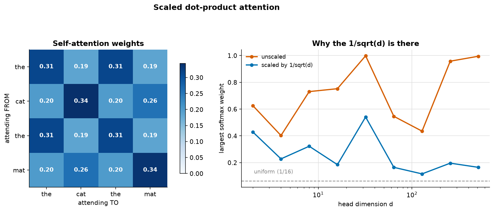
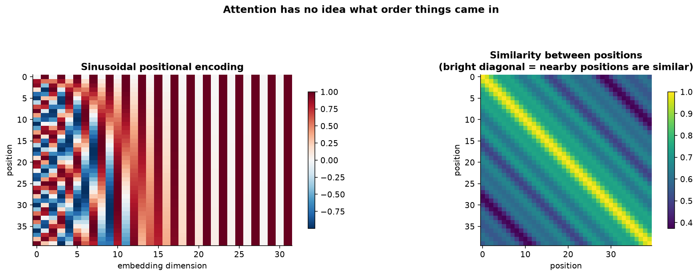
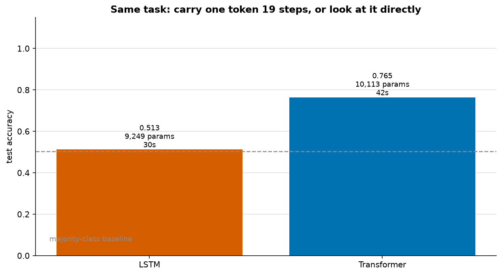

# Attention and the Transformer

> **Concept reference:** Foundations volume, Parts B.16–B.18
> **Runtime:** ~2 min 10 s on a laptop CPU
> **Data:** a 4-token worked example, plus a synthetic set-membership task

```bash
python 03_neural_networks/05_transformer_attention/transformer_attention.py
```

The transformer replaced recurrence with one idea: instead of carrying state forward step by step,
let every position look directly at every other position. That removes the sequential bottleneck —
which is why these models could be scaled.

---

## 1. Attention is four lines



```python
d       = Q.shape[-1]
scores  = Q @ K.T / np.sqrt(d)   # how well does each query match each key
weights = softmax(scores)        # turn them into a distribution
output  = weights @ V            # a weighted average of the values
```

Everything else in a transformer — multiple heads, layer norm, the feed-forward block, residual
connections — is scaffolding around those lines.

Four tokens, `Q = K = V = E` (which is what makes it *self*-attention):

| | the | cat | the | mat |
|---|---|---|---|---|
| **the** | 0.314 | 0.186 | **0.314** | 0.186 |
| **cat** | 0.200 | 0.344 | 0.200 | 0.256 |
| **the** | 0.314 | 0.186 | **0.314** | 0.186 |
| **mat** | 0.201 | 0.259 | 0.201 | 0.339 |

Every row sums to 1 — each token distributes a fixed budget of attention. Token 0 (`the`) gives
**0.314** to token 2, the *other* `the`, and only 0.186 to `cat`. Nothing told it those tokens were
related; it fell out of the dot product.

### Why the `1/√d` is not cosmetic

| d | raw score range | max softmax weight | scaled |
|---|---|---|---|
| 4 | −1.61 … 2.27 | 0.272 | 0.201 |
| 64 | −14.18 … 6.37 | 0.534 | 0.249 |
| **512** | −55.08 … 47.12 | **1.000** | 0.574 |

At d=512 the unscaled softmax puts essentially **all** its mass on one token — it has become a hard
argmax with almost no gradient. The scaling keeps the distribution soft enough to learn from.

## 2. Attention cannot see order



Run attention on 5 tokens, shuffle them, run again:

```
Are the outputs identical (just reordered)?  True
Max absolute difference: 4.44e-16
```

The difference is floating-point rounding (sums taken in a different order), not a real one.

**Attention is permutation equivariant — it sees an unordered *set*.** *"dog bites man"* and
*"man bites dog"* are the same input. That is a fatal defect for language, and positional encoding
is the fix: position information is **added to the embeddings before attention runs**.

Sinusoidal encodings need no training and extrapolate to sequences longer than any seen in
training. Modern models mostly use **learned** positional embeddings, or **rotary (RoPE)**, which
rotates Q and K by an angle proportional to position and so encodes *relative* distance directly.

## 3–4. A tiny transformer against an LSTM



Task: **does the first token reappear later in the sequence?** 20 tokens, vocabulary of 28, 52%
positive, majority-class baseline 0.504.

| model | params | test acc | fit s |
|---|---|---|---|
| LSTM | 9,249 | **0.513** ← chance | 30.4 |
| **Transformer** | 10,113 | **0.765** | 41.6 |

**The LSTM never leaves chance. The transformer reaches 0.765** — and this is a real separation,
not a budget artefact: both had 35 epochs, and the LSTM had flattened while the transformer was
still climbing.

The transformer compares position 0 against every other position in **one operation** — literally
what a query scored against a set of keys computes. The LSTM must carry the first token's identity
across 19 steps while 19 other tokens overwrite it.

> **Note the contrast with [04](../04_rnn_lstm_gru/), where the LSTM *won* the forecasting task by
> 20%.** Forecasting needs a compressed summary of recent history — what a recurrent state is for.
> Set membership needs exact comparison against every position — what attention is for.
> **Match the mechanism to the question**, rather than ranking architectures in the abstract.

### The structural difference that actually mattered historically

| | sequential steps | work |
|---|---|---|
| RNN | **O(L)** — step *t* cannot start until *t−1* finishes | O(L) |
| Attention | **O(1)** — every position computed at once | O(L²) |

That is why transformers scaled and RNNs did not. **Not because attention is smarter, but because
it is parallelisable**, which let models grow by four orders of magnitude. The O(L²) cost in
sequence length is the price, and it is why long-context work is full of attention approximations.

### A backend gotcha worth keeping

Building the positional embedding with `keras.ops.arange(length)` directly in a functional model
evaluates it **once**, at construction time, baking a constant into the graph. On the torch backend
that raises *"Trying to backward through the graph a second time"* on the second training step. It
has to be built inside a layer's `call()` so the positions are produced fresh each forward pass.

---

## The exam angle

- **Q, K, V** and scaled dot-product attention — expect the formula.
- **Self-attention** = Q, K, V from the same sequence. **Cross-attention** = Q from one, K and V
  from another — how a decoder reads an encoder, and how **RAG** grounds a model in retrieved
  documents.
- **Positional encoding is required** because attention is order-blind.
- **Encoder-only** (BERT) for understanding/classification; **decoder-only** (GPT, Gemini) for
  generation; **encoder-decoder** (T5) for translation-style tasks.
- **Residuals + layer norm** around each sub-block make deep stacks trainable — the same
  gradient-highway idea as the LSTM cell state.
- **O(L²) attention** is why context windows are expensive, and the motivation for FlashAttention,
  sliding-window and sparse variants.
- On Google Cloud, this is the machinery under **Model Garden**, and Vertex AI's embedding models
  are transformer encoders.

---

## Things to try

1. Set `heads=1` in `build_transformer`. You might expect accuracy to drop, since one head must
   serve every relationship at once. Measured, it **rises to 0.999** (from 0.765 with four). This
   task needs exactly one relationship — "compare everything to position 0" — and a single head
   with the full 32-dimensional key space learns it easily, where four heads of 8 dimensions each
   split the capacity. More heads is not automatically better.
2. Delete the `AddPositionEmbedding` layer. Accuracy **falls to 0.533**, back to chance. The task
   sounds order-free ("does the token reappear?") but it is not: without positions, attention
   cannot tell *which* token is the first one, so "the first token" is undefined. Positional
   encoding is needed whenever the answer depends on where a token sits, and that is more often
   than it looks.
3. Remove the residual connections (`x + att` → `att`). Training becomes visibly less stable.
4. Raise `length` from 20 to 60 and watch fit time grow roughly quadratically for the transformer
   and linearly for the LSTM — the O(L²) cost, measured.
5. Return the attention scores with `return_attention_scores=True` and plot them for one positive
   example. Position 0 should attend to wherever the repeat occurs.
