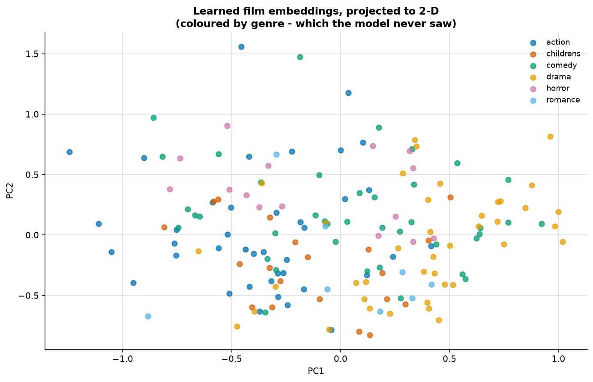
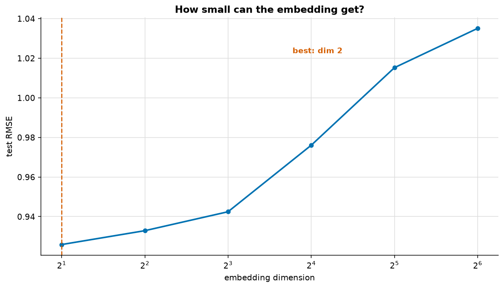

# Embeddings

> **Concept reference:** Foundations volume, Parts B.19–B.20
> **Dataset:** MovieLens 100K
> **Runtime:** ~1 min 10 s on a laptop CPU

```bash
python 03_neural_networks/06_embeddings/embeddings.py
```

A category has no arithmetic. One-hot encoding admits that honestly — every category equidistant
from every other — and pays a column per level. An embedding instead **learns** a short dense
vector per category, so similarity is discovered from the task rather than declared in advance.

---

## 1. One-hot vs embedding — and the parameter claim that does not hold

| representation | width | params into a 32-unit layer |
|---|---|---|
| one-hot | 1,682 | 53,824 |
| embedding, dim 8 | 8 | **13,712** |
| embedding, dim 16 | 16 | 27,424 |
| embedding, dim 32 | 32 | **54,848** ← *more* than one-hot |
| embedding, dim 64 | 64 | 109,696 |

**The embedding only saves parameters while its dimension stays below ~31.** At 32 it costs more
than one-hot; at 64, nearly double.

The arithmetic, written out: one-hot into a *W*-unit layer costs `V·W`. An embedding costs `V·d`
for the table plus `d·W` for the layer, so it wins only when `d·(V+W) < V·W` — i.e. when *d* is
comfortably smaller than *W*. **The embedding table is itself a V×d weight matrix.** It has not
removed the big matrix, only made it narrower.

### The reason that actually matters

In one-hot space the cosine similarity between any two distinct categories is **0, always**. The
encoding cannot express *"these two films are alike"*, because it was built to assert the opposite.

An embedding has no such constraint. The vectors are **parameters**, and gradient descent moves
categories that behave similarly towards each other.

> This is the strongest argument for a neural network on tabular data — the argument that was
> *missing* in [02_mlp_tabular](../02_mlp_tabular/), where the MLP barely justified itself.
> High-cardinality categoricals are what trees must otherwise one-hot or target-encode by hand.

## 2. Learning film embeddings from ratings alone



A 32-dimensional embedding per film, trained on 100,000 ratings. **The model saw only user id,
film id and rating** — no genres, no cast, no text:

```
Nearest to Star Wars (1977):
    0.919  Return of the Jedi (1983)
    0.905  Empire Strikes Back, The (1980)
    0.563  Raiders of the Lost Ark (1981)
    0.542  Indiana Jones and the Last Crusade (1989)

Nearest to Toy Story (1995):
    0.618  Beauty and the Beast (1991)
    0.565  Lion King, The (1994)
    0.513  Aladdin (1992)

Nearest to Fargo (1996):
    0.589  People vs. Larry Flynt, The (1996)
    0.565  M*A*S*H (1970)
    0.483  Chinatown (1974)
```

The two Star Wars sequels come back at 0.92 and 0.91; Toy Story returns three Disney animations;
Fargo returns dark adult comedies. **All of that was inferred from who rated what.**

> Judge these **by eye** — there is no ground-truth "similar film" label, so plausibility is the
> only available test. And note the popularity filter in the code: films with under 50 ratings have
> embeddings barely moved from their random initialisation, and without excluding them they
> dominate the neighbour lists by accident. Same small-sample trap as the raw item means in
> [02_traditional_ml/07](../../02_traditional_ml/07_recommenders/).

The 2-D projection colours points by **genre, which the model never saw**. Expect partial
separation at best — co-rating behaviour correlates with genre without being genre.

## 3. How many dimensions? — the sweep that went the wrong way



| dim | params | test RMSE |
|---|---|---|
| **2** | 7,881 | **0.9259** |
| 4 | 13,135 | 0.9329 |
| 8 | 23,643 | 0.9425 |
| 16 | 44,659 | 0.9761 |
| 32 | 86,691 | 1.0152 |
| 64 | 170,755 | 1.0351 |

**The smallest size tested won, and error rose monotonically with capacity.** That is not the
U-shaped curve this experiment was designed to produce.

The reason is that every extra dimension here is pure capacity with nothing holding it back — no
dropout, no weight decay — and 100,000 ratings spread over 1,682 films and 943 users is thin. **At
dim 64 there are more embedding parameters than ratings to fit them with**, so the model memorises.

The common rule of thumb `dim ≈ 4·cardinality^0.25` suggests ~26 here, which the measurement says
is already far too large.

> **Caveat in the other direction:** dim 2 winning is a statement about *this dataset at this
> regularisation*, not about embeddings in general. Add weight decay, or ten times the data, and
> the optimum moves right. The point is to **sweep it**, not to trust either the rule of thumb or
> this table.

---

## The exam angle

- **High-cardinality categoricals → embeddings.** One-hot for low cardinality; hashing when the
  vocabulary is unbounded.
- **Embeddings are learned weights**, trained with the rest of the model — not a preprocessing step.
- **Two embedding tables plus a dot product is matrix factorisation** — the recommender from
  [02_traditional_ml/07](../../02_traditional_ml/07_recommenders/), rewritten as a network.
- **Pretrained embeddings** (word2vec, GloVe, or a Vertex AI text-embedding model) let you skip
  learning them when you have little data.
- **The embedding table dominates memory**, which is why vocabulary size, hashing and pruning are
  production concerns — and why Vertex AI **Vector Search / Agent Retrieval** exists to serve
  nearest-neighbour lookups at scale.
- **Sanity-check by reading back nearest neighbours.** Expect this as the recommended validation
  step for an embedding you cannot otherwise evaluate.

---

## Things to try

1. Add `embeddings_regularizer=keras.regularizers.l2(...)` to both tables and re-run the sweep. At
   `1e-5` every dimension improves a little but the optimum stays at dim 2 — too weak to change the
   shape. At `1e-4` the curve flattens out and the optimum moves to **dim 32** (0.9144, the best
   RMSE in the whole experiment). With the capacity held back, extra dimensions stop overfitting.
2. Train on 10% of the ratings. RMSE rises everywhere (~1.06) and the curve goes almost flat — dims
   2 and 4 tie at 1.0596/1.0595, with 64 only 0.016 worse. With this little data the dimension
   barely matters, because nothing much can be learned at any size.
3. Look up the nearest neighbours of a film with *fewer* than 50 ratings by lowering the filter.
   The list becomes noise, which is the small-sample effect made visible.
4. Replace the dot product with `Concatenate()` followed by two Dense layers — neural collaborative
   filtering. Measured at dim 8 with Dense 32 → 16: RMSE 0.9360 against the dot product's 0.9425.
   A small gain, and well short of what the extra expressiveness suggests. Rendle et al. (2020)
   found a well-tuned dot product matches NCF; try a few layer sizes before concluding either
   way.
5. Extract the **user** embeddings instead and cluster them. The groups are taste profiles, learned
   with no demographic data at all.
