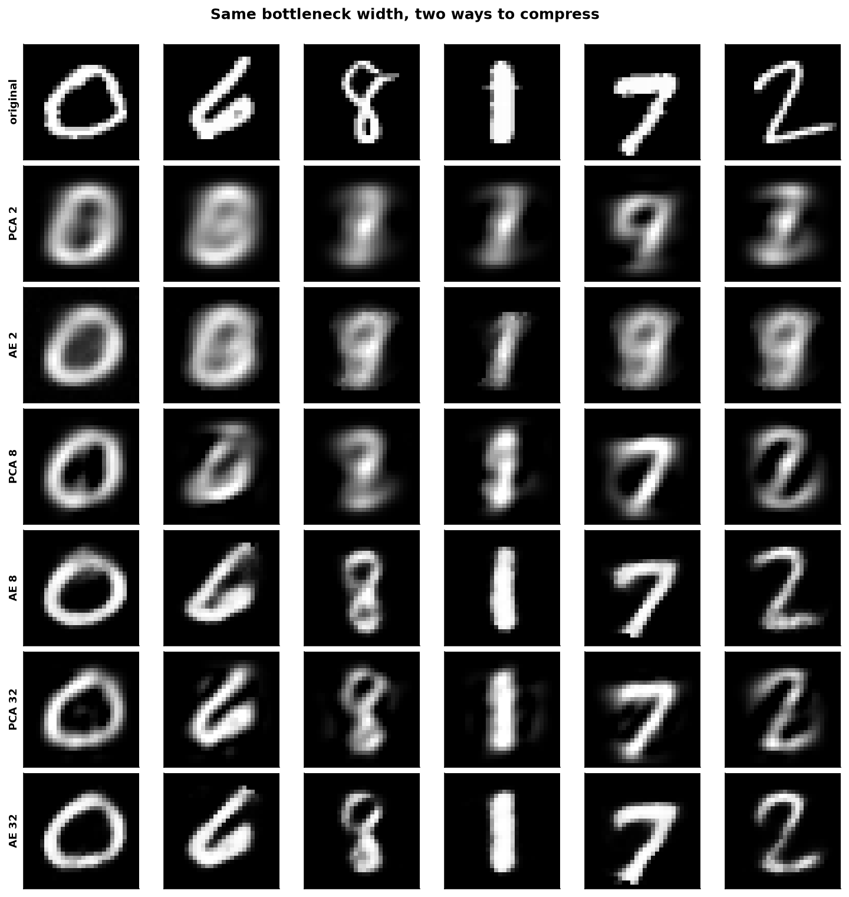
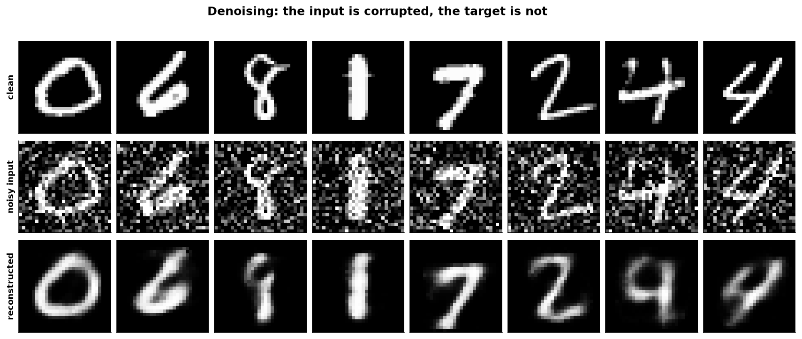
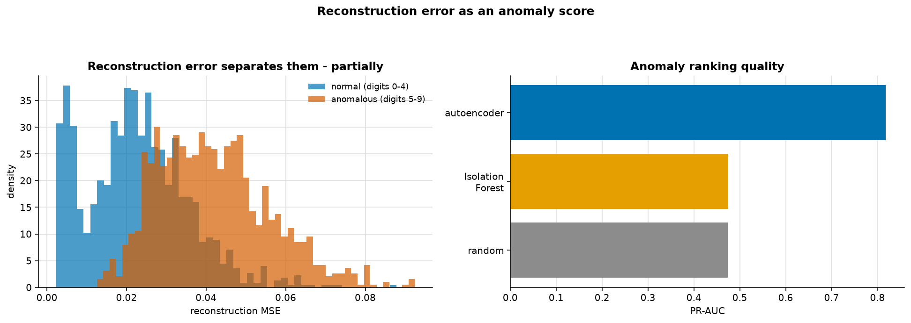

# Autoencoders

> **Concept reference:** Foundations volume, Parts B.21–B.22
> **Dataset:** MNIST, 12,000 train / 2,500 test
> **Runtime:** ~2 min on a laptop CPU

```bash
python 03_neural_networks/07_autoencoders/autoencoders.py
```

An autoencoder is trained to reproduce its own input through a narrow bottleneck. Because the
bottleneck cannot carry everything, the network must decide what matters — and the code it settles
on is a learned, non-linear alternative to PCA.

---

## 1. Autoencoder vs PCA, at a matched bottleneck



Reconstruction MSE on held-out digits:

| bottleneck | PCA | linear AE | deep AE | deep vs PCA |
|---|---|---|---|---|
| 2 | 0.05522 | 0.05693 | 0.05860 | +6% |
| **8** | 0.03711 | 0.03731 | **0.02738** | **−26%** |
| 32 | 0.01676 | 0.01692 | 0.01774 | +6% |

**The linear AE column is the control**, and it matters. With no hidden layers and no activation
the autoencoder can only learn a linear projection, so it should match PCA — and it roughly does,
within about 3% at every width (the difference is optimisation noise). **An autoencoder without
non-linearity *is* PCA**, spanning the same subspace (though not necessarily with orthogonal
axes).

**The deep autoencoder beat PCA at 1 of 3 widths**, and by a lot where it did (−26% at width 8).
Where it wins, it wins because it can *bend*: a curved manifold needs fewer non-linear coordinates
than linear ones.

> Where it loses, the reason is mundane: **PCA has a closed-form optimum and cannot be
> undertrained.** An autoencoder is gradient descent on a harder problem with a fixed epoch budget.
> Compare at a matched bottleneck, and give the network enough epochs, before concluding anything.

## 2. Denoising



Input: digits + N(0, 0.4) noise. Target: the **clean** digit. The only change from section 1 is
that input and target differ.

A denoising autoencoder **cannot succeed by copying its input**, because its input is wrong. It has
to learn what a digit actually looks like in order to produce one — a far stronger constraint than
reconstruction alone, and the standard fix for an autoencoder that would otherwise learn the
identity function.

> This is also **self-supervised learning**
> ([02_traditional_ml/08](../../02_traditional_ml/08_self_supervised/)): the noise was added by us,
> so the clean target is free. Masked autoencoders for images and masked language modelling for
> text are the same idea with a different corruption.

## 3. Reconstruction error as an anomaly score



Train on digits **0–4 only**; test on everything. Digits 5–9 are anomalies the model has never seen.

| method | PR-AUC |
|---|---|
| random baseline | 0.474 |
| Isolation Forest on pixels | **0.475** ← no better than random |
| **autoencoder reconstruction** | **0.818** |

**Isolation Forest scores exactly the random baseline.** On 784 raw pixel dimensions it has nothing
useful to isolate on — the curse of dimensionality, arriving exactly where
[02_traditional_ml/04](../../02_traditional_ml/04_dimensionality_reduction/) said it would. The
autoencoder reaches 0.818 because it learned what "normal" looks like rather than searching for
sparse regions.

The idea is simple: train only on normal data, so the network has never had reason to learn
anything else. **Reconstruction error then *is* the anomaly score** — no labels required at any
point.

> **The catch every autoencoder detector has:** a sufficiently wide bottleneck learns to
> reconstruct *anything*, including the anomalies, and the score collapses. The bottleneck is doing
> all the work, so it is the hyperparameter that matters most — and you usually cannot tune it,
> because you have no anomaly labels to tune against. Same bind as `contamination` in
> [02_traditional_ml/05](../../02_traditional_ml/05_anomaly_detection/).

---

## The exam angle

- **Autoencoder = unsupervised compression.** Encoder, bottleneck, decoder; loss is reconstruction
  error against the input.
- **A linear autoencoder is equivalent to PCA.** Expect this as a direct question.
- **BigQuery ML has `MODEL_TYPE='AUTOENCODER'`** and `ML.DETECT_ANOMALIES` built on it — the
  managed version of section 3.
- **Denoising / masking** prevents the identity shortcut and is the bridge to self-supervised
  pretraining.
- **VAE** adds a distribution over the code so you can *sample* new data; a plain autoencoder
  cannot generate.
- **Sequence autoencoders** are the encoder-decoder architecture machine translation used before
  attention replaced it.
- For anomaly detection, the **bottleneck width** is the critical and usually untunable knob.

---

## Things to try

1. Set the bottleneck in section 3 to 128. Reconstruction improves for *everything*, including the
   unseen digits (anomalous MSE 0.0419 → 0.0338), and PR-AUC slips from 0.818 to 0.793. It
   degrades rather than collapses at this width, but the direction is the failure mode described
   above: a wider bottleneck learns to reconstruct what it was never meant to.
2. Give the deep autoencoder 100 epochs instead of 25. It should beat PCA at all three widths,
   which confirms the "undertrained, not incapable" diagnosis.
3. Run Isolation Forest on the autoencoder's 16-dimensional **code** rather than raw pixels. You
   might expect it to recover, if dimensionality were the only problem. It does not: PR-AUC
   **0.408, below the 0.474 random baseline**. The code was learned on digits 0–4 only, so it maps
   unseen digits *into* the normal region (4 of the 16 ReLU code units are dead, too). A
   representation trained on normal data is not built to keep anomalies apart. Reconstruction
   error uses the decoder's failure; the code alone throws that signal away.
4. Replace the Dense layers with `Conv2D`/`Conv2DTranspose`. A convolutional autoencoder does much
   better on images at the same parameter count, for the reasons in
   [03_cnn_images](../03_cnn_images/).
5. Add `activity_regularizer=keras.regularizers.l1(1e-5)` to the code layer — a *sparse*
   autoencoder. The bottleneck can then be wide while still being forced to use few units.
