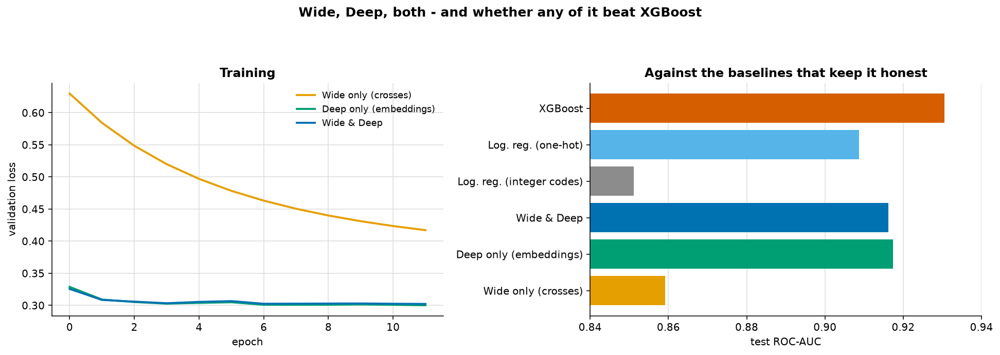

# Wide & Deep

> **Concept reference:** Foundations volume, Parts B.23–B.24
> **Dataset:** Census Income (32,561 × 15) — the dataset the original paper's tutorial used
> **Runtime:** ~1 min 30 s on a laptop CPU

```bash
python 03_neural_networks/08_wide_and_deep/wide_and_deep.py
```

Google's 2016 argument: a **wide** linear model over crossed categoricals *memorises* combinations
it has seen; a **deep** model over embeddings *generalises* to combinations it has not. Train them
jointly. This example builds all three and checks whether the joint model earns its complexity.

---

## 1. What a feature cross is

A linear model sees `education` and `occupation` as two separate effects it **adds**. Share earning
over $50K:

| | Exec-managerial | Handlers-cleaners |
|---|---|---|
| HS-grad | 0.323 | 0.062 |
| **Masters** | **0.743** | **0.000** |

Average education effect: **+0.178**. But the effect differs by occupation by **+0.481** — a
Masters is worth a great deal in management and nothing at all in handling. **That gap is exactly
what an additive model throws away.**

A **feature cross** creates one new categorical whose levels are the observed combinations:
`Masters|Exec-managerial` becomes its own feature with its own weight.

> That is **memorisation** in the paper's precise sense: the model stores a value for a combination
> it has seen. Its weakness follows immediately — a combination absent from training gets no weight
> at all.

Crosses are **hashed** into fixed buckets here, because three crosses of realistic cardinality run
to tens of thousands of columns. Hashing caps the width and accepts occasional collisions, which is
what production systems do.

> **The hash must be stable — and Python's built-in `hash()` is not.** It is salted per process
> (`PYTHONHASHSEED`), so `hash("Masters|Exec-managerial") % 1000` lands in a different bucket in
> every run. Train in one process and serve in another, and every crossed weight is applied to the
> wrong combination: a **training-serving skew** that raises no error. An earlier version of this
> script did exactly that, and its wide-model score moved a little on every run. It now uses
> `zlib.crc32`, which is identical everywhere. TensorFlow's `Hashing`/`HashedCrossing` layers and
> BigQuery ML's `ML.HASH_BUCKETIZE` use a fixed FarmHash for the same reason, and putting the hash
> *inside* the model graph (or a BigQuery ML `TRANSFORM` clause) guarantees training and serving run
> the same code.

Missing values (`?` in the raw file) get an **explicit out-of-vocabulary index** — one row past
each vocabulary. `pd.factorize` codes NaN as `-1`, and an `Embedding` lookup at `-1` silently wraps
to the *last* row, quietly sharing another category's vector.

## 2–3. All three, against honest baselines



| model | params | test ROC-AUC | accuracy |
|---|---|---|---|
| Wide only (crosses) | 3,000 | 0.8591 | 0.8160 |
| **Deep only (embeddings)** | 5,345 | **0.9174** | 0.8602 |
| Wide & Deep | 8,345 | 0.9163 | 0.8587 |
| Logistic regression (integer codes) | — | 0.8511 | 0.8280 |
| Logistic regression (one-hot) | — | 0.9087 | 0.8531 |
| **XGBoost** | — | **0.9306** | **0.8738** |

**The joint model did not beat its own deep half** (−0.0012). And **XGBoost beats the entire
construction** — with no embeddings, no crosses, no architecture and no epochs to tune.

That is not a surprise once stated: **a tree finds interactions by construction.** Every split
below another split *is* a conditional effect — precisely the job the wide part was added to do.

> **The honest framing.** Wide & Deep was designed for Google Play's recommender: hundreds of
> millions of rows, categorical vocabularies in the millions, and a serving budget that rules out
> large models. On 32,000 rows with eight modest categoricals, **gradient boosting is simply the
> right tool**, and the architecture is solving a problem this data does not have.

**Check which logistic regression you are beating.** The wide part alone (0.8591) beats logistic
regression on **integer codes** (0.8511) — but integer codes tell a linear model that "occupation 7"
is seven times "occupation 1", which is a weak baseline. With the categoricals **one-hot** encoded,
logistic regression scores **0.9087** and beats the crosses-only wide part comfortably (it also has
the numeric columns, which the wide part does not). So "the crosses add something" holds only
against the weak baseline. Integer codes are fine for trees, which split on them; a linear model
takes them literally.

---

## The exam angle

- **Wide = memorisation** (crossed categoricals, linear). **Deep = generalisation** (embeddings,
  MLP). Expect this phrasing verbatim.
- They are trained **jointly** — one loss, one backward pass, the two logits added before the
  sigmoid. Not an ensemble, not stacking.
- **Feature crosses are hashed** in production because raw crosses are unbounded — with a
  **deterministic** hash, computed in one place for training and serving. BigQuery ML has
  `ML.FEATURE_CROSS` and `ML.HASH_BUCKETIZE` (in `TRANSFORM`); Vertex AI Feature Store handles the
  serving side.
- **The deep part can over-generalise** — recommending things that are merely plausible. The wide
  part anchors it to what actually happened.
- The lineage continues: **DeepFM, DCN, and two-tower retrieval** ([09](../09_two_tower_retrieval/))
  all keep some form of the memorise-plus-generalise split.
- **Always check gradient boosting first on tabular data**, as in
  [02_mlp_tabular](../02_mlp_tabular/).

---

## Things to try

1. Remove the crosses and keep only raw categoricals in the wide part. It drops to roughly logistic
   regression — confirming the crosses, not the linearity, were doing the work.
2. Raise the hash buckets from 1,000 to 50,000. Collisions fall and the wide part improves slightly,
   at a linear cost in parameters.
3. Give the wide and deep parts separate optimisers (the paper used FTRL for wide, AdaGrad for
   deep). Sparse crossed features and dense embeddings genuinely prefer different update rules.
4. Subsample to 2,000 rows. The gap to XGBoost narrows, because trees lose their data advantage
   faster than embeddings do.
5. Replace `education` and `occupation` with a synthetic pair of 10,000-level categoricals. That is
   the regime Wide & Deep was built for, and the ranking should change.
