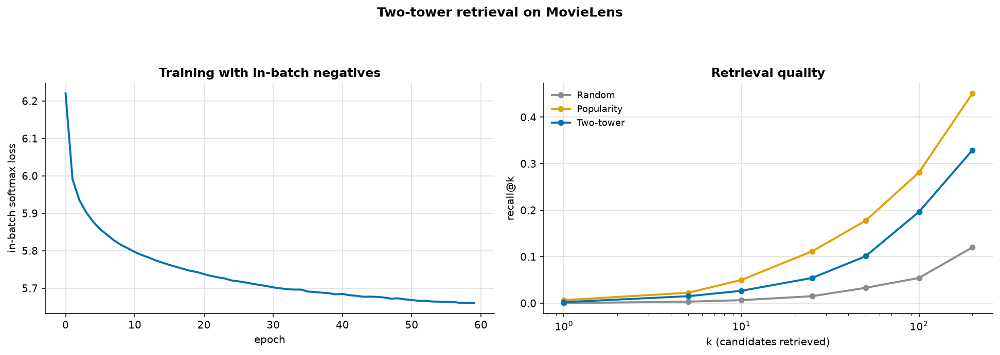

# Two-Tower Retrieval

> **Concept reference:** Foundations volume, Parts B.25–B.26
> **Dataset:** MovieLens 100K, positives only (rating ≥ 4)
> **Runtime:** ~2 min 10 s on a laptop CPU

```bash
python 03_neural_networks/09_two_tower_retrieval/two_tower.py
```

Matrix factorisation learns one vector per **id**, which fails the moment a new item appears — the
cold-start problem measured in
[02_traditional_ml/07](../../02_traditional_ml/07_recommenders/). A two-tower model embeds
**features** instead.

---

## 1. The architecture

```
user features ---> [ USER TOWER ] ---> u  (32-d, unit length)
                                        |
                                    dot product  --> relevance
                                        |
item features ---> [ ITEM TOWER ] ---> v  (32-d, unit length)
```

**The towers never see each other's input.** That constraint is the design, and it buys two things:

- **Servability.** Every item vector is computed once, offline, and put in an ANN index. At request
  time you encode *one* user and do a nearest-neighbour lookup. A joint model would need a forward
  pass per candidate item.
- **Cold start.** The item tower takes features, not an id — so a film added this morning gets a
  vector immediately.

The cost: **no user–item feature interaction.** Everything passes through a single dot product.
Hence the production pattern — **retrieve cheap, rank expensively**: two-tower narrows millions to
hundreds, then a cross-feature ranker ([08](../08_wide_and_deep/)) reorders the survivors.

## 2. In-batch negatives

There are no explicit negative examples. For a batch of B observed pairs, the B×B matrix of dot
products has the **true pairs on its diagonal** and B−1 non-interacted items per row. Softmax each
row; the label is the row index.

```python
logits = uv @ iv.T / temperature          # B x B
labels = arange(B)                        # the diagonal
```

That is the sampled-softmax trick, and it is why retrieval models train on **positives alone**.

## 3. Retrieval quality — where popularity wins again



| model | Recall@10 | Recall@50 | Recall@100 |
|---|---|---|---|
| Random | 0.0064 | 0.0329 | 0.0541 |
| **Popularity** | **0.0499** | **0.1773** | **0.2813** |
| Two-tower | 0.0265 | 0.1008 | 0.1964 |

**Popularity wins**, by −0.023 at k=10 (and at every k) — the same uncomfortable result as
[02_traditional_ml/07](../../02_traditional_ml/07_recommenders/), and for the same reasons: one
held-out item per user, and a heavy popularity bias in what people actually watch, which an offline
recall metric flatters.

Note also what this model has to work with: **19 genre flags and a release year.** No cast, no
synopsis, no images. The ceiling on distinguishing two 1995 comedies is low. Production item towers
consume text embeddings and dozens of attributes, which is where the approach earns its reputation.

> The in-batch loss ran 6.22 → 5.66 over 60 epochs against a random-guess value of
> `ln(512) = 6.24` — so it learned, but not much. An earlier 12-epoch version had barely moved at
> all, which is why the budget was raised before reporting anything.

## 4. Cold start — the thing id-based factorisation cannot do

Invent a film that appears nowhere in training: genres = animation + children's.

```
Nearest existing films:
  0.846  Cats Don't Dance (1997)
  0.846  Anastasia (1997)
  0.804  Gumby: The Movie (1995)
  0.804  Balto (1995)
  0.804  Land Before Time III (1995)
```

**Children's animation, every one** — from a film that does not exist, with no id, no retraining
and no interaction history.

Compare with matrix factorisation: a new item has no row in the factorisation, so no vector, so it
can never be recommended, so it never acquires the interactions it would need to get a row. **The
two-tower model breaks that loop by never depending on the id.**

> **Honest limitation:** the *user* tower here still takes a user id, so this model is only
> half cold-start-proof. Making it fully feature-based is the same change applied to the other
> side.

### A serving bug worth seeing

The first version set the new film's release year to z = **+2.0**. The actual range in the data is
−4.73 to **+0.60** — so that was 1.4 SD beyond the newest film in the data, a release year
no film in training had. The year feature then
dominated the dot product and every "nearest" film came back as an obscure late-90s title at an
identical 0.873, genres ignored entirely.

**Feeding a standardised feature a value outside its training range is a real production bug**, and
that is what it looks like from the outside: plausible-looking output, silently wrong.

---

## The exam angle

- **Two-tower = retrieval.** Separate encoders, dot-product similarity, ANN index at serving time.
- **Maps directly onto Vertex AI Vector Search** — *Agent Retrieval* in the 2026 naming: generate
  embeddings, index, query by nearest neighbour.
- **Retrieve then rank** is the standard two-stage pattern. Know why: the retriever must be cheap
  enough for millions of candidates, the ranker rich enough to model interactions.
- **In-batch negatives** are the default training trick for retrieval.
- **Cold start is solved by features, not ids** — the key architectural reason to prefer two-tower
  over matrix factorisation.
- **Evaluate with recall@k**, and keep the popularity baseline in the table.

---

## Things to try

1. Drop the user id from the user tower, leaving only the taste profile. Recall falls a little and
   the model becomes fully cold-start-capable for new users too.
2. Raise `batch_size` from 512 to 2048. More in-batch negatives *usually* means a better retrieval
   model, but not here: Recall@10 falls from 0.0265 to 0.0212 (Recall@100 is level, 0.1964 →
   0.2006). With a quarter as many steps per epoch over the same 60 epochs, and popular films
   appearing as "negatives" more often in a bigger batch, the extra negatives don't pay. The batch
   size is a *modelling* parameter here, not just a memory setting, so sweep it.
3. Sweep `temperature` (0.01, 0.05, 0.2). It controls how sharply the softmax separates the
   positive from its negatives, and it matters more than most hyperparameters.
4. Remove `UnitNormalization`. Dot products become unbounded, a few popular items dominate every
   ranking, and training destabilises.
5. Add the film's title as a bag-of-words input to the item tower. Even crude text lifts recall
   noticeably, which is the point about feature-poor towers made above.
