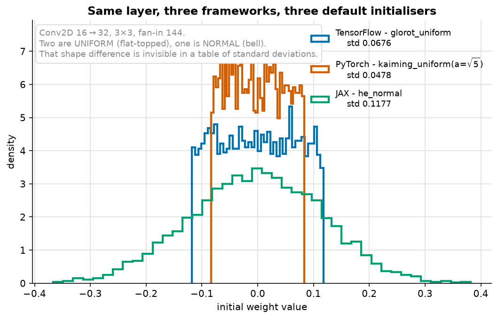

# The Same Model, Three Ways

> **Runtime:** ~15 s (reads `results.json`, then re-measures the initialisers)

```bash
# run all three first - each appends its result
python 04_frameworks/01_tensorflow/tf_version.py
python 04_frameworks/02_pytorch/torch_version.py
python 04_frameworks/03_jax/jax_version.py

python 04_frameworks/00_same_model_three_ways/compare.py
```

---

## 1. The results

| framework | test acc | train s | params | lines |
|---|---|---|---|---|
| TensorFlow 2.21 | 0.8767 | **5.4** | 105,866 | 197 |
| PyTorch 2.14 | 0.8550 | 8.7 | 105,866 | 198 |
| JAX 0.11 | **0.8800** | 11.6 | 105,866 | 192 |

- **Accuracy spread:** 0.0250
- **Time spread:** 2.5×
- **Lines of code:** 192–198, essentially the same

All three report **exactly 105,866 parameters**. Each script asserts that against the shared spec
in [`common.py`](../common.py) and exits if it drifts — so "the architectures are identical" is
checked, not claimed.

### On lines of code

197 / 198 / 192 looks like a wash and is misleading. These files are dominated by narration and
demonstrations, not by the model. The **modelling** code differs far more: Keras trains in one
`fit()` call, PyTorch needs ~35 lines of loop, JAX needs the loop *plus* the convolution and
pooling written against `jax.lax`.

## 2. Why the accuracies differ

Same architecture, same optimiser, same learning rate, same data, same seed. So the difference has
to come from a **default none of the scripts set** — and it does.

Standard deviation of the initial weights in the same layer (Conv2D 16→32, 3×3, fan-in 144):

| framework | init std | default scheme |
|---|---|---|
| Keras Conv2D | 0.0676 | `glorot_uniform` |
| PyTorch Conv2d | **0.0478** | `kaiming_uniform(a=√5)` |
| this JAX (by hand) | **0.1177** | `he_normal` |

*He target: 0.1179. Glorot target: 0.0680.*



**The table gives the widths; the figure gives the shapes, and the shapes are not the same kind of
thing.** Keras and PyTorch draw from a **uniform** distribution — flat-topped, with a hard cutoff
and no weight beyond it. The JAX code draws from a **normal** — a bell with tails running roughly
three times further out than either uniform's edge.

So "PyTorch initialises smaller than JAX" undersells it. PyTorch cannot produce a weight outside
±0.083 at all, while JAX routinely produces some past ±0.3. Same layer, same fan-in, same seed
discipline — three different densities, none of them chosen by the person writing the model.

Now put that next to the accuracies:

| framework | init std | test acc |
|---|---|---|
| JAX | 0.1177 | 0.8800 |
| TensorFlow | 0.0676 | 0.8767 |
| PyTorch | 0.0478 | 0.8550 |

**The accuracy ordering matches the initialisation-scale ordering exactly** — and a controlled run
shows init scale is a real effect, not a coincidence. The same PyTorch model, only the initialiser
changed, five seeds each:

| initialiser | mean test acc | sd | range over 5 seeds |
|---|---|---|---|
| He normal | **0.8783** | 0.0037 | 0.8740–0.8817 |
| Glorot uniform | 0.8677 | 0.0033 | 0.8623–0.8713 |
| PyTorch default | 0.8603 | 0.0097 | 0.8463–0.8693 |

But it is **not the whole explanation**. Seed and data-order noise is about a point on its own —
PyTorch's default spans 2.3 points across five seeds — so a single run per framework cannot
separate gaps smaller than that. The 0.3-point JAX/TensorFlow gap in the table above is inside the
noise; the ~2-point gap to PyTorch's default is mostly initialisation.

PyTorch's default deserves a note. `kaiming_uniform_(a=math.sqrt(5))` produces a gain suited to a
leaky ReLU of slope √5 — which is nobody's network. It is a historical accident rather than a
recommendation, and for ReLU you must ask for He initialisation explicitly.

> **The lesson for porting a model between frameworks:** matching the *layers* is the easy part.
> Matching the **defaults** — initialisers, optimiser epsilon, whether the loss wants logits or
> probabilities, weight decay — is where a port silently loses two points of accuracy and nobody
> can say why.

## 3. What each framework asks of you

| | TensorFlow | PyTorch | JAX |
|---|---|---|---|
| Training loop | `fit()` | you write it | you write it |
| Early stopping | callback | you write it | you write it |
| Checkpointing | callback | you write it | orbax |
| LR scheduling | callback | `lr_scheduler` | optax chain |
| Input pipeline | `tf.data` | `DataLoader` | you write it |
| Shape inference | automatic | you declare | you declare |
| Layers provided | `keras.layers` | `torch.nn` | `jax.lax` (raw) |
| Model state | in the object | in the object | **a value you hold** |
| Randomness | global seed | global seed | **explicit keys** |
| Serving artefact | SavedModel | TorchScript / ONNX | you decide |
| Channel order | NHWC | **NCHW** | either |
| Loss expects | probabilities | **logits** | logits |

Read the last row twice. Keras' `sparse_categorical_crossentropy` defaults to probabilities, so the
Keras model ends in softmax. PyTorch's `CrossEntropyLoss` applies `log_softmax` itself, so the
PyTorch model must **not**. Add a softmax to the PyTorch model and it still trains — just worse.
**The single most common bug when porting between them.**

---

## Which one?

**For the GCP ML Engineer exam: TensorFlow/Keras.** Vertex AI prebuilt containers, SavedModel
serving, TFRecord, TFX and BigQuery ML all assume it.

In practice:

- **Keras** — standard model, want it working today. The callbacks alone justify it.
- **PyTorch** — you need to change the training loop, or you are reading research code.
- **JAX** — composable transformations, or TPUs. Smallest idea, most demanding to build on.

**Keras 3 runs on all three backends**, selected by one environment variable — so the API and the
backend are now separable choices, and "which framework" is a smaller decision than it used to be.

> **The honest summary:** all three trained the same network to within 2.5 points, in under 13
> seconds, in about the same number of lines. **The framework is rarely the thing that decides
> whether a project works.**

---

## Things to try

1. Set PyTorch's initialiser to He explicitly and re-run:
   `nn.init.kaiming_normal_(m.weight, nonlinearity="relu")` on each conv and linear layer. Its
   accuracy moves up towards the other two (five-seed mean 0.8603 → 0.8783 in the controlled
   run above). Run several seeds: one run each cannot separate a one-point difference.
2. Add a `nn.Softmax(dim=1)` to the end of the PyTorch model. It still trains and scores several
   points worse — the silent double-softmax bug, reproduced deliberately.
3. Raise `BATCH` in `common.py` from 128 to 512. JAX benefits most, because `jit` amortises over
   more work per compiled call.
4. Run the JAX script twice in a row. The second is no faster — `jit` caches within a process, not
   across them, which is why short-lived JAX jobs can feel slow.
5. Change `EPOCHS` and confirm all three still land within ~2.5 points of each other. The gap is
   about initialisation, not about training length.
