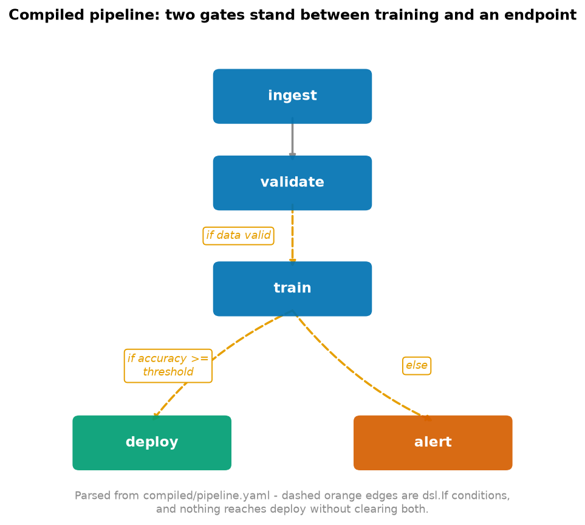

# Pipelines (Kubeflow Pipelines v2)

> **Runtime:** ~5 s · **Requires:** `kfp>=2.9` — no cluster, no credentials, no Docker

```bash
python 06_pipelines/pipeline.py      # compiles to compiled/pipeline.yaml
python 06_pipelines/render_dag.py    # draws the figure below, from that YAML
```



**That figure is parsed from `compiled/pipeline.yaml`, not drawn by hand** — it is a reading of the
compiled artefact rather than a claim about it. Recompile the pipeline and the figure follows.
Three of its four edges are conditional, which is the whole argument of this section in one
picture: `deploy` is unreachable unless the data validates *and* the model clears its threshold,
and there is an explicit `alert` branch for when it does not.

A pipeline is what turns a notebook into a system. The model is usually the easy part; what makes
it production is that training is reproducible, artefacts are tracked, and **a model cannot reach
an endpoint without passing a check**.

---

## What was actually run

**The compile is real.** `kfp` turns the Python into a YAML pipeline spec entirely locally, and
that spec is the genuine artefact — the thing you would submit. The pipeline has **never been
submitted**: no cluster, no project, no billing.

| | |
|---|---|
| `pipeline.py` | ✅ runs and **compiles** |
| `compiled/pipeline.yaml` | ✅ **generated** — 533 lines, 21 KB, 9 component definitions |
| `render_dag.py` | ✅ runs — **parses that YAML** and draws the figure above |
| submission to Vertex AI | ❌ not done |

The compiled spec was structurally validated, not just produced:

```
pipeline name : train-and-conditionally-deploy
schemaVersion : 2.1.0
root inputs   : ['accuracy_threshold', 'n_estimators', 'row_limit']

Conditional gates compiled into the spec:
  validate-Output == true
  train-Output >= accuracy_threshold
  !(train-Output >= accuracy_threshold)
```

Those three conditions are the gates, correctly parameterised, present in the YAML.

---

## 1. A component is a function *plus a container*

Five components: `ingest`, `validate`, `train`, `deploy`, `alert`. Three consequences of "its own
container" that catch people:

- **The function body is isolated.** It cannot see imports at the top of the file, or any other
  function in it. Every import goes *inside* the component — which looks wrong and is correct.
- **Dependencies install at runtime.** `packages_to_install` runs a pip install when the step
  starts, on every run. **Pin the versions** — an unpinned pipeline is not reproducible — and bake
  a custom base image for anything heavy.
- **Steps share nothing but artifacts.** No shared memory, no shared filesystem. A value crossing a
  step boundary is either a parameter or an artifact.

## 2. Artifacts vs parameters

| | parameter | artifact |
|---|---|---|
| what | a small value (`int`, `str`, `float`, `bool`) | a file or directory |
| passed | **by value**, through the orchestrator | by **reference** — a path |
| examples | `n_estimators`, a threshold, a flag | `Dataset`, `Model`, `Metrics` |
| **control flow** | **YES** — can drive `dsl.If` | **NO** — contents never read by KFP |
| tracked | as a run input | in the metadata store, with lineage |

**The control-flow row shapes real pipelines.** KFP's orchestrator never opens an artifact, so you
cannot branch on *"the accuracy inside this Metrics file"*. That is why `train()` **returns** a
float as well as logging it — only a parameter can drive the gate.

## 3. The graph is inferred

There is not one explicit ordering statement in the pipeline function. KFP derives the DAG from
**data dependencies**: `train` consumes `ingest`'s output, so it runs after it. Independent steps
parallelise for free.

`set_upstream` exists for the rare case where a step depends on another's *side effect*. Reach for
it seldom — it usually means the data flow isn't modelled.

## 4. The deployment gate

```
dsl.If(validate_task.outputs["Output"] == True)
    train
    dsl.If(accuracy >= accuracy_threshold)
        deploy
    dsl.Else()
        alert
```

The threshold is a **pipeline parameter** (default 0.85), not a constant, so it can be raised per
run without touching code.

> This is the structural difference between a script and a pipeline. A script trains a model and a
> human decides whether to ship it. A pipeline makes that decision a **reviewable,
> version-controlled step that cannot be skipped** because someone was in a hurry on a Friday.

Note also the **validation gate before training**. Failing on bad data there, rather than after an
hour of GPU time, is most of what a pipeline buys you on cost alone. The checks it makes are the
failures this repository actually hit: too few rows, nulls that get silently imputed downstream,
and a class balance that makes accuracy meaningless
([01_foundations/03](../01_foundations/03_confusion_matrix_and_metrics/)).

## 5. The YAML is the artefact

The Python is a convenient way to author it. What you submit, version and review is the compiled
spec — and it is self-contained: each component carries its base image and its pip commands, so it
can be handed to a cluster that has never seen this repository. The same YAML runs on **any KFP v2
backend**, which is the main argument for KFP over a vendor-specific orchestrator.

---

## Two real gotchas hit while writing this

**`from __future__ import annotations` breaks KFP.** Every other file in this repository uses it.
This one deliberately does not, because PEP 563 turns annotations into *strings* and KFP builds a
component's interface by inspecting them at runtime. The failure is badly misleading:

```
TypeError: Artifacts must have both a schema_title and a schema_version,
           separated by `@`. Got: int
```

— which points at artifacts when the real problem is string annotations. Any library that reads
annotations at runtime has this constraint.

**`.output` only works for a single output.** `validate` returns a bool *and* writes a `Metrics`
artifact, so `validate_task.output` raises `AttributeError: The task has multiple outputs`. The
bare return value is keyed under the literal name `"Output"`:

```python
validate_task.outputs["Output"]     # not .output
```

---

## Submitting it (not done here)

```python
from google.cloud import aiplatform
aiplatform.init(project=PROJECT, location=REGION)
aiplatform.PipelineJob(
    display_name="train-and-deploy",
    template_path="compiled/pipeline.yaml",
    pipeline_root=PIPELINE_ROOT,
    parameter_values={"n_estimators": 200},
).submit()
```

---

## The exam angle

- **Vertex AI Pipelines runs KFP v2 specs.** Author in Python, compile to YAML, submit the YAML.
- **Components run in containers**; pin `packages_to_install` or use a custom base image.
- **Parameters drive control flow; artifacts do not.** Expect a question that hinges on this.
- **Artifacts are tracked with lineage** in Vertex ML Metadata — the answer to "how do we know
  which data produced this model".
- **`dsl.If` / `dsl.Else` for conditional deployment** is the canonical MLOps pattern: never ship a
  model that fails its evaluation gate.
- **Caching** is on by default — an unchanged step with unchanged inputs is skipped, which is a
  large cost saving and an occasional source of confusion.
- **TFX** is the heavier, TensorFlow-specific alternative; KFP is framework-agnostic.

---

## Things to try

1. Lower `accuracy_threshold` to 0.5 and recompile. The YAML changes only in the default — the
   gate condition is identical, because the threshold was always a parameter.
2. Add `from __future__ import annotations` back to the top and watch the compile fail with the
   misleading artifact error. Worth seeing once so you recognise it later.
3. Add `.set_caching_options(False)` to the train task. Useful when a component reads something
   external that KFP cannot see changing.
4. Replace the `alert` stub with a component that posts to a webhook — that turns a silent block
   into an actual MLOps signal.
5. Compile, then read `compiled/pipeline.yaml` and find the `triggerPolicy` entries. Seeing your
   `dsl.If` as a string expression in the spec makes the parameter-vs-artifact rule obvious.
