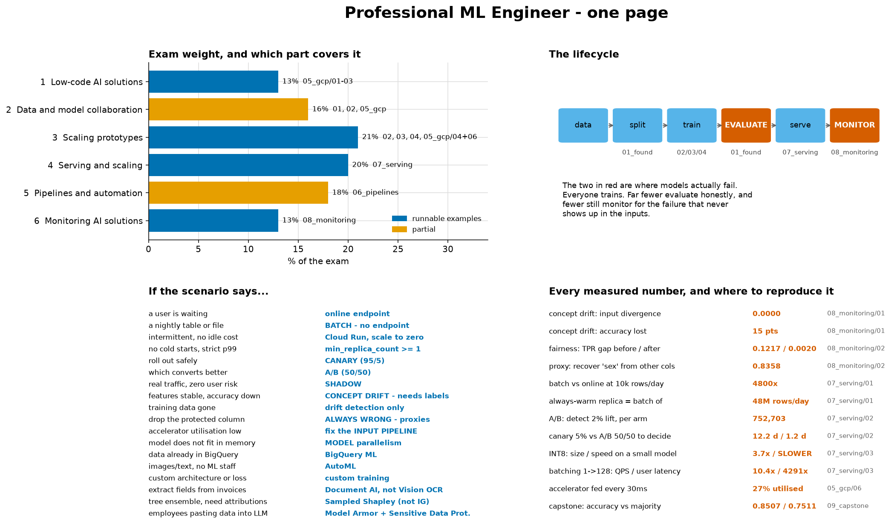

# Summary — the whole thing on one page

> **Concept reference:** everything · Blueprint: all six sections
> **Runtime:** ~2 s on a laptop CPU

```bash
python 10_summary/cheatsheet.py
```



The script prints the same content as text, so it is useful on a screen, on paper, and in a
terminal.

---

## Exam weight, and where it lives here

| blueprint section | % | repo | state |
|---|---|---|---|
| 1 Low-code AI solutions | 13% | `05_gcp/01-03` | covered |
| 2 Data and model collaboration | 16% | `01`, `02`, `05_gcp` | partial |
| 3 Scaling prototypes | **21%** | `02`, `03`, `04`, `05_gcp/04+06` | covered |
| 4 Serving and scaling | **20%** | `07_serving` | covered |
| 5 Pipelines and automation | 18% | `06_pipelines` | partial |
| 6 Monitoring AI solutions | 13% | `08_monitoring` | covered |

**Partial is honest, not a placeholder.** Section 2 needs Feature Store, Experiments and
Workbench, which have no local proxy; section 5 has the Kubeflow pipeline but not retraining
policy. Both are documented in their section READMEs rather than pretended at.

## The lifecycle

```
data -> split -> train -> EVALUATE -> serve -> MONITOR
          |        |         |          |         |
     01_found   02/03/04  01_found  07_serving 08_monitoring
     (leakage)  (models)  (metrics) (batch vs  (skew, drift,
                                     online)    fairness)
```

**The two in capitals are where models actually fail.** Everyone trains. Far fewer evaluate
honestly, and fewer still monitor for the failure that never shows up in the inputs.

## If the scenario says…

| | |
|---|---|
| a user is waiting | online endpoint |
| a nightly table or file | **BATCH — no endpoint** |
| intermittent, no idle cost | Cloud Run, scale to zero |
| no cold starts, strict p99 | `min_replica_count >= 1` |
| roll out safely | **CANARY** (95/5) |
| which converts better | **A/B** (50/50) |
| real traffic, zero user risk | SHADOW |
| **features stable, accuracy down** | **CONCEPT DRIFT — needs labels** |
| training data gone | drift detection only |
| **drop the protected column** | **ALWAYS WRONG — proxies** |
| accelerator utilisation low | fix the **INPUT PIPELINE** |
| model does not fit in memory | MODEL parallelism |
| data already in BigQuery | BigQuery ML |
| images/text, no ML staff | AutoML |
| custom architecture or loss | custom training |
| extract fields from invoices | **Document AI**, not Vision OCR |
| tree ensemble, need attributions | **Sampled Shapley** (not Integrated Gradients) |
| employees pasting data into an LLM | **Model Armor** + Sensitive Data Protection |

## Every measured number

| what | value | reproduce with |
|---|---|---|
| concept drift: input divergence | **0.0000** | `08_monitoring/01` |
| concept drift: accuracy lost | **15 pts** | `08_monitoring/01` |
| fairness: TPR gap before / after | 0.1217 / **0.0020** | `08_monitoring/02` |
| proxy: recover `sex` from other columns | **0.8358** | `08_monitoring/02` |
| batch vs online at 10k rows/day | **4800×** | `07_serving/01` |
| always-warm replica = batch of | 48M rows/day | `07_serving/01` |
| A/B: detect a 2% lift, per arm | **752,703** | `07_serving/02` |
| canary 5% vs A/B 50/50 to decide | 12.2 d / **1.2 d** | `07_serving/02` |
| INT8: size / speed on a small model | 3.7× / **SLOWER** | `07_serving/03` |
| batching 1→128: QPS / user latency | 10.4× / **4291×** | `07_serving/03` |
| accelerator fed every 30 ms | **27% utilised** | `05_gcp/06` |
| capstone: accuracy vs majority | 0.8507 / 0.7511 | `09_capstone` |

> **Every one is reproducible.** Run the script named beside it and you get that figure back,
> because the data generator is seeded. **If a number here disagrees with a fresh run, the cheat
> sheet is wrong** — not the run.

## The five that carry the most weight

1. **Concept drift is invisible to input monitoring.** Same rows in, 15 points of accuracy gone,
   divergence exactly 0.0000. Only labels reveal it.
2. **Online serving bills uptime, not usage.** 10k and 1M rows/day cost the same.
3. **Canary is containment; A/B is measurement.** Same mechanism, opposite purposes, and the
   traffic share that makes one safe makes the other take 10× longer.
4. **Dropping the protected column does not remove bias.** It is recoverable from the rest at 0.84.
5. **Accuracy on imbalanced data is nearly content-free.** 0.8507 against a 0.7511 baseline is ten
   points of information, not eighty-five.
